# 26-015-DO — Conception de la solution et du logiciel

> Comment fermer les écarts du document [02](02-BESOINS-ET-ANALYSE-ECARTS.md) **dans** Nexu VINA,
> sans bâtir un second produit à côté : architecture de solution, principe des données
> paramétrables, moteur de règles, modèle de données, séquences, états, API, exigences non
> fonctionnelles et lots.
>
> Lecteurs : l'équipe de développement (Node et Java) et l'architecte qui rédigera les ADR 0047 à
> 0054. Chaque décision renvoie aux exigences qu'elle sert ; une exigence sans décision est un
> oubli, à signaler.

---

## 1. Portée et principes

**Portée** : les 82 critères essentiels ouverts, les 29 préférentiels ouverts et les clauses
hors grille (RAO, SAAV, PFT, BD Corpo, Graph, rétention, IA, disponibilité).

**Principes**, dans l'ordre où ils tranchent un conflit :

1. **Étendre les contextes existants, n'en créer que si un invariant nouveau l'exige.** Les
   horaires, les absences, le moteur de recherche et le journal existent et sont éprouvés. Deux
   contextes seulement naissent : `agph` (un processus annuel avec son propre invariant : une
   personne, un choix, à son tour) et `presence` (le temps déclaré et sa preuve).
2. **Ce que l'organisme nomme est une donnée ; ce que le moteur comprend est un enum.** § 3.
3. **Une règle est une donnée versionnée, évaluée par une fonction pure qui explique sa
   décision.** § 4. C'est ce qui rend vraies à la fois « paramétrable » (E-GN-12), « motifs
   d'inadmissibilité » (E-GN-16) et « traçabilité des décisions automatiques » (E-GN-9).
4. **Rien de calculé n'est stocké** — taux de comblement, statut opérationnel d'un quart,
   anomalies d'une feuille ouverte. Seul un **instantané** est figé au moment où une décision s'y
   appuie (soumission, approbation, clôture).
5. **Clean architecture et parité Node ↔ Java** : domaine pur, ports dans le domaine, adaptateurs
   en infrastructure ; chaque lot livre les deux moteurs, comme les lots STO et AI-2026-03.
6. **Toute intégration passe par un port, un simulateur, un adaptateur et une suite de contrat
   exécutée contre les deux** (patron des lots scolaires : SMS, GRICS, antivirus).

## 2. Architecture de solution

### 2.1 Contexte (C4 niveau 1)

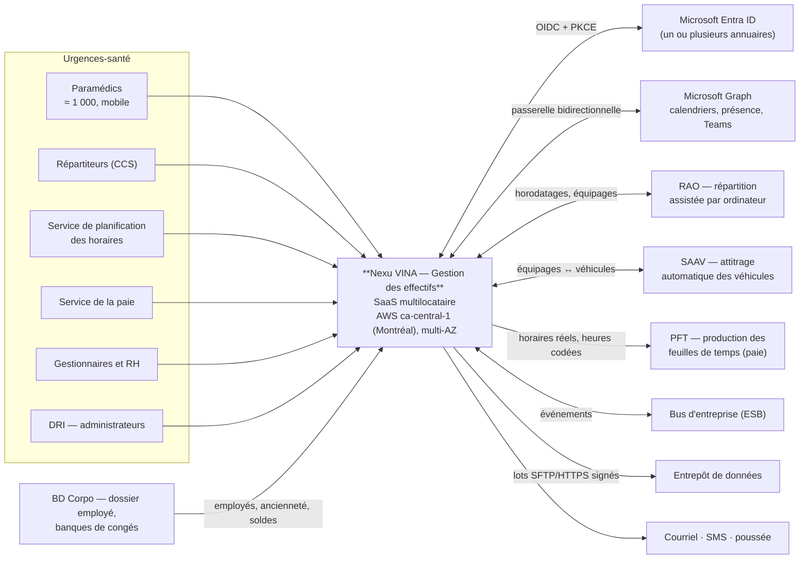

### 2.2 Conteneurs (C4 niveau 2)

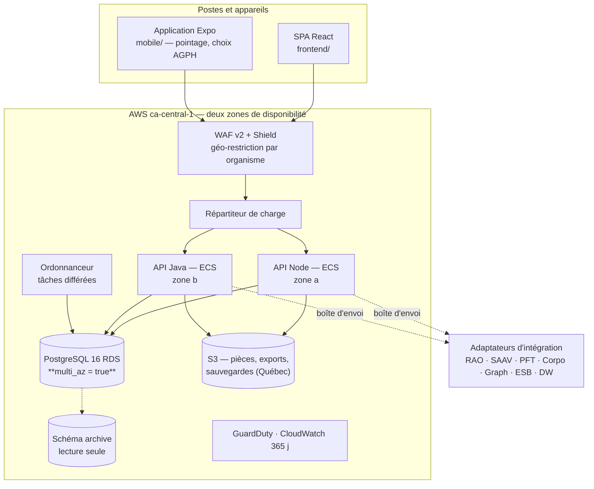

### 2.3 Contextes et dépendances

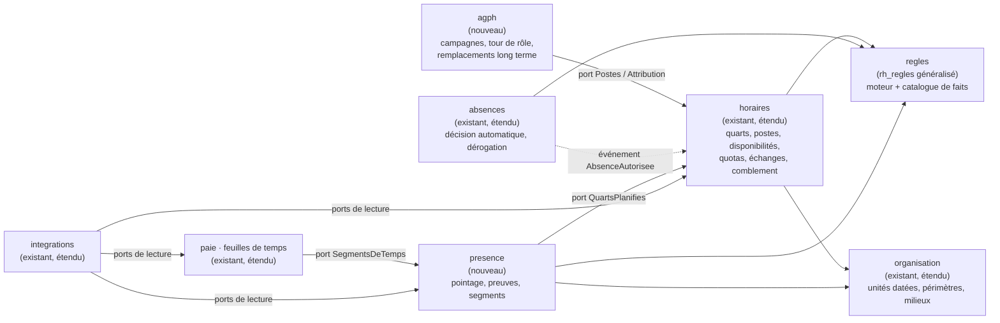

Règles de dépendance, vérifiées par `ArchitectureTest` (Java) et `rbac-architecture.test.ts` (Node) :

- `horaires` ne dépend ni de `rh` ni de `agph` (cycle interdit, ADR 0032) ; `agph` agit sur les
  quarts **par un port** `Horaires.Attribution` que `horaires` implémente.
- `absences` ne connaît pas les quarts : il publie `AbsenceAutorisee` ; `horaires` s'y abonne pour
  rendre vacantes les places du titulaire (E-CH-6, E-GN-6).
- `regles` ne connaît aucun contexte métier : chaque contexte lui **déclare ses faits** (§ 4.2).

## 3. Le principe qui rend les données dynamiques

### 3.1 Référentiel d'organisme → comportement du logiciel

L'avis exige que presque tout soit « paramétrable ». La norme Java (ADR 0030) exige qu'un ensemble
fermé soit un enum. Les deux se concilient en séparant **ce que l'organisme nomme** de **ce que le
logiciel sait faire** :

```
Référentiel de l'organisme (table, par locataire)        Comportement (enum, dans le code)
─────────────────────────────────────────────────        ─────────────────────────────────
TPR  « Temps partiel régulier »          ───────────▶   TEMPS_PARTIEL_REGULIER
TC   « Temps complet »                    ───────────▶   TEMPS_COMPLET
SUP  « Surnuméraire »                     ───────────▶   TEMPS_PARTIEL_OCCASIONNEL
```

L'organisme crée, renomme, ordonne, date et désactive ses lignes ; le moteur ne raisonne que sur
les comportements. Un nouveau statut d'emploi négocié dans la prochaine convention devient une
ligne, pas une livraison — sauf s'il demande un **comportement** inédit, et c'est alors bien un
développement.

| Référentiel (contexte propriétaire) | Comportement fermé | Exigences |
|---|---|---|
| Statuts d'emploi (`rh`) | `TEMPS_COMPLET`, `TEMPS_PARTIEL_REGULIER`, `TEMPS_PARTIEL_OCCASIONNEL` | P-CH-5 à 7, E-GN-12 |
| Corps et titres d'emploi (`rh`) | — (pur vocabulaire) | E-GN-1, P-GH-1 |
| Conventions collectives (`rh`) | — | E-GN-12, E-CH-1 |
| Natures de quart (`horaires`) | `REGULIER`, `AD_HOC`, `REMPLACEMENT`, `HEURES_SUPPLEMENTAIRES` | E-GN-3, E-GR-13 |
| Plages horaires (`horaires`) | — | E-GR-8 |
| États de période (`horaires`) | `PREPARATION`, `COLLECTE`, `CONFECTION`, `PUBLIEE`, `CLOSE` | E-GR-10, E-GR-11 |
| Paramètres de poste (`horaires`) | type de valeur : `TEXTE`, `NOMBRE`, `BOOLEEN`, `REFERENCE` | E-CH-5 |
| Codes d'absence (`absences`) | durée : `PONCTUELLE`, `MOYEN_TERME`, `LONG_TERME` ; effet : `PAYE`, `NON_PAYE`, `BANQUE` | P-CH-8, P-GH-1 |
| Types d'heures (`paie`) | `TRAVAILLEE`, `PAUSE_PAYEE`, `PAUSE_NON_PAYEE`, `PRESENCE_PREALABLE`, `ABSENCE_PAYEE`, `SUPPLEMENTAIRE` | E-RF-6, E-GP-2, E-GP-9 |
| Profils de pointage (`presence`) | mode : `TEMPS_REEL`, `A_POSTERIORI`, `MIXTE` | E-GP-1, P-GP-1 |
| Mécanismes de preuve (`presence`) | `GEOREPERAGE`, `CODE_QR_DE_LIEU`, `RESEAU`, `BORNE`, `SOURCE_EXTERNE` | E-GP-11 |
| Milieux physiques (`organisation`) | type : `CASERNE`, `CENTRE_OPERATIONNEL`, `POINT_DE_SERVICE`, `AUTRE` | E-GN-17, E-GP-7 |
| Motifs d'inadmissibilité (`regles`) | — (clé de message traduite) | E-GN-16 |
| Sources d'horodatage (`presence`) | type : `RAO`, `SAAV`, `BADGE`, `FICHIER` | E-RF-13 |

### 3.2 Forme commune d'un référentiel

Chaque référentiel est une **table typée** dans son contexte (intégrité référentielle, requêtes
lisibles) qui partage la même forme :

| Colonne | Rôle |
|---|---|
| `tenantId`, `code` | clé naturelle, unique par locataire |
| `libelleFr`, `libelleEn` | affichage (i18n) |
| `comportement` | l'enum du § 3.1, quand il y en a un |
| `ordre`, `actif` | présentation, retrait sans suppression |
| `effectifDepuis`, `effectifJusqua` | **datation** : une valeur s'applique aux faits de sa période |
| `attributs` | JSON validé par le descripteur (paramètres propres) |

Un registre **en lecture seule**, `partage/referentiels`, décrit chaque référentiel (contexte,
colonnes, schéma des attributs, comportements admis, droits). C'est ce registre qui permet un
**écran de paramétrage générique** (document 04, § 5) sans que l'écran connaisse les tables — et
sans qu'un contexte lise les tables d'un autre.

### 3.3 Non-rétroactivité : datation et surcharges

E-GR-9 : « ajustement temporaire de paramètres opérationnels incluant les quotas, **sans effet
rétroactif** ». Deux mécanismes, un seul principe — **un paramètre se lit à la date du fait** :

- une **modification durable** ferme la version courante (`effectifJusqua = aujourd'hui`) et en
  ouvre une nouvelle ; les faits antérieurs gardent leur valeur ;
- une **surcharge temporaire** (`parametre_surcharges`) s'applique sur une fenêtre `[depuis,
  jusqua[` dont le début ne peut pas précéder l'instant de sa création : la base refuse une
  surcharge rétroactive (contrainte vérifiée par le domaine **et** par un essai de propriété).

## 4. Le moteur de règles

### 4.1 Modèle

`rh_regles` existe déjà (contexte, champ, opérateur, valeur, action, priorité, dates d'effet) mais
n'expose que cinq champs et ne sert que les absences scolaires. Il devient le contexte `regles` :

| Élément | Contenu |
|---|---|
| **Contexte d'évaluation** (enum) | `DISPONIBILITE`, `ABSENCE`, `ATTRIBUTION`, `ECHANGE`, `POINTAGE`, `FEUILLE_DE_TEMPS`, `HEURES_SUPPLEMENTAIRES`, `CHOIX_AGPH`, `INTERET_REMPLACEMENT` |
| **Portée** | organisme, unité (et son sous-arbre), groupe, convention, statut d'emploi, corps d'emploi, poste |
| **Condition** | arbre JSON `tous` / `un_de` / `non` sur des **faits déclarés** (§ 4.2) avec opérateurs typés |
| **Action** (enum) | `ACCEPTER`, `AVERTIR`, `EXIGER_APPROBATION`, `EXCLURE_DU_BASSIN`, `BLOQUER`, `REFUSER` |
| **Message** | clé traduite + paramètres, pour le motif affiché (E-GN-16) |
| **Versionnage** | toute modification crée une version ; l'évaluation retient la version appliquée |

```json
{
  "contexte": "DISPONIBILITE",
  "portee": { "type": "CONVENTION", "code": "FSSS-PARAMEDICS" },
  "condition": { "tous": [
    { "fait": "disponibilite.quartsParSemaine", "op": "<", "valeur": 3 },
    { "fait": "personne.statutEmploi.comportement", "op": "=", "valeur": "TEMPS_PARTIEL_REGULIER" }
  ]},
  "action": "BLOQUER",
  "message": { "cle": "regle.dispo.minimumQuarts", "parametres": { "minimum": 3 } },
  "priorite": 100,
  "effectifDepuis": "2027-01-01"
}
```

### 4.2 Catalogue de faits

Chaque contexte déclare les faits qu'il expose au moteur (nom, type, libellé, calcul). Le moteur
ne lit jamais une table : il reçoit un **dossier de faits** construit par le contexte appelant.
Ajouter un fait est un développement (il faut le calculer) ; composer des règles avec les faits
existants est du paramétrage. Faits du premier jet, par contexte :

| Contexte | Faits |
|---|---|
| `DISPONIBILITE` | quarts par semaine, heures par période, durée d'un quart, fins de semaine, nuits, écart minimal entre quarts, plage, statut d'emploi, corps d'emploi, convention |
| `ABSENCE` | code, catégorie de durée, préavis en jours, solde de banque, quota d'absences simultanées du groupe, taux de comblement après absence, titre d'emploi |
| `ATTRIBUTION` / `ECHANGE` | admissibilité au poste, repos depuis le dernier quart, heures cumulées de la semaine, contiguïté, formation requise, période du quart |
| `POINTAGE` | écart au début prévu, distance au milieu, mécanisme de preuve, source, présence préalable exigée |
| `FEUILLE_DE_TEMPS` / `HEURES_SUPPLEMENTAIRES` | heures du jour, de la semaine, de la période, écart planifié/déclaré, type d'heure, jour férié |
| `CHOIX_AGPH` | rang, statut d'emploi visé, corps requis par le poste, qualifications |

### 4.3 Évaluation

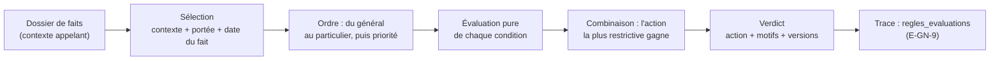

- **Ordre** : organisme → unité → groupe → convention → statut → corps → poste (le particulier
  précise le général, exigence préférentielle A7 de l'AI-2026-03 et E-GN-12 ici) ; à spécificité
  égale, la priorité.
- **Combinaison** : `REFUSER` > `BLOQUER` > `EXCLURE_DU_BASSIN` > `EXIGER_APPROBATION` > `AVERTIR`
  > `ACCEPTER`. Tous les motifs sont conservés, pas seulement le décisif.
- **Aperçu d'impact** : une règle en brouillon s'évalue contre les faits de la période en cours
  sans rien écrire (« 14 disponibilités deviendraient non conformes ») avant d'être activée.
- **Réglage « bloquer ou signaler »** (E-GN-15) : c'est l'action de la règle, pas un réglage à
  part.

## 5. Modèle de données

Conventions : `tenantId` sur toute table (omis des diagrammes) ; heures en **minutes entières
depuis minuit** et horodatages en UTC ISO ; montants en cents (ADR 0002) ; toute table métier
est journalisée par le domaine.

### 5.1 Organisation, périmètres et milieux (U1)

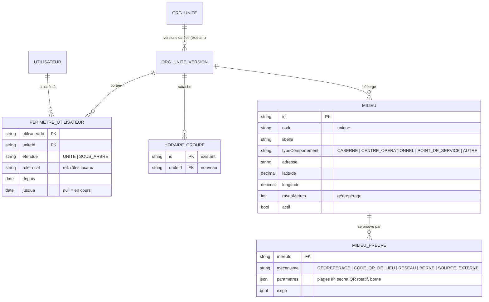

La garde de périmètre (E-GN-8) devient une **garde de route** au même titre que `requireRole` :
`exigerPerimetre(ressource → uniteId)`, refus par défaut (403), exemptions nommées dans
`rbac-architecture.test.ts`. Elle s'applique aux routes cœur des horaires, qui n'en ont pas
aujourd'hui (écart **G5**).

### 5.2 Référentiels, règles et surcharges (U1, U3)

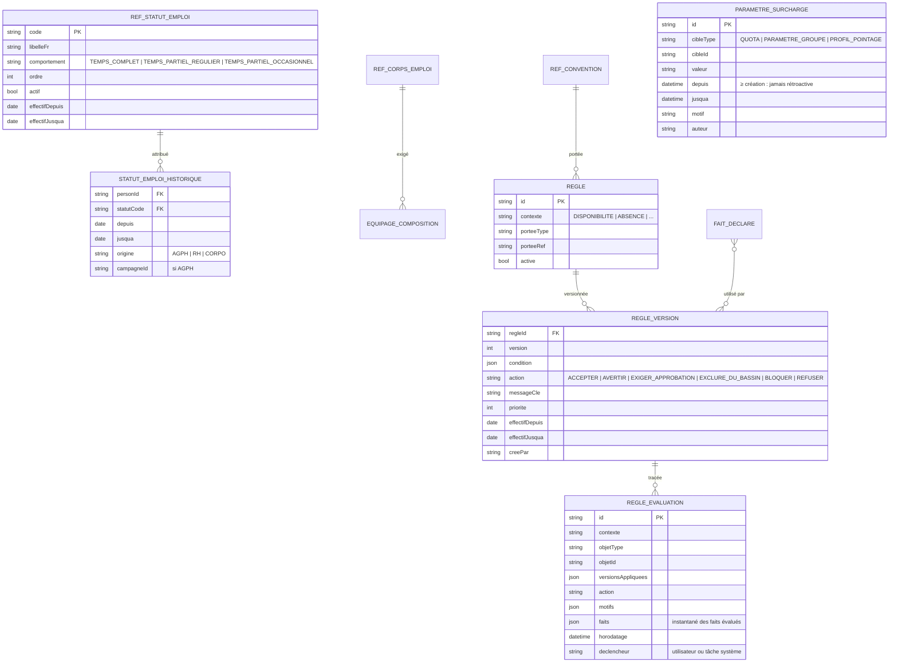

### 5.3 Quarts, équipages, postes, disponibilités et quotas (U2, U3)

Glossaire, pour ne pas confondre : le **quart** du métier (un véhicule, un équipage, une plage)
devient `horaire_equipages` ; la table historique `horaire_quarts` en est la **place** (une
personne, un rang). Le renommage de la table serait plus propre, mais `horaire_quarts` est lue par
la paie, le pointage, les échanges et le Java ; l'en-tête qui manquait s'ajoute au-dessus d'elle.

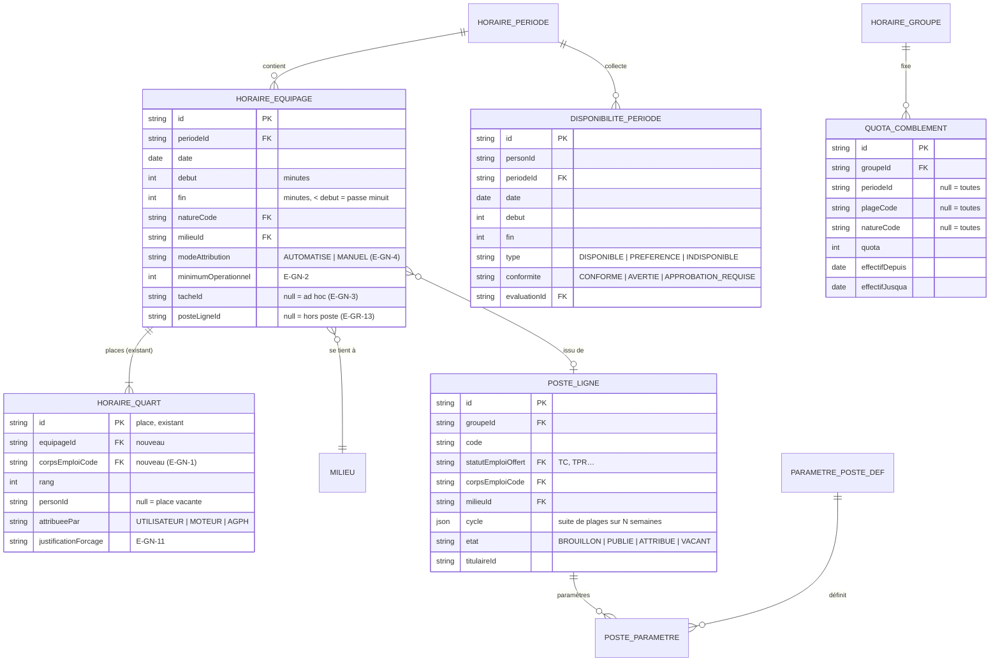

Le **statut opérationnel** d'un équipage (`places pourvues ≥ minimumOperationnel`) et le **taux de
comblement** ne sont pas stockés : ils se calculent à la lecture (principe 4).

### 5.4 AGPH et remplacements long terme (U4)

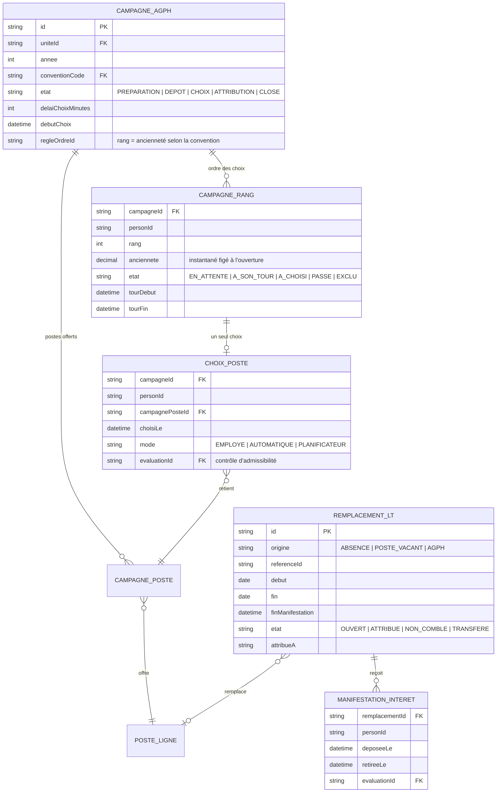

L'ancienneté est **figée à l'ouverture** de la campagne (instantané venu de BD Corpo ou saisi) :
un recalcul pendant le tour de rôle déplacerait des rangs déjà servis.

### 5.5 Absences : décision automatique et dérogation (U5)

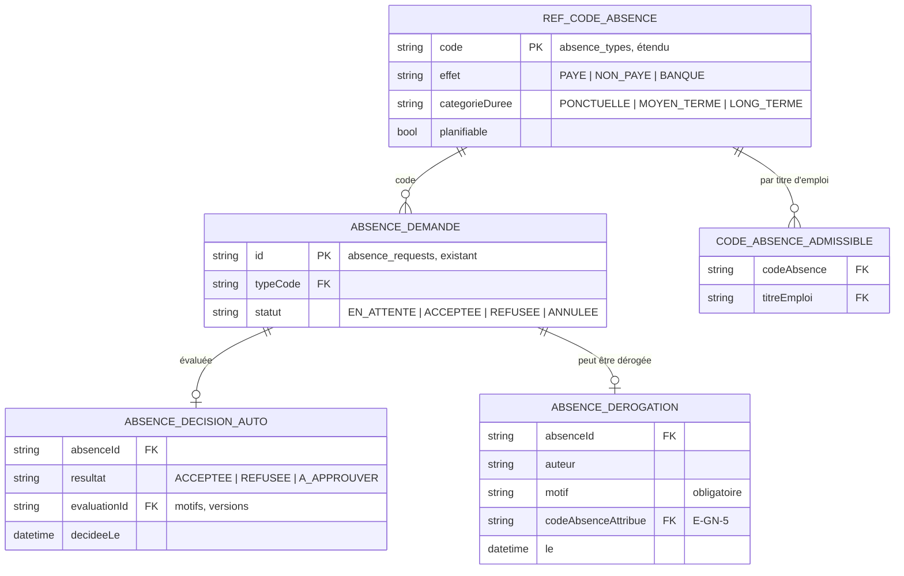

Le refus automatique **est conservé** (aujourd'hui l'action `refuser` lève une exception et rien ne
reste) : c'est la condition de la dérogation.

### 5.6 Présence, segments de temps et feuille (U6, U7)

Le **segment de temps** devient l'unité du temps (écart **G1**) ; `time_entries` reste la vue en
heures que la paie lit, **dérivée** des segments pour les organismes qui pointent.

> **Révision (lot R12, décision D-13 de la feuille de route).** `time_entries` s'est révélé être le temps **facturable aux projets** (`projectId` obligatoire), pas la vue de paie : les segments d'effectifs n'y sont pas versés. La paie des effectifs passe par le lot codé et signé de la feuille de temps (R9), transmis au PFT par la boîte d'envoi (R10).

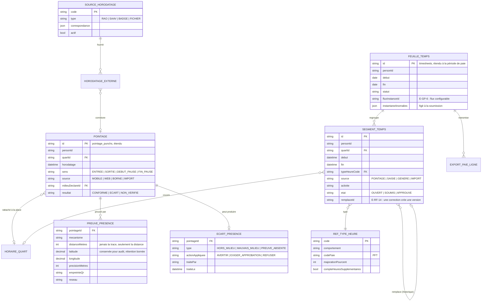

### 5.7 Organisme, conformité et intégrations (U0, U8)

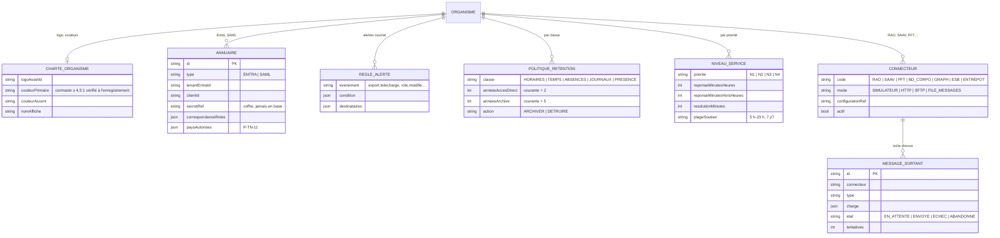

## 6. Séquences

### 6.1 Dépôt de disponibilités contrôlé par les règles (E-GN-12 à 16, E-GR-11)

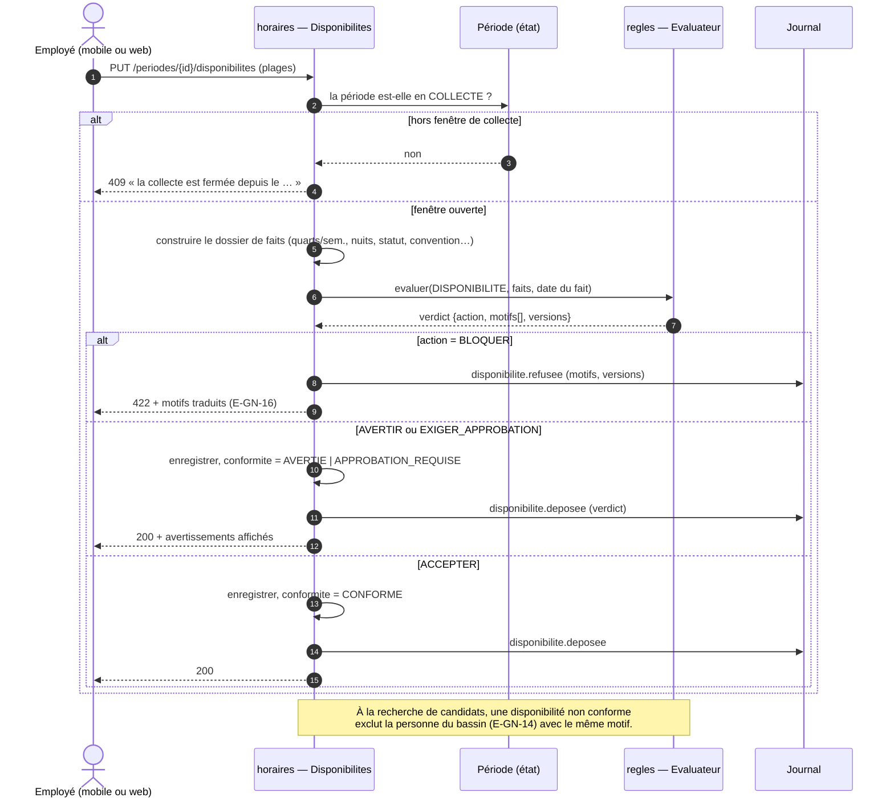

### 6.2 Absence planifiée : décision automatique, dérogation, vacance, comblement (E-GN-5, 6 ; E-CH-6 ; E-GR-3, 4 ; P-GN-1 à 3 ; P-GH-3)

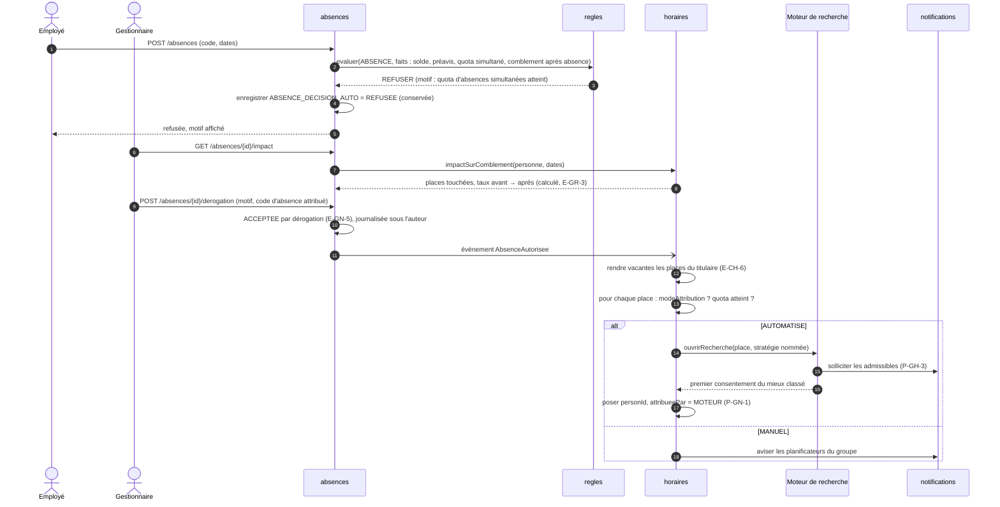

### 6.3 AGPH : tour de rôle, choix unique, attribution et reliquats (E-CH-1, E-CH-10, P-CH-1 à 7)

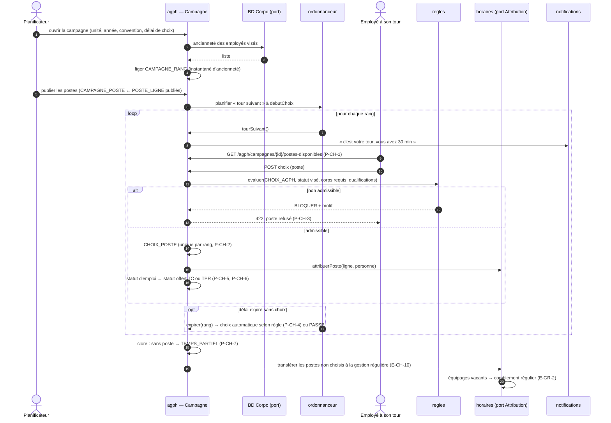

### 6.4 Pointage mobile avec preuve de présence (E-GP-1, E-GP-7, E-GP-10 à 14)

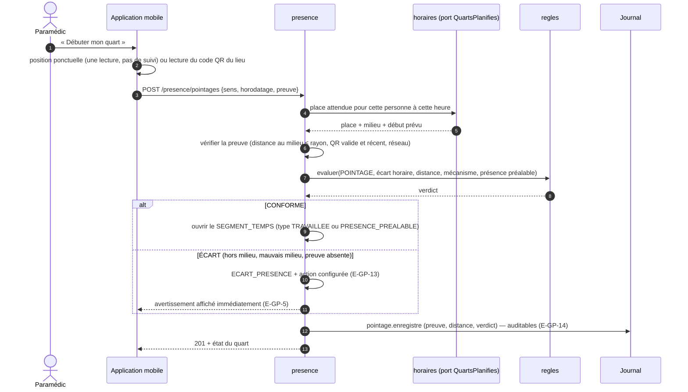

**Vie privée (Loi 25)** : la position est lue **au moment du pointage seulement**, jamais en
continu ; seule la distance sert à la décision ; les coordonnées brutes, conservées pour l'audit,
suivent la politique de rétention de la classe `PRESENCE`. Une **évaluation des facteurs relatifs
à la vie privée** précède l'activation, et un mécanisme sans géolocalisation (code QR de lieu,
borne) reste offert. Le pare-feu doit alors autoriser la géolocalisation pour l'origine de
l'application (`Permissions-Policy: geolocation=(self)`), au lieu de l'interdire.

### 6.5 De l'horaire à la paie (E-RF-1 à 13, E-GP-6, E-GP-8)

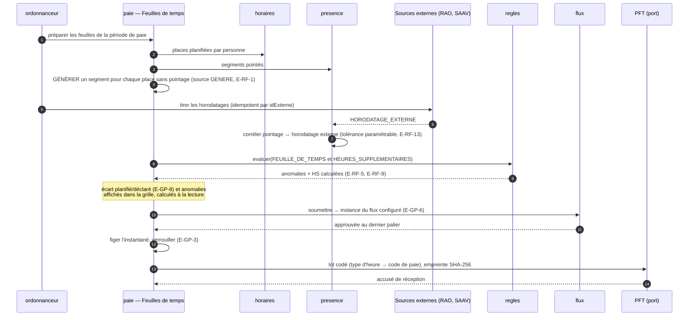

### 6.6 Attribution manuelle d'exception (E-GN-11)

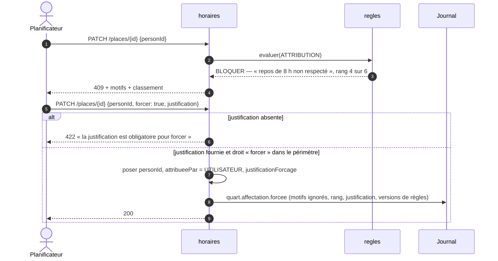

### 6.7 Échange de quarts entre périodes (E-GR-7, E-GR-12)

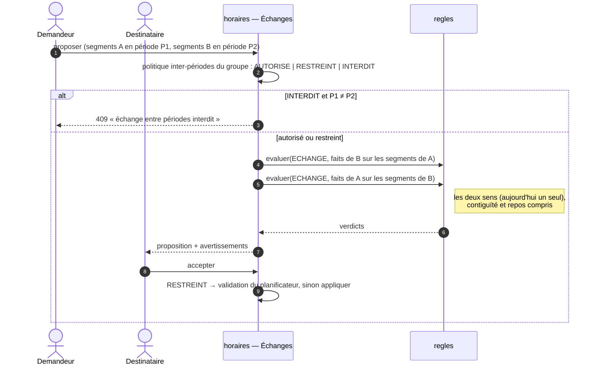

### 6.8 Surcharge temporaire d'un quota (E-GR-8, E-GR-9)

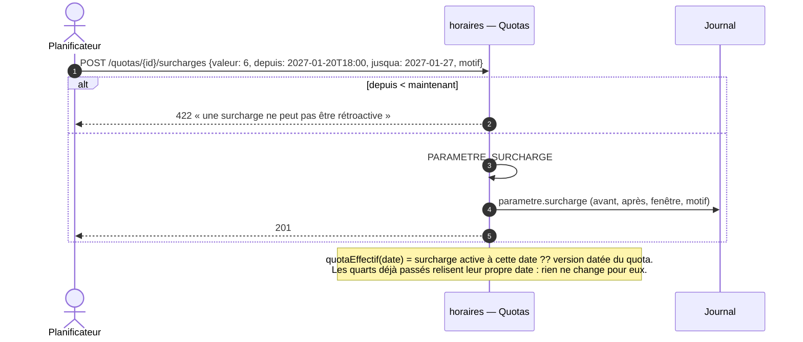

### 6.9 Authentification : plusieurs annuaires, pays autorisés (E-TN-2, P-TN-2, P-TN-11)

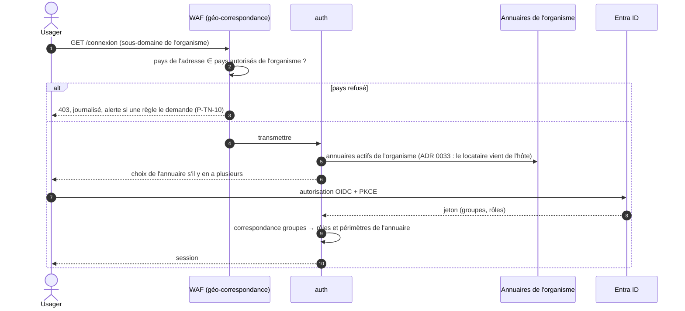

## 7. États

### 7.1 Période de planification (E-GR-10, E-GR-11)

```mermaid
stateDiagram-v2
    [*] --> Preparation
    Preparation --> Collecte: ouvrir la collecte (date de fin)
    Collecte --> Confection: fermer la collecte (manuel ou échéance)
    Confection --> Publiee: publier
    Publiee --> Publiee: ajustements journaliers, échanges, comblement
    Publiee --> Close: clore (fin de période + délai)
    Close --> [*]
    note right of Collecte
        Seul état où l'employé dépose
        ou ajuste ses disponibilités
    end note
    note right of Publiee
        Une période publiée ne redevient
        jamais brouillon (invariant L1)
    end note
```

Les libellés et les délais sont des données de l'organisme ; les **cinq comportements** et leurs
transitions sont du code.

### 7.2 Campagne AGPH

```mermaid
stateDiagram-v2
    [*] --> Preparation
    Preparation --> Depot: ouvrir (ancienneté figée)
    Depot --> Choix: postes publiés, tour de rôle démarré
    Choix --> Choix: tour suivant (choix ou expiration)
    Choix --> Attribution: dernier rang servi
    Attribution --> Close: statuts d'emploi posés, reliquats transférés
    Close --> [*]
```

### 7.3 Demande d'absence

```mermaid
stateDiagram-v2
    [*] --> Evaluee: déclarée
    Evaluee --> Acceptee: règles → ACCEPTER (P-GN-3)
    Evaluee --> AApprouver: règles → EXIGER_APPROBATION
    Evaluee --> RefuseeAuto: règles → REFUSER
    AApprouver --> Acceptee: approuvée
    AApprouver --> Refusee: refusée
    RefuseeAuto --> Acceptee: dérogation motivée + code (E-GN-5)
    RefuseeAuto --> [*]
    Acceptee --> Annulee: annulation
    Acceptee --> [*]
    Refusee --> [*]
    Annulee --> [*]
```

### 7.4 Remplacement long terme

```mermaid
stateDiagram-v2
    [*] --> Ouvert: absence longue ou poste vacant (E-CH-7)
    Ouvert --> Ouvert: manifestations d'intérêt (E-CH-8)
    Ouvert --> Attribue: fin de fenêtre, attribution selon les règles (P-CH-9)
    Ouvert --> NonComble: aucun intéressé admissible (E-CH-9)
    NonComble --> Transfere: quarts versés à la gestion régulière (E-CH-10)
    Attribue --> [*]
    Transfere --> [*]
```

## 8. API

Toutes les routes sont documentées dans l'OpenAPI 3.0.3 existant (`services/openapi.ts`, ADR 0019
et 0028), gardées par `requireModule`, `requireRole` **et** la nouvelle garde de périmètre, et
portées à l'identique en Java (`codeDe` partagé pour les codes 404/409/422).

| Contexte | Routes principales | Exigences |
|---|---|---|
| `organisation` | `GET/POST /api/organisation/milieux`, `PUT /milieux/:id/preuves`, `GET/PUT /api/organisation/perimetres/:utilisateurId` | E-GN-7, 8, 17 |
| `referentiels` | `GET /api/referentiels` (registre), `GET/POST/PUT /api/referentiels/:type`, `POST /:type/:code/fermer` | § 3 |
| `regles` | `GET/POST /api/regles`, `POST /api/regles/:id/versions`, `POST /api/regles/:id/apercu`, `GET /api/regles/evaluations?objet=` | E-GN-9, 10, 12, 15, 16 |
| `horaires` | `POST /api/horaires/equipages` (ad hoc), `PATCH /equipages/:id` (heures, mode, minimum), `PATCH /places/:id` (`forcer` + `justification`), `POST /equipages/lot` (modification en lot), `GET/PUT /periodes/:id/disponibilites`, `POST /periodes/:id/etat`, `GET/POST /quotas`, `POST /quotas/:id/surcharges`, `GET /periodes/:id/comblement`, `GET/POST /postes-lignes`, `POST /postes-lignes/publier` | E-GN-1 à 4, E-CH-2 à 5, E-GR-3 à 13 |
| `agph` | `POST /api/agph/campagnes`, `POST /:id/ouvrir`, `GET /:id/rangs`, `GET /:id/postes-disponibles`, `POST /:id/choix`, `POST /:id/clore`, `GET/POST /api/agph/remplacements`, `POST /remplacements/:id/interets` | E-CH-1, 7 à 10, P-CH-1 à 9 |
| `absences` | `GET /api/absences/:id/impact`, `POST /api/absences/:id/derogation`, `GET/PUT /api/absences/codes/:code/admissibilite` | E-GN-5, E-GR-3, P-GH-1 |
| `presence` | `POST /api/presence/pointages`, `GET /pointages?personne=&du=&au=`, `GET/PUT /profils`, `GET /ecarts`, `POST /ecarts/:id/traiter`, `GET/POST /sources`, `POST /sources/:code/tirer` | E-GP-1 à 15, E-RF-13 |
| `paie` | `POST /api/payroll/feuilles/preparer`, `GET /feuilles/:id/segments`, `PUT /segments/:id` (version), `GET /feuilles/:id/anomalies`, `POST /exports/pft` | E-RF-1 à 14 |
| `saas` | `GET/PUT /api/saas/tenants/:id/charte`, `/annuaires`, `/alertes`, `/retention`, `/niveaux-service` ; module `ia` au catalogue | P-TN-2, 9, 10, 11 ; Contrat 2.06, 5.02, 17.08 |
| `integrations` | `GET/PUT /api/integrations/connecteurs/:code`, `POST /connecteurs/:code/essai`, `GET /messages?etat=` | E-TN-7, P-TN-7, Cahier 2.3 |

## 9. Exigences non fonctionnelles

### 9.1 Disponibilité 99,7 % au Québec (E-TN-9, Contrat 6.01)

Un mois de 30 jours compte 43 200 minutes : **99,7 % laisse 129 minutes d'indisponibilité**, hors
maintenance approuvée trois jours à l'avance ; sous 99,0 % (432 minutes), le manquement est majeur.

| Élément | Aujourd'hui (ADR 0043, CSSDC) | Cible 26-015-DO |
|---|---|---|
| Base de données | RDS PostgreSQL 16, `multi_az = false` | **`multi_az = true`**, bascule automatique (≈ 1-2 min) |
| Application | 2 tâches ECS | ≥ 2 tâches **réparties sur 2 zones**, sonde de santé et retour arrière automatique |
| Objectifs | RTO 48 h, RPO 15 min | **RTO 1 h, RPO 5 min** |
| Relève (P-TN-4) | IaC seulement | environnement tiède dans une **autre zone de ca-central-1** |
| Mesure | battement interne, cible 99,5 % | sondes synthétiques externes, cible **par contrat** (`NIVEAU_SERVICE`), rapport mensuel des incidents |

**La relève ne peut pas sortir du Québec** (Contrat 17.07.04) : ca-west-1 est à Calgary. La
redondance se fait donc **entre zones de disponibilité de la région de Montréal**, pas entre
régions. C'est un amendement de l'ADR 0043 pour cette offre (ADR 0052).

### 9.2 Performance (E-TN-17)

Scénario JMeter à ajouter au kit `perf/jmeter` : 1 100 usagers, **pointe de relève de quart**
(≈ 300 pointages en 10 minutes à 6 h et 18 h), consultation d'horaire, dépôt de disponibilités en
fin de collecte, tour de rôle AGPH. Cible : p95 < 2 000 ms sur les transactions de base, mesurée
contre les deux moteurs.

### 9.3 Sécurité (E-TN-8, 23, 24, 31 ; P-TN-10, 11)

- **GuardDuty** et journaux CloudWatch à **365 jours** (aujourd'hui 90) ; Shield Standard et
  règles de débit du WAF ; Shield Advanced chiffré en option.
- **Géo-restriction** par organisme dans le WAF, doublée d'un contrôle applicatif.
- **Règles d'alerte** par courriel sur événements du journal (export téléchargé, rôle modifié,
  forçage d'attribution, pays refusé).
- **Correspondance MCN** : un tableau par contrôle de la liste de vérification de la zone
  d'accueil, avec preuve (à obtenir, question Q-12), et un rapport de sécurité mensuel.

### 9.4 Données (Contrat 2.06, 6.05, 6.06)

- **Rétention par classe** : tâche `archiver_donnees` de l'ordonnanceur ; au-delà de l'année
  courante + 2, les lignes passent au schéma `archive` (lecture seule, consultable sur requête) ;
  au-delà de + 5, destruction attestée (mécanisme de `saas/destruction.ts`).
- **Dictionnaire de données généré** à partir des migrations et des descripteurs de référentiels
  (E-TN-13), publié avec chaque version.
- **Plan de sortie** : export complet par organisme dans un format ouvert, dictionnaire joint.

### 9.5 IA (Contrat 17.08)

Module `ia` au catalogue, **désactivé par défaut**, `requireModule("ia")` sur `/api/ai`, widget
masqué sans le module, registre des usages (finalité, données, fournisseur, lieu de traitement)
exigé par 17.08.02 et consultable par l'organisme.

## 10. Lots de réalisation

```mermaid
flowchart LR
    U1["U1 Organisation,<br/>référentiels, journal"] --> U2["U2 Quarts, postes,<br/>équipages"]
    U1 --> U3["U3 Moteur de règles,<br/>disponibilités, quotas"]
    U2 --> U3
    U3 --> U4["U4 AGPH et<br/>remplacements LT"]
    U3 --> U5["U5 Absences<br/>et comblement"]
    U1 --> U6["U6 Pointage<br/>et présence"]
    U3 --> U6
    U6 --> U7["U7 Feuille de temps,<br/>HS, rapports"]
    U1 --> U8["U8 Intégrations"]
    U7 --> U8
    U0["U0 Socle de conformité"]

    style U1 fill:#ffe6e6
    style U3 fill:#ffe6e6
    style U6 fill:#ffe6e6
```

| Lot | Contenu | Essentiels fermés | Effort (j-p) | ADR |
|---|---|---:|---:|---|
| **U0** | Multi-AZ et RTO 1 h ; module `ia` ; charte par organisme ; annuaires par organisme ; géo-restriction ; alertes ; rétention et archive ; environnement de formation ; niveaux de service configurables ; GuardDuty, CloudWatch 365 j ; dictionnaire de données ; retour arrière applicatif | 14 | 25 | 0052, 0053 |
| **U1** | Unités ↔ groupes, périmètres utilisateur et garde, milieux et preuves, registre de référentiels, journal unifié consultable (filtres, export), traces des étapes automatiques | 5 | 15 | 0047 |
| **U2** | `horaire_equipages`, composition par corps d'emploi, minimum opérationnel, quarts ad hoc, mode d'attribution, ajustements journaliers, postes-lignes et paramètres, modification en lot | 11 | 18 | — |
| **U3** | Contexte `regles` (catalogue de faits, versions, aperçu), cycle de période paramétrable, disponibilités par période, quotas et surcharges, échanges inter-périodes bidirectionnels, contrôles temporels | 12 | 22 | 0048 |
| **U4** | Contexte `agph` : campagnes, rangs figés, choix unique minuté, attribution automatique, statuts d'emploi, remplacements long terme, reliquats vers la gestion régulière | 7 | 25 | 0051 |
| **U5** | Décision automatique conservée, dérogation, impact sur le comblement, événement `AbsenceAutorisee` → vacance → recherche, attribution par le moteur, avis aux admissibles, codes par titre d'emploi | 6 | 15 | — |
| **U6** | Contexte `presence` : segments de temps, pointage temps réel (mobile, web, borne), pauses, présence préalable, preuves, écarts et actions, journal des localisations, sources d'horodatage corrélées | 12 | 25 | 0049, 0050 |
| **U7** | Feuille générée depuis les horaires, validation en temps réel, anomalies en ligne, HS par règles, types d'heures, flux d'approbation branchés, historique des corrections, rapports et relevés paramétrables, export PFT | 13 | 20 | — |
| **U8** | Connecteurs RAO, SAAV, PFT, BD Corpo, Graph, ESB (boîte d'envoi transactionnelle), entrepôt de données — chacun port + simulateur + adaptateur + contrat | 2 (+ cahier) | 30 | 0054 |
| | **Total** | **82** | **≈ 195** | |

Chemin critique : **U1 → U2 → U3 → U6 → U7 → U8** (≈ 130 jours-personne) ; U0, U4 et U5 se
parallélisent.

## 11. Stratégie d'essai

| Niveau | Ce qui est vérifié | Seuil |
|---|---|---|
| Unitaires de domaine | moteur de règles (ordre, combinaison, non-rétroactivité), tour de rôle, corrélation, calcul HS, statut opérationnel | **100 %** lignes et branches |
| Propriétés | `quotaEffectif(date)` ne change jamais pour une date passée ; un rang AGPH servi n'est jamais re-servi ; Σ segments d'une place = durée pointée | mêmes graines Node et Java |
| Intégration (PostgreSQL réel) | chaînes 6.1 à 6.8 de bout en bout côté serveur | ≥ 96 % par classe |
| **Contrat par port** | RAO, SAAV, PFT, BD Corpo, Graph, ESB, entrepôt, source d'horodatage : simulateur **et** adaptateur HTTP passent la même suite | toutes les implémentations |
| Architecture | `horaires ↛ rh`, `horaires ↛ agph`, `regles ↛ contextes métier` ; garde de périmètre présente sur chaque route mutante des horaires | 0 violation |
| Bout en bout + accessibilité | chaque écran du document 04 dans chaque état, quatre largeurs, axe-core | 0 violation |
| Charge | scénario § 9.2 | p95 < 2 s |
| Mutation | Stryker (Node), PIT (Java) sur `regles`, `agph`, `presence` | MSI ≥ 90 % sur le domaine |

## 12. ADR à rédiger

| # | Titre | Décision |
|---|---|---|
| 0047 | Référentiels de l'organisme, comportements du logiciel | table typée par référentiel, registre de descripteurs, enum pour le comportement |
| 0048 | Un moteur de règles unique, versionné et explicable | `rh_regles` devient le contexte `regles` ; faits déclarés par les contextes ; trace de chaque évaluation |
| 0049 | Le segment de temps, unité du temps | ~~`time_entries` devient une vue dérivée~~ — écarté (D-13) : `time_entries` est le temps de projet ; la paie passe par le lot PFT |
| 0050 | Preuve de présence et vie privée | lecture ponctuelle de la position, distance comme critère, EFVP, alternative sans géolocalisation |
| 0051 | L'AGPH, contexte distinct des horaires | invariant propre (une personne, un choix, à son tour) ; action sur les quarts par port |
| 0052 | Haute disponibilité intra-Québec | amende l'ADR 0043 pour les contrats à 99,7 % : multi-AZ, RTO 1 h, relève dans une autre zone de Montréal |
| 0053 | IA désactivée par défaut, par organisme | module `ia`, registre des usages, autorisation préalable (Contrat 17.08) |
| 0054 | Intégrations par boîte d'envoi | outbox transactionnelle, reprises, idempotence, adaptateur ESB |
