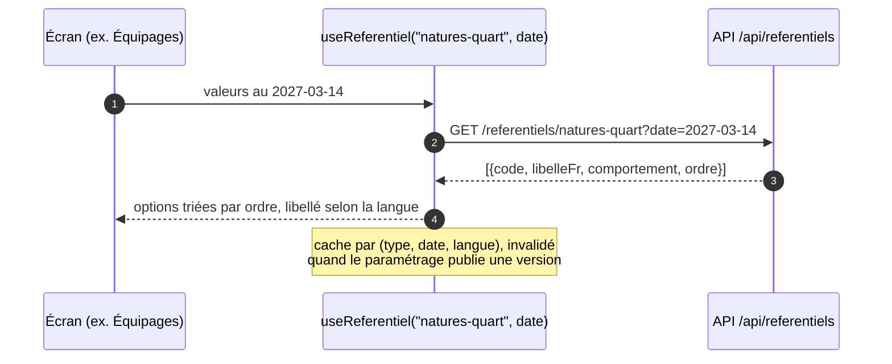

# 26-015-DO — Conception de l'intégration dans l'interface

> Où les écrans de la gestion des effectifs se posent dans l'interface existante de Nexu VINA :
> le menu, chaque écran et ses états, les composants réutilisés, les données **toutes chargées
> depuis les référentiels** de l'organisme, l'accessibilité SGQRI 008 3.0 / WCAG 2.2 AA et les
> essais qui la prouvent.
>
> Complète le document [03](03-CONCEPTION-SOLUTION-LOGICIELLE.md) : chaque écran nomme les routes
> qu'il appelle et les exigences qu'il sert.

---

## 0. Révision du 1er novembre 2026 — le menu, le chrome et la planche manquante

Trois changements, chacun avec sa trace :

- **Une section « Urgences-santé » au menu, découpée comme les planches.** Les vues du module
  vivaient sous « Temps & présences », « Administration » et « Mon espace » : rien ne nommait
  l'avis, et il fallait déjà savoir où regarder. Les **vingt-six** vues sont désormais sous une
  section à elles, gouvernée par le socle `effectifs`, et ses entrées sont celles de la colonne
  « MENU PRINCIPAL » des planches : Mon horaire · Disponibilités · Absences · Confection AGPH ·
  Gestion des quarts · Pointage et présence · Feuilles de temps · Demandes et échanges ·
  Administration des effectifs. Chaque notion réunit **la vue de l'employé et celle de
  l'encadrement** du même sujet.
- **Un organisme de démonstration** se sème en une commande
  (`node scripts/semer-urgences-sante.cjs`), avec le contenu des planches et quatre comptes.
- **Des parcours joués au nom de chaque profil** : `e2e/donnees/urgences-sante/profils.json` dit
  qui fait quoi, et `urgences-sante-parcours.spec.ts` le joue — un écran complet pour
  l'administration peut être inatteignable pour la paramédic à qui il est destiné.
- **Le système visuel des douze planches** (`docs/urgences-sante/maquettes/svg/`), posé une fois
  dans `PageUrgencesSante` : **ADR 0069**. Une seule teinte de la palette a dû être corrigée.
- **« Mon horaire » (planche s03) a été créé** : c'était la seule planche sans écran hôte.

Table de correspondance planche par planche :
[`docs/urgences-sante/maquettes/CORRESPONDANCE-MAQUETTES-ECRANS.md`](../urgences-sante/maquettes/CORRESPONDANCE-MAQUETTES-ECRANS.md).

---

## 1. Les contraintes qui décident de tout

| Contrainte | Conséquence pour 26-015-DO | Source |
|---|---|---|
| **Menu à deux niveaux** `section > notion > vue` ; une vue est une page ou un onglet adressable par `?onglet=` | Les nouveaux écrans sont des **vues de notions**, jamais des entrées isolées | `frontend/src/navigation.tsx` |
| **Un onglet n'appartient qu'à une notion** | Les onglets des horaires se répartissent sans doublon entre « Planification des effectifs » et « Calendriers » | ADR 0035 |
| **Un module ne se retrouve pas dans un autre** | La déclaration d'absence reste dans **Absences** ; le pointage n'apparaît pas aussi dans la feuille de temps | ADR 0034 |
| **Un module absent du catalogue est invisible pour tous** | `agph` et `presence` entrent dans `catalogueModules.ts` **et** `PAGE_MODULE` au même commit | mémoire « module absent du catalogue » |
| **Sous-menus masquables par organisme** | Urgences-santé peut masquer ce qu'il n'achète pas | ADR 0042 |
| **`data-testid` gelés** | Chaque écran ajoute ses identifiants à `docs/refonte-visuelle/testids.txt`, n'en recycle aucun | refonte visuelle |
| **SGQRI 008 3.0 / WCAG 2.2 AA** | Obligatoire, vérifié par `scripts/audit-accessibilite.js` et `npm run test:ui -- audit-wcag22` | `CLAUDE.md` |
| **Aucune liste codée dans l'écran** | Toute liste de choix vient de `GET /api/referentiels/:type` ; tout libellé fixe vient de l'i18n (fr, en, mg) | principe du document 03, § 3 |

`Horaires.tsx` compte déjà **4 717 lignes et 20 onglets**. Les écrans nouveaux n'y entrent pas :
ils naissent en composants de `frontend/src/horaires/`, `frontend/src/agph/` et
`frontend/src/presence/`, et la page hôte ne fait que les monter.

## 2. Le menu, après

Une notion naît sous **Temps & présences** ; une autre sous **Administration** ; trois notions
existantes gagnent une vue.

```
⏱️ Temps & présences                               (existant)
   ├─ ⏱️ Temps                                      (existant, enrichi)
   │    ├─ Feuilles de temps          time                              ← segments, anomalies en ligne
   │    ├─ Heures travaillées         workedhours
   │    ├─ Pointer                    presence                          🆕 principale pour l'employé
   │    └─ Écarts de présence         presence?onglet=ecarts            🆕 gestionnaire
   ├─ 🚑 Planification des effectifs  (nouvelle notion)                 🆕
   │    ├─ Tableau de comblement      horaires?onglet=comblement         principale
   │    ├─ Équipages et quarts        horaires?onglet=equipages          🆕
   │    ├─ Postes                     horaires?onglet=postes             🆕
   │    ├─ Périodes et disponibilités horaires?onglet=periodes           (existant, cycle de collecte)
   │    ├─ Mes disponibilités         horaires?onglet=mes-disponibilites 🆕 employé
   │    ├─ Quotas                     horaires?onglet=quotas             🆕
   │    ├─ Échanges                   horaires?onglet=echanges           (existant, déplacé)
   │    ├─ AGPH                       agph                               🆕
   │    └─ Remplacements long terme   agph?onglet=remplacements          🆕
   └─ 📅 Calendriers et horaires      (existant)
        ├─ Calendrier personnel       calendar
        └─ Horaires                   horaires                          (autres onglets existants)

👥 Paie & RH
   ├─ 🏝️ Absences                     + Décisions automatiques   absences?onglet=decisions   🆕
   └─ 💵 Paie                          + Transmission PFT         payroll?onglet=pft          🆕

🛠️ Administration
   ├─ 🏢 Organisation                 (nouvelle notion)                  🆕
   │    ├─ Structure                  organisation                       unités datées (existant sans écran)
   │    ├─ Milieux                    organisation?onglet=milieux
   │    └─ Périmètres                 organisation?onglet=perimetres
   ├─ ⚙️ Paramétrage des effectifs    (nouvelle notion)                  🆕
   │    ├─ Référentiels               referentiels
   │    ├─ Règles                     regles
   │    └─ Journal des décisions      regles?onglet=journal
   └─ Admin                           + onglets Charte · Annuaires · Alertes · Rétention · Niveaux de service
```

Déplacer l'onglet `echanges` de « Calendriers » vers « Planification des effectifs » respecte
l'ADR 0035 : il n'a toujours qu'une notion. L'identifiant `nav-horaires` reste celui de la page ;
chaque vue reçoit `nav-horaires-<onglet>`, comme le veut la convention du menu.

**Modules du catalogue** : `horaires` (existant) porte les vues de planification ; `agph` et
`presence` sont nouveaux, activables séparément (ADR 0013) ; `ia` devient un module **désactivé par
défaut** (Contrat 17.08). Dépendances déclarées dans `catalogueModules.ts` : `agph → horaires`,
`presence → horaires`.

## 3. Parcours par profil

| Profil | Appareil | Parcours principal | Écrans |
|---|---|---|---|
| **Paramédic** (≈ 1 000) | téléphone | pointer au début et à la fin du quart ; consulter son horaire ; déposer ses disponibilités pendant la collecte ; choisir son poste à son tour ; manifester son intérêt ; déclarer une absence | M1 à M5 |
| **Répartiteur (CCS)** | poste fixe | idem, pointage web depuis le réseau du centre | E14, E8 |
| **Planificateur** | poste fixe | ouvrir et fermer les collectes, confectionner, publier, combler, conduire l'AGPH | E5 à E12 |
| **Gestionnaire** | poste et tablette | approuver absences et feuilles, traiter les écarts de présence, déroger, forcer une attribution | E13, E14, E15 |
| **Service de la paie** | poste fixe | contrôler les anomalies, transmettre à PFT | E15, E16 |
| **Administrateur (DRI)** | poste fixe | référentiels, règles, milieux, périmètres, charte, annuaires, rétention | E1 à E4, E17, E18 |

## 4. Composants réutilisés

| Composant | Rôle ici | Fichier |
|---|---|---|
| `EnTeteEcran`, `FilAriane` | titre unique `<h1>`, fil d'Ariane de la notion | `frontend/src/composants/` |
| `Onglets` | vues d'une page, synchronisées avec `?onglet=` | idem |
| `Tableau` + `TbodyPagine` / `Pagination` | listes avec `<caption>`, `scope`, pagination par 10 | idem, `Pagination.tsx` |
| `BarreFiltres` | filtres par unité, période, statut — **valeurs chargées des référentiels** | idem |
| `Tiroir` | création et modification sans quitter la liste (focus piégé puis rendu) | idem |
| `Modal` (`FormulaireModal`) | confirmations : forcer, déroger, clore, publier | `frontend/src/Modal.tsx` |
| `Etapes` | cycle d'une période, d'une campagne AGPH | `composants/Etapes.tsx` |
| `Calendrier` | disponibilités, horaire personnel | `composants/Calendrier.tsx` |
| `Badge` | statut **toujours doublé d'un texte et d'une icône** (1.4.1) | `composants/Badge.tsx` |
| `Message` | `role="status"` pour une confirmation, `role="alert"` pour une erreur | `composants/Message.tsx` |
| `EtatVide`, `Tuile`, `MenuActions`, `SommaireSections` | états vides, indicateurs, actions groupées, longues pages | `composants/` |

**Nouveaux composants**, chacun avec ses essais unitaires et son contrôle axe-core :

| Composant | Ce qu'il fait | Pourquoi un composant |
|---|---|---|
| `FormulaireReferentiel` | rend un formulaire à partir du **descripteur** d'un référentiel (champs, types, validations, comportements admis) | un seul écran pour tous les référentiels |
| `ConstructeurCondition` | construit l'arbre `tous / un_de / non` d'une règle **par boutons et listes**, sans glisser-déposer | 2.5.7 : le glisser ne peut pas être le seul moyen |
| `ChronoTour` | compte à rebours du tour AGPH, annonces à 5 et 1 minute en `role="status"`, jamais de vol de focus | 2.2.1 et 4.1.3 |
| `PreuvePresence` | explique puis demande la position, ou ouvre la lecture du code QR ; propose toujours une autre preuve | consentement éclairé, vie privée |
| `LigneDeTemps` | segments d'une journée (travail, pause, présence préalable) en liste accessible, **doublée** d'une frise visuelle | 1.3.1 : la frise seule ne se lit pas au lecteur d'écran |
| `ChampCouleurContraste` | choisit une couleur de charte et **calcule** le contraste sur chaque surface, refuse sous 4,5:1 | 1.4.3, 1.4.11 |

## 5. Des données dynamiques jusque dans l'écran

Trois règles, vérifiées par un essai statique qui échoue si un écran de ces dossiers déclare un
tableau littéral de choix métier :

1. **Toute liste de choix métier** (statut d'emploi, nature de quart, type d'heure, code
   d'absence, milieu, plage, corps d'emploi…) vient de `GET /api/referentiels/:type`, filtrée sur
   `actif` et sur la **date du fait** (un quart de mars montre les valeurs en vigueur en mars).
2. **Tout libellé de l'interface** vient de l'i18n ; **tout libellé de l'organisme** vient du
   référentiel (`libelleFr` / `libelleEn`).
3. **Tout formulaire de paramétrage** se rend depuis un descripteur : ajouter un attribut à un
   référentiel ne demande aucun changement d'écran.



## 6. Les écrans

Chaque fiche donne l'hôte, les exigences servies, les routes appelées, la maquette et ce que
l'accessibilité y exige **en plus** des règles générales du § 7.

### E1 — Référentiels · `referentiels` (Urgences-santé › Paramétrage des effectifs)

Exigences : § 3 du document 03 (toutes les « paramétrables »). Routes : `GET /api/referentiels`,
`GET/POST/PUT /api/referentiels/:type`, `POST /:type/:code/fermer`.

```
┌ Référentiels ─────────────────────────────────────────────────────────────┐
│ Référentiel [Statuts d'emploi ▾]   Afficher [en vigueur ▾]  [+ Ajouter]   │
├───────┬─────────────────────────┬──────────────────────────┬──────┬───────┤
│ Code  │ Libellé                 │ Comportement             │ Ordre│ En    │
│       │                         │                          │      │vigueur│
├───────┼─────────────────────────┼──────────────────────────┼──────┼───────┤
│ TC    │ Temps complet           │ Temps complet            │ 1    │ depuis│
│       │                         │                          │      │ 2025  │
│ TPR   │ Temps partiel régulier  │ Temps partiel régulier   │ 2    │ …     │
│ SUP   │ Surnuméraire            │ Temps partiel occasionnel│ 3    │ …  ⋮  │
└───────┴─────────────────────────┴──────────────────────────┴──────┴───────┘
  ⋮ Modifier · Fermer à une date et remplacer · Historique des versions
```

- Le tiroir de modification est rendu par `FormulaireReferentiel` ; « Fermer et remplacer » crée
  une nouvelle version datée plutôt que d'écraser (non-rétroactivité).
- Testids : `ref-type`, `ref-filtre-vigueur`, `ref-ajouter`, `ref-ligne-{code}`, `ref-fermer-{code}`,
  `ref-form-{champ}`, `ref-form-enregistrer`, `ref-form-erreur`.

### E2 — Règles · `regles` (Urgences-santé › Paramétrage des effectifs)

Exigences : E-GN-12, E-GN-15, E-GN-16, E-RF-10, P-GN-2, P-GH-2. Routes : `/api/regles`,
`POST /:id/versions`, `POST /:id/apercu`.

```
┌ Règles — Disponibilités ──────────────────────────────── [+ Nouvelle règle]┐
│ Contexte [Disponibilités ▾]  Portée [Convention FSSS ▾]  État [actives ▾]  │
├──────────────────────────────────────────────┬────────┬──────────┬────────┤
│ Règle                                        │ Action │ Priorité │ Depuis │
├──────────────────────────────────────────────┼────────┼──────────┼────────┤
│ Au moins 3 quarts par semaine (TPR)          │ ⛔ Bloquer │ 100   │ 2027-01│
│ Pas plus de 2 nuits consécutives             │ ⚠ Avertir  │ 50    │ 2027-01│
└──────────────────────────────────────────────┴────────┴──────────┴────────┘

┌ Tiroir : modifier la règle ────────────────────────────────────────────────┐
│ Si TOUTES les conditions suivantes sont vraies :        [Tous ▾]           │
│   [Quarts par semaine ▾] [est inférieur à ▾] [ 3 ]         [Retirer]       │
│   [Statut d'emploi    ▾] [est          ▾] [TPR ▾]          [Retirer]       │
│   [+ Ajouter une condition]   [+ Ajouter un groupe]                        │
│ Alors : (•) Bloquer  ( ) Avertir  ( ) Exiger une approbation               │
│ Message affiché à l'employé : [regle.dispo.minimumQuarts — aperçu ▾]       │
│ En vigueur à partir du [2027-01-01]                                        │
│ [Aperçu de l'impact]  → 14 disponibilités de la période en cours           │
│                         deviendraient non conformes (role="status")        │
│                                   [Annuler]  [Publier la version 3]        │
└────────────────────────────────────────────────────────────────────────────┘
```

- `ConstructeurCondition` : chaque groupe est un `<fieldset>` avec sa `<legend>` ; chaque
  condition, trois champs étiquetés ; l'ordre de tabulation suit l'arbre.
- L'onglet **Journal des décisions** (`regles?onglet=journal`) liste les `REGLE_EVALUATION` :
  filtres objet, acteur, date, action ; export CSV/XLSX/PDF (E-GN-9, E-GN-10).
- Testids : `rgl-contexte`, `rgl-ligne-{id}`, `rgl-cond-{chemin}-{champ}`, `rgl-cond-ajouter`,
  `rgl-groupe-ajouter`, `rgl-action-{action}`, `rgl-apercu`, `rgl-apercu-resultat`, `rgl-publier`,
  `rgl-journal-*`.

### E3 — Milieux · `organisation?onglet=milieux` (Administration › Organisation)

Exigences : E-GN-17, E-GP-7, E-GP-11, E-GP-12. Routes : `/api/organisation/milieux`, `PUT
/milieux/:id/preuves`.

- Tableau des milieux (code, libellé, type, unité, adresse, preuves exigées) ; tiroir avec
  **latitude, longitude et rayon saisis en champs** — une carte peut s'ajouter pour situer, jamais
  pour saisir seule (2.5.7).
- Section « Preuves de présence » : cases à cocher **≥ 24 px** par mécanisme ; pour le code QR,
  bouton « Imprimer l'affiche du lieu » (le code change périodiquement ; l'affiche porte un code
  de secours lisible).
- Testids : `mil-ligne-{code}`, `mil-form-{champ}`, `mil-preuve-{mecanisme}`, `mil-affiche-qr`.

### E4 — Périmètres · `organisation?onglet=perimetres`

Exigences : E-GN-7, E-GN-8. Route : `GET/PUT /api/organisation/perimetres/:utilisateurId`.

```
┌ Périmètres — Marie Tremblay (planificatrice) ─────────────────────────────┐
│ Unité                              │ Étendue            │ Rôle local │ Depuis │
│ Direction des opérations — Est     │ (•) Sous-arbre     │ Planif.    │ 2027-01│
│ Centre de communication santé      │ (•) Unité seule    │ Lecture    │ 2027-01│
│ [+ Ajouter une unité]                                                        │
│ Aperçu : cette personne verra 14 groupes d'horaires. [Voir la liste]         │
└──────────────────────────────────────────────────────────────────────────────┘
```

- L'aperçu du nombre de groupes rend le périmètre **vérifiable avant** l'enregistrement.
- Testids : `per-utilisateur`, `per-ligne-{uniteId}`, `per-etendue-{uniteId}`, `per-apercu`.

### E5 — Équipages et quarts · `horaires?onglet=equipages`

Exigences : E-GN-1 à 4, E-GN-11, E-GN-17, E-CH-3, E-GR-5, E-GR-6, E-GR-13. Routes : `GET
/api/horaires/equipages`, `POST /equipages`, `PATCH /equipages/:id`, `POST /equipages/lot`,
`PATCH /places/:id`.

```
┌ Équipages — Semaine du 15 mars 2027 · Unité Est ───── [+ Quart ad hoc] ┐
│ Filtres : Milieu [Caserne 12 ▾]  Plage [Jour ▾]  État [tous ▾]          │
├──────────────────────────┬──────────────────────┬──────────────────────┤
│ Lun 15 · 06 h-18 h       │ Mar 16 · 06 h-18 h   │ …                    │
│ Caserne 12 · Unité 3412  │ Caserne 12 · 3412    │                      │
│ ✅ Opérationnel (2/2)     │ ⚠ Sous le minimum     │                      │
│  PSA  Julie R.           │  (1/2, minimum 2)     │                      │
│  PSA  Marc D.            │  PSA  Luc P.          │                      │
│ Mode : automatisé        │  PSA  — vacant [Combler]                    │
│ [☐ sélectionner]         │ Mode : manuel         │                      │
└──────────────────────────┴──────────────────────┴──────────────────────┘
 Sélection (3) : [Modifier les heures] [Changer le milieu] [Mode d'attribution]
```

- L'état opérationnel est **texte + icône + couleur** ; il se calcule à l'affichage (jamais stocké).
- Sur téléphone, la grille devient une **liste de jours** (reflow à 320 px, 1.4.10).
- **Forcer une attribution** (E-GN-11) : la réponse 409 ouvre un `FormulaireModal` qui liste les
  motifs et le rang, et exige une **justification** (champ requis, erreur en `role="alert"` liée
  par `aria-describedby`). Le bouton « Forcer » n'existe que si le périmètre donne ce droit.
- Testids : `hor-equipage-{id}`, `hor-equipage-etat-{id}`, `hor-place-{id}`, `hor-place-combler-{id}`,
  `hor-equipage-selection-{id}`, `hor-equipage-lot-*`, `hor-adhoc-*`, `hor-forcer-justification`,
  `hor-forcer-confirmer`.

### E6 — Postes · `horaires?onglet=postes`

Exigences : E-CH-2 à 5. Routes : `/api/horaires/postes-lignes`, `POST /postes-lignes/publier`.

- Tableau des postes (code, statut offert, corps, milieu, cycle, état, titulaire) ; tiroir avec
  paramètres **rendus depuis `PARAMETRE_POSTE_DEF`** (E-CH-5).
- **Éditeur de cycle** : une grille semaines × jours de **listes déroulantes de plages** — pas de
  peinture à la souris ; « Copier la semaine 1 vers… » pour aller vite au clavier.
- Testids : `hor-poste-{id}`, `hor-poste-form-{champ}`, `hor-poste-cycle-{semaine}-{jour}`,
  `hor-poste-publier`.

### E7 — Périodes et collecte · `horaires?onglet=periodes` (existant, étendu)

Exigences : E-GR-10, E-GR-11. Route : `POST /api/horaires/periodes/:id/etat`.

- Le composant `Etapes` montre le cycle **Préparation → Collecte → Confection → Publiée → Close**
  avec les libellés de l'organisme ; l'étape courante porte `aria-current="step"`.
- Ouvrir la collecte demande sa date de fin ; la fermeture est manuelle ou automatique à
  l'échéance (ordonnanceur).
- Testids ajoutés : `hor-periode-etapes`, `hor-periode-ouvrir-collecte`, `hor-periode-fin-collecte`,
  `hor-periode-fermer-collecte`.

### E8 — Mes disponibilités · `horaires?onglet=mes-disponibilites` (et mobile M3)

Exigences : E-GN-13 à 16, E-GR-11, P-GH-4. Route : `GET/PUT
/api/horaires/periodes/:id/disponibilites`.

```
┌ Mes disponibilités — Période du 3 au 30 avril 2027 ────────────────────────┐
│ ⓘ Collecte ouverte jusqu'au 20 mars à 23 h 59.                             │
│ Semaine du 3 avril                                                         │
│  Lun 3  (•) Disponible ( ) Préférence ( ) Indisponible  [06:00]–[18:00]    │
│  Mar 4  ( ) Disponible ( ) Préférence (•) Indisponible                     │
│  …                                                                          │
│ ⛔ Cette semaine ne compte que 2 quarts : votre convention en exige         │
│    au moins 3 (temps partiel régulier). [Voir la règle]      (role="alert") │
│                                          [Enregistrer mes disponibilités]  │
└────────────────────────────────────────────────────────────────────────────┘
```

- La validation se fait **à l'enregistrement** (réponse du moteur) et, pour les règles simples,
  en direct à la sortie du champ, annoncée en `role="status"` — jamais à chaque frappe.
- Chaque motif (E-GN-16) dit **quoi corriger** et cite la règle ; une erreur bloquante est reliée
  au groupe de champs par `aria-describedby`.
- Collecte fermée : champs en lecture seule et message expliquant la prochaine ouverture.
- Testids : `hor-dispo-jour-{date}-{type}`, `hor-dispo-debut-{date}`, `hor-dispo-fin-{date}`,
  `hor-dispo-enregistrer`, `hor-dispo-motif-{n}`, `hor-dispo-collecte`.

### E9 — Quotas · `horaires?onglet=quotas`

Exigences : E-GR-8, E-GR-9. Routes : `/api/horaires/quotas`, `POST /quotas/:id/surcharges`.

- Tableau des quotas par période, plage et nature ; bouton « Surcharger temporairement » ouvrant
  un tiroir dont le champ « à partir de » **refuse une date passée** (message explicite : « une
  surcharge ne peut pas être rétroactive »).
- Colonne « Valeur en vigueur maintenant » calculée, avec l'origine (version ou surcharge).
- Testids : `hor-quota-{id}`, `hor-quota-surcharger-{id}`, `hor-surcharge-{champ}`.

### E10 — Tableau de comblement · `horaires?onglet=comblement` (vue principale)

Exigences : E-GN-2, E-GR-2, E-GR-3, E-GR-4, P-GH-3. Routes : `GET
/api/horaires/periodes/:id/comblement`, `GET /api/absences/:id/impact`.

```
┌ Comblement — Période en cours ───────────────────────────────────────────┐
│ [Tuile] Taux de comblement 96,4 %   [Tuile] Sous le minimum : 3 quarts    │
│ [Tuile] Quotas atteints 11/14        [Tuile] Recherches en cours : 5       │
│                                                                          │
│ Quarts à offrir (identifiés automatiquement)                             │
│ Date   │ Milieu      │ Places vacantes │ Minimum │ Mode   │ Action        │
│ 16 mar │ Caserne 12  │ 1 PSA           │ ⚠ non   │ Auto   │ Recherche n°12│
│ 17 mar │ CCS         │ 2 RMU           │ ⛔ non   │ Manuel │ [Offrir]      │
└──────────────────────────────────────────────────────────────────────────┘
```

- Les tuiles sont des `<section>` titrées, pas des images ; les chiffres ont leur unité en texte.
- Testids : `hor-comblement-tuile-{cle}`, `hor-comblement-ligne-{equipageId}`, `hor-comblement-offrir-{equipageId}`.

### E11 — AGPH · `agph` (planificateur et employé)

Exigences : E-CH-1, E-CH-10, P-CH-1 à 7. Routes : `/api/agph/campagnes*`.

**Planificateur** : `Etapes` Préparation → Dépôt → Choix → Attribution → Close ; tableau des rangs
(rang, ancienneté figée, état, poste choisi, heure) ; actions « Prolonger le tour » et « Passer ».

**Employé** (web ou mobile M4) :

```
┌ AGPH 2027 — Votre tour ─────────────────────────────────────────────────┐
│ Rang 42 sur 318 · Il vous reste 24 min (role="timer" non annoncé)        │
│ Annonces : « 5 minutes restantes » (role="status")                        │
│ Postes encore disponibles (12)            Filtre [Milieu ▾] [Statut ▾]    │
│ ( ) Poste 3412-J · TC · Caserne 12 · cycle 4 semaines [Voir le cycle]     │
│ ( ) Poste 5120-N · TPR · Caserne 5  · cycle 2 semaines [Voir le cycle]    │
│ ⛔ Poste 7001-J — réservé aux PSA soins avancés (non admissible)          │
│                                     [Choisir ce poste] (confirmation)     │
└──────────────────────────────────────────────────────────────────────────┘
```

- **Limite de temps (WCAG 2.2.1)** : la convention fixe le délai, mais l'employé est prévenu à
  5 et à 1 minute, et le planificateur peut **prolonger** un tour ; le délai et la possibilité de
  prolonger sont annoncés en début de tour.
- Un poste non admissible reste **visible avec son motif** plutôt que masqué (P-CH-3) ; il n'est
  pas sélectionnable (`aria-disabled` + motif lié).
- Choisir demande une confirmation ; le choix est **unique** (P-CH-2), l'écran le dit avant.
- Testids : `agph-campagne-*`, `agph-rang-{rang}`, `agph-prolonger-{rang}`, `agph-tour-chrono`,
  `agph-poste-{id}`, `agph-poste-motif-{id}`, `agph-choisir`, `agph-confirmer`.

### E12 — Remplacements long terme · `agph?onglet=remplacements`

Exigences : E-CH-6 à 10, P-CH-9. Routes : `/api/agph/remplacements*`.

- Liste des remplacements (origine, période, fin de manifestation, état, intéressés) ; pour
  l'employé, bouton « Je suis intéressé » et, s'il est inadmissible, le motif.
- Testids : `rlt-ligne-{id}`, `rlt-interet-{id}`, `rlt-motif-{id}`, `rlt-attribuer-{id}`.

### E13 — Décisions automatiques et dérogation · `absences?onglet=decisions`

Exigences : E-GN-5, E-GN-6, E-GR-3, P-GN-2, P-GN-3, P-GH-1, P-GH-2. Routes : `GET
/api/absences/:id/impact`, `POST /api/absences/:id/derogation`.

- File des absences **refusées ou à approuver par les règles**, avec motifs ; le panneau d'impact
  montre les quarts touchés et le taux de comblement **avant → après**.
- « Déroger » ouvre un `FormulaireModal` : motif requis, **code d'absence à attribuer** (liste du
  référentiel filtrée par le titre d'emploi) ; après enregistrement, un message `role="status"`
  indique les recherches de remplaçants ouvertes (E-GN-6).
- Le formulaire de déclaration reste celui d'**Absences** (ADR 0026 et 0034) ; seuls les codes
  offerts dépendent désormais du titre d'emploi (P-GH-1).
- Testids : `abs-decision-{id}`, `abs-impact-{id}`, `abs-deroger-{id}`, `abs-derog-motif`,
  `abs-derog-code`, `abs-derog-confirmer`.

### E14 — Pointer et écarts de présence · `presence` (et mobile M1)

Exigences : E-GP-1, 2, 5, 7, 9 à 14. Routes : `/api/presence/pointages`, `/ecarts`.

**Employé** :

```
┌ Pointer ─────────────────────────────────────────────────────────────────┐
│ Quart prévu : aujourd'hui 06 h 00 – 18 h 00 · Caserne 12                 │
│ Présence préalable rémunérée : 15 min avant (dès 05 h 45)                │
│                                                                          │
│            [   Débuter mon quart   ]   ← cible ≥ 44 × 44 px              │
│                                                                          │
│ Preuve de présence : position (une seule lecture, rien n'est suivi)     │
│   [Utiliser ma position]  ou  [Lire le code du lieu]                     │
│ ✅ 05 h 47 — entrée enregistrée à la Caserne 12 (role="status")           │
│ [Début de pause] [Fin de pause] [Terminer mon quart]                     │
└──────────────────────────────────────────────────────────────────────────┘
```

- Avant la première demande de position, l'écran explique **pourquoi**, **quand** et **ce qui est
  conservé** ; un refus n'empêche pas de pointer : il propose le code du lieu.
- Un écart (hors milieu, mauvais milieu) s'affiche immédiatement avec l'action appliquée (E-GP-5,
  E-GP-13) ; jamais par la seule couleur.

**Gestionnaire** (`presence?onglet=ecarts`) : file des écarts filtrable par milieu, type et état ;
détail avec distance, mécanisme, heure ; actions « Accepter », « Refuser », « Corriger l'heure »
(motif requis). Les coordonnées brutes ne s'affichent qu'aux profils d'audit (E-GP-14).

- Testids : `pre-quart-prevu`, `pre-debuter`, `pre-pause-debut`, `pre-pause-fin`, `pre-terminer`,
  `pre-preuve-position`, `pre-preuve-qr`, `pre-resultat`, `pre-ecart-{id}`, `pre-ecart-accepter-{id}`,
  `pre-ecart-refuser-{id}`, `pre-ecart-corriger-{id}`.

### E15 — Feuille de temps · `time` (existant, étendu)

Exigences : E-GP-3, 6, 8, 15 ; E-RF-1 à 6, 9, 11, 14 ; P-GP-1 à 4. Routes : `/api/payroll/feuilles/*`,
`/segments/:id`.

```
┌ Feuille de temps — Période de paie du 14 au 27 mars ───── État : À soumettre ┐
│ Jour     │ Prévu          │ Déclaré (segments)          │ Écart │ Anomalies  │
│ Lun 15   │ 06:00–18:00    │ 05:45–06:00 Présence préal. │       │            │
│          │                │ 06:00–12:00 Travail         │       │            │
│          │                │ 12:00–12:30 Repas non payé  │       │            │
│          │                │ 12:30–18:40 Travail         │ +40 m │ ⚠ HS à     │
│          │                │                             │       │ approuver  │
│ Mar 16   │ 06:00–18:00    │ (généré depuis l'horaire)   │       │ ⓘ aucun    │
│          │                │                             │       │ pointage   │
│ [+ Ajouter un segment]  (a posteriori, selon mon profil)                      │
│ Total : 76,2 h (dont 0,7 h supplémentaires, 1,0 h présence préalable)          │
│ Flux : Gestionnaire → Service de la paie                   [Soumettre]        │
└──────────────────────────────────────────────────────────────────────────────┘
```

- `LigneDeTemps` rend les segments en **liste lisible** ; la frise visuelle est `aria-hidden`.
- Les anomalies sont dans la ligne concernée (E-RF-11), avec icône **et** texte, et un résumé en
  tête lié à chaque ligne (lien d'ancre) ; elles se recalculent à la lecture.
- Modifier un segment approuvé crée une **version** ; « Historique » montre l'avant/après et l'auteur
  (E-RF-14). Les droits de modification viennent des règles (E-GP-3).
- Les testids `ts-*` existants restent ; ajouts : `ts-segment-{id}`, `ts-segment-ajouter`,
  `ts-ecart-{date}`, `ts-anomalie-{date}-{n}`, `ts-flux-etat`, `ts-segment-historique-{id}`.

### E16 — Transmission PFT · `payroll?onglet=pft`

Exigences : E-RF-12, cahier 2.3 (PFT). Route : `POST /api/payroll/exports/pft`.

- Choix de la période de paie ; aperçu des lignes par code de paie ; bouton « Transmettre » ;
  historique des lots (date, nombre de lignes, empreinte SHA-256, accusé de PFT).
- Testids : `pft-periode`, `pft-apercu`, `pft-transmettre`, `pft-lot-{id}`.

### E17 — Journal unifié · `regles?onglet=journal` et `horaires?onglet=journal`

Exigences : E-GN-9, E-GN-10. Filtres **acteur** (personne ou « système »), **période**, **action**,
**objet** ; export ; détail avant/après. Les décisions automatiques y figurent avec les versions de
règles appliquées. Testids : `jrn-filtre-{cle}`, `jrn-ligne-{id}`, `jrn-exporter`.

### E18 — Organisme · onglets d'`admin`

Exigences : E-TN-2, P-TN-2, P-TN-9, P-TN-10, P-TN-11 ; Contrat 2.06, 5.02, 17.08.

| Onglet | Contenu | Testids |
|---|---|---|
| Charte | logo (texte alternatif requis), couleurs par `ChampCouleurContraste`, aperçu clair et sombre | `org-charte-*` |
| Annuaires | un ou plusieurs Entra ID ou SAML, correspondance groupes → rôles et périmètres, pays autorisés | `org-annuaire-*` |
| Alertes | événement, condition, destinataires | `org-alerte-*` |
| Rétention | par classe de données : accès direct, archive, destruction | `org-retention-*` |
| Niveaux de service | délais par priorité, plage de soutien | `org-sla-*` |

La **charte** s'applique par variables CSS (`--couleur-primaire`, `--couleur-accent`…) posées à la
connexion ; une couleur qui ne tient pas **4,5:1** sur chacune des surfaces où elle sert, dans le
thème clair **et** le sombre, est refusée à l'enregistrement, avec le ratio calculé affiché.

### Mobile (Expo) — `mobile/src/ecrans/`

| Écran | Rôle | Existant ? |
|---|---|---|
| M1 `Pointer.tsx` | E14 employé ; hors ligne : le pointage est horodaté sur l'appareil, mis en file et transmis au retour du réseau, **marqué comme différé** | 🆕 |
| M2 `MonHoraire.tsx` | horaire publié, prochain quart et son milieu | 🆕 |
| M3 `Disponibilites.tsx` | E8, par période ouverte | existant, étendu |
| M4 `ChoixAgph.tsx` | E11 employé, notification poussée au début du tour | 🆕 |
| M5 `Remplacements.tsx` | manifestation d'intérêt, propositions de quarts | `Propositions.tsx` étendu |

Cibles **≥ 44 px** sur mobile (usage terrain, gants), contraste vérifié en plein soleil comme au
thème sombre, textes à taille dynamique du système respectés.

## 7. Accessibilité : ce que chaque écran doit prouver

| Critère | Application ici |
|---|---|
| 1.3.1 Information et relations | tableaux avec `<caption>` et `scope` ; groupes de conditions et de disponibilités en `<fieldset>` |
| 1.4.1 Utilisation de la couleur | opérationnel/sous le minimum, anomalies, écarts : **icône + texte** |
| 1.4.3 / 1.4.11 Contraste | calculé, jamais jugé ; aussi pour la **charte d'organisme** ; bordures de champs ≥ 3:1 |
| 1.4.10 Redisposition | grilles d'équipages et de feuille en liste sous 600 px ; aucun défilement horizontal à 320 px |
| 2.1.1 Clavier | éditeurs de cycle et de conditions entièrement au clavier |
| 2.2.1 Réglage du délai | tour AGPH : avertissements, prolongation possible |
| 2.4.3 / 2.4.11 Focus | ordre logique ; tiroirs et modales rendent le focus ; rien de collant ne masque le focus |
| 2.5.7 Glisser | aucune action par glisser seulement (cycle, conditions, milieux) |
| 2.5.8 Taille des cibles | ≥ 24 px partout, ≥ 44 px sur mobile et pour « Pointer » |
| 3.3.1 / 3.3.3 Erreurs | chaque motif de règle dit quoi corriger ; lié au champ |
| 3.3.8 Authentification | connexion Entra ID (aucun test cognitif), collage accepté |
| 4.1.3 Messages d'état | confirmations `role="status"`, erreurs `role="alert"`, compte à rebours sans vol de focus |

## 8. Essais qui accompagnent chaque écran

| Essai | Contenu | Fichier |
|---|---|---|
| Bout en bout, par écran et par état | tiroir ouvert, erreur affichée, collecte fermée, tour en cours, écart affiché, période close | `e2e/tests/e2e/effectifs-*.spec.ts` |
| Géométrie WCAG 2.2 | 390, 768, 1 280, 1 920 px : cibles, recouvrement, débordement | liste `AUDIT_PAGES` étendue |
| axe-core | chaque écran, **chaque état** ; un écran sauté fait échouer l'audit | audit existant (« audit qui passe à vide ») |
| Statique | `scripts/audit-accessibilite.js` ; essai « aucune liste de choix métier littérale » (§ 5) | — |
| Mobile | `mobile-pointage.spec` (`E2E_MOBILE=1`), pointage en ligne et différé | `e2e/` |
| Contre le Java | la campagne `backend-java/scripts/campagne-e2e.sh` rejoue les mêmes écrans | — |

**Jeu de données de démonstration** : un organisme fictif « Service préhospitalier de démonstration »
(3 unités, 6 milieux, 40 postes, 120 employés, une convention, 20 règles), chargé par une fixture
commune aux essais de bout en bout et à la **démonstration** que l'organisme peut exiger avec 5
jours de préavis (Régie 1.16.04 c). Aucune donnée réelle d'Urgences-santé n'y figure.

## 9. Ordre de livraison des écrans

Il suit les lots du document 03, § 10 : un écran ne se livre qu'avec son lot serveur, ses deux
moteurs (Node et Java) et ses essais.

| Lot | Écrans |
|---|---|
| U1 | E1 Référentiels, E3 Milieux, E4 Périmètres, E17 Journal |
| U2 | E5 Équipages, E6 Postes |
| U3 | E2 Règles, E7 Périodes, E8 Mes disponibilités, E9 Quotas |
| U4 | E11 AGPH, E12 Remplacements LT, M4 |
| U5 | E10 Comblement, E13 Décisions |
| U6 | E14 Pointer et écarts, M1, M2 |
| U7 | E15 Feuille de temps, E16 PFT |
| U0 | E18 Organisme |
