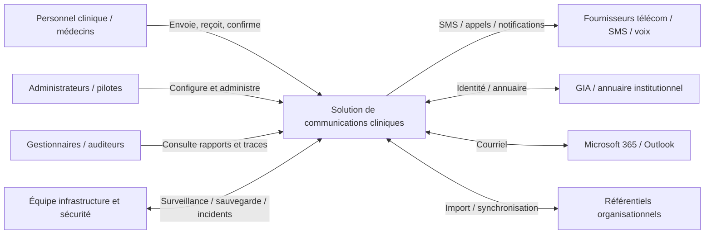
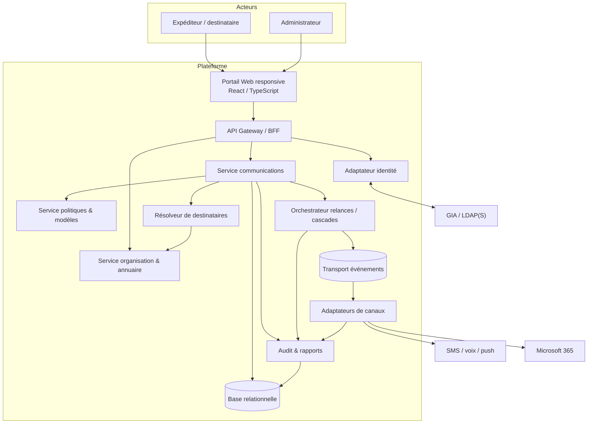
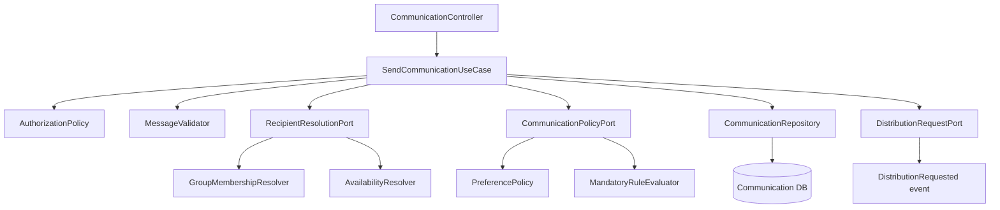
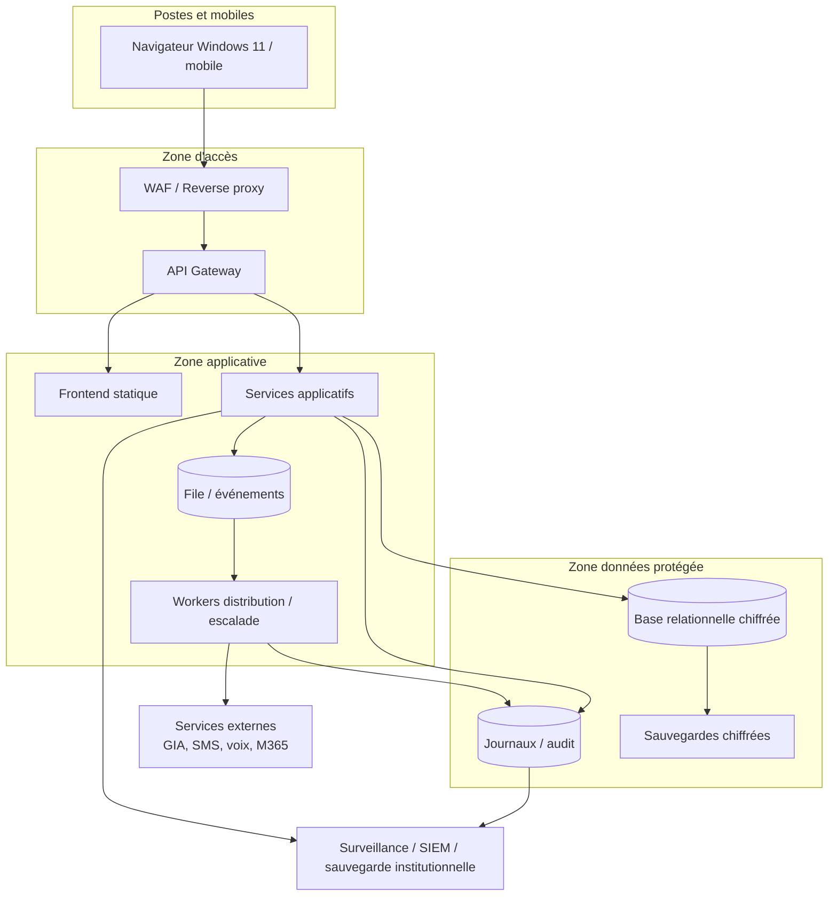

# Diagrammes C4 — C1 à C4

Les diagrammes sont fournis en Mermaid/PlantUML source pour être versionnés et régénérés. Les noms de composants sont logiques; les technologies restent indicatives.

## C1 — Contexte système

## C2 — Conteneurs

## C3 — Composants du service de communication

## C4 — Déploiement logique

## Lecture et réserves
- C1 expose les acteurs et systèmes externes.
- C2 montre les conteneurs logiques et leurs échanges.
- C3 détaille le service central de communication.
- C4 représente les zones de déploiement sans imposer de fournisseur cloud.
- Les flux réels, zones réseau, certificats, protocoles et frontières de confiance doivent être validés par l'architecture institutionnelle.
