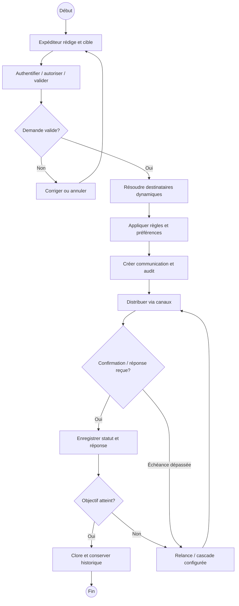

# Processus BPMN 2.0 — tableaux et flux

Les tableaux décrivent les éléments BPMN (événements, tâches, passerelles, flux de séquence et responsabilités). Le diagramme Mermaid est une vue de processus simplifiée; il ne remplace pas un fichier BPMN XML exécutable.

## BPMN-01 — Envoyer une communication clinique et escalader
| Étape | Type BPMN 2.0 | Participant / lane | Entrée | Traitement / règle | Sortie |
|---|---|---|---|---|---|
| E01 | Start Event | Expéditeur | Besoin de communiquer | Début du processus | Demande |
| T01 | User Task | Expéditeur | Besoin | Rédiger message, choisir destinataire/groupe, priorité et confirmation | Brouillon |
| T02 | Service Task | Plateforme | Brouillon | Authentifier, autoriser, valider contenu et cible | Demande validée |
| G01 | Exclusive Gateway | Plateforme | Validation | Valide? | Oui/non |
| T03 | User Task | Expéditeur | Erreurs | Corriger ou annuler | Brouillon corrigé |
| T04 | Service Task | Plateforme | Cible | Résoudre groupe, membres, disponibilité et canaux | Liste effective |
| T05 | Service Task | Plateforme | Liste | Appliquer règles obligatoires et préférences | Plan de diffusion |
| T06 | Service Task | Plateforme | Plan | Créer communication, tentatives et événements d'audit | Communication créée |
| T07 | Service Task | Adaptateur canal | Tentative | Transmettre par canal configuré | Résultat technique |
| G02 | Event-based Gateway | Plateforme | Communication diffusée | Attendre accusé, réponse ou échéance | Événement reçu |
| T08 | Service Task | Plateforme | Accusé | Enregistrer reçu/lu/prise en charge/réponse | Statut mis à jour |
| G03 | Exclusive Gateway | Plateforme | Statut + règles | Condition de succès atteinte? | Oui/non |
| T09 | Service Task | Orchestrateur | Délai dépassé | Déclencher relance/cascade selon configuration | Nouvelle tentative/étape |
| T10 | Service Task | Plateforme | Succès ou arrêt | Clore orchestration et conserver historique | Communication suivie |
| E02 | End Event | Plateforme | Clôture | Fin | Historique consultable |

## BPMN-01 — Vue séquentielle

## BPMN-02 — Administrer les référentiels dynamiques
| Étape | Type BPMN | Acteur | Description |
|---|---|---|---|
| A01 | Start Event | Administrateur | Besoin de modifier la structure |
| A02 | User Task | Administrateur | Créer/modifier site, unité, service, groupe ou règle |
| A03 | Service Task | Plateforme | Valider unicité, dates d'effet, dépendances et permissions |
| A04 | Exclusive Gateway | Plateforme | Validation réussie? |
| A05 | User Task | Administrateur | Corriger les erreurs |
| A06 | Service Task | Plateforme | Enregistrer nouvelle version et audit |
| A07 | End Event | Plateforme | Configuration publiée |

## BPMN-03 — Synchroniser l'annuaire
| Étape | Type BPMN | Acteur | Description |
|---|---|---|---|
| S01 | Timer / Message Start | Planificateur ou événement IAM | Déclenchement synchronisation |
| S02 | Service Task | Adaptateur IAM | Lire les identités autorisées |
| S03 | Service Task | Plateforme | Mapper attributs et unités externes vers référentiels configurés |
| S04 | Gateway | Plateforme | Données valides? |
| S05 | Service Task | Plateforme | Appliquer créations, changements, suspensions |
| S06 | Service Task | Plateforme | Journaliser écarts et résultat |
| S07 | End Event | Plateforme | Synchronisation terminée |

## BPMN-04 — Gestion incident critique
| Étape | Type BPMN | Acteur | Description |
|---|---|---|---|
| I01 | Message Start | Monitoring / utilisateur | Incident détecté |
| I02 | Service Task | Soutien | Créer incident et classifier |
| I03 | Gateway | Soutien | Critique? |
| I04 | Service Task | Soutien | Activer soutien critique 24/7 en français |
| I05 | Service Task | Fournisseur + organisme | Contenir, communiquer, restaurer |
| I06 | Service Task | Fournisseur | Analyse cause, correctif et rapport |
| I07 | End Event | Organisme | Acceptation de résolution |

## Règles de modélisation
- Les délais et séquences sont stockés en configuration versionnée, jamais dans le code.
- Chaque timer possède une date d'échéance persistée et peut être repris après redémarrage.
- Les transitions de processus sont idempotentes.
- Les processus cliniques critiques nécessitent validation métier et analyse de risques avant activation.
