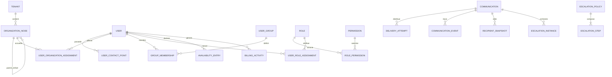

# MCD — Modèle conceptuel de données dynamique

## Principes de modélisation
Aucune liste métier n'est codée en dur. Les sites, établissements, unités, spécialités, groupes, rôles, canaux, priorités, statuts extensibles, modèles, réponses, règles de cascade et paramètres sont des données administrables. Les clés primaires techniques sont générées; les codes métier sont configurables et non utilisés comme clés de programmation.

## Entités principales
| Entité | Attributs principaux | Notes |
|---|---|---|
| Tenant | id, name, status, created_at | Frontière organisationnelle logique; si mono-organisme, un tenant initial |
| OrganizationNode | id, tenant_id, parent_id, node_type_id, name, external_ref, valid_from, valid_to | Arbre dynamique établissement/site/unité/service/spécialité |
| OrganizationNodeType | id, code, label, configuration | Types administrables |
| User | id, tenant_id, external_id, first_name, last_name, display_name, status, preferred_locale | Identité applicative; external_id unique par source |
| UserContactPoint | id, user_id, channel_type_id, encrypted_value, verified_at, is_primary | Coordonnées protégées |
| UserOrganizationAssignment | id, user_id, organization_node_id, role_id, valid_from, valid_to | Affectations multiples et temporaires |
| UserGroup | id, tenant_id, name, description, status, valid_from, valid_to | Groupe dynamique |
| GroupMembership | id, group_id, user_id, membership_rule_id, valid_from, valid_to, source | Adhésion explicite ou dérivée |
| MembershipRule | id, name, rule_definition_json, version, enabled | Critères dynamiques, validés et audités |
| Role | id, name, description, scope_type_id | Rôles configurables |
| Permission | id, resource, action, description | Catalogue extensible de permissions |
| RolePermission | role_id, permission_id | Association |
| UserRoleAssignment | id, user_id, role_id, scope_node_id, valid_from, valid_to | Attribution contextualisée |
| ChannelType | id, code, label, provider_config_id, enabled | SMS, push, email, voice, etc. configurables |
| ProviderConfig | id, provider_type, endpoint_ref, secret_ref, settings_json, status | Secrets externalisés, jamais stockés en clair |
| Communication | id, tenant_id, conversation_id, sender_user_id, content_ref, content_ciphertext, priority_type_id, created_at, status_type_id | Contenu protégé et statut extensible |
| Conversation | id, subject, created_at, retention_policy_id | Fil de discussion |
| CommunicationTarget | id, communication_id, target_type, target_id, resolved_at | Cible individuelle ou groupe |
| RecipientSnapshot | id, communication_id, user_id, resolution_reason, resolved_at | Snapshot de résolution pour preuve historique |
| DeliveryAttempt | id, communication_id, user_id, channel_type_id, provider_message_ref, attempt_no, status_type_id, attempted_at, result_at | Tentative par canal |
| CommunicationEvent | id, communication_id, user_id, event_type_id, event_at, metadata_json | Envoyé, reçu, lu, répondu, pris en charge |
| MessageTemplate | id, name, category_id, content_template, enabled, version | Modèles configurables |
| QuickReply | id, name, content, enabled, version | Réponses prédéfinies |
| RecipientPreference | id, user_id, channel_type_id, preference, effective_from, effective_to | Préférence soumise aux règles obligatoires |
| MandatoryCommunicationRule | id, name, rule_json, priority, effective_from, effective_to, enabled | Règles impératives |
| EscalationPolicy | id, name, trigger_type_id, enabled, version | Politique de relance/cascade |
| EscalationStep | id, policy_id, sequence_no, target_type, target_ref, delay_seconds, channel_type_id, stop_condition_json | Étapes ordonnées |
| EscalationInstance | id, communication_id, policy_version, current_step, due_at, status | Instance exécutable persistante |
| AvailabilityCalendar | id, name, timezone, enabled | Calendrier configurable |
| AvailabilityEntry | id, calendar_id, user_id, start_at, end_at, availability_type_id, source | Disponibilités et absences |
| AuditEvent | id, actor_type, actor_id, action, resource_type, resource_id, occurred_at, correlation_id, payload_hash | Journal protégé/append-only |
| IntegrationMapping | id, source_system, source_entity, source_key, target_entity, target_id, mapping_version | Correspondance externe dynamique |
| BillingActivity | id, user_id, communication_id, activity_month, targeted_at, source_mechanism | Mesure vérifiable d'utilisateur actif |
| RetentionPolicy | id, name, retention_days, archive_rule, destruction_rule | Conservation/archivage/destruction |
| ReferenceValue | id, category, code, label, active, sort_order, metadata_json | Valeurs configurables (états, priorités, types) |

## Relations et cardinalités (synthèse)
| Relation | Cardinalité |
|---|---|
| Tenant — OrganizationNode | 1 à N |
| OrganizationNode — OrganizationNode (parent/enfant) | 0..1 à N |
| User — UserContactPoint | 1 à N |
| User — UserOrganizationAssignment | 1 à N |
| UserGroup — GroupMembership — User | N à N avec période de validité |
| Role — Permission via RolePermission | N à N |
| User — UserRoleAssignment — Role | N à N contextualisé |
| Communication — DeliveryAttempt | 1 à N |
| Communication — CommunicationEvent | 1 à N |
| Communication — RecipientSnapshot | 1 à N |
| EscalationPolicy — EscalationStep | 1 à N |
| Communication — EscalationInstance | 0..N |
| User — AvailabilityEntry | 1 à N |
| Communication — BillingActivity | 1 à N, dédupliqué par utilisateur/mois pour facturation |
| RetentionPolicy — Conversation / AuditEvent | 1 à N selon politique |

## Diagramme ER Mermaid

## Contraintes et invariants
1. Toute table métier est tenant-scoped lorsque la séparation organisationnelle s'applique.
2. Les dates d'effet sont obligatoires pour les affectations et règles qui peuvent évoluer.
3. Les groupes sont résolus à l'envoi; un snapshot des destinataires est conservé pour l'audit.
4. Une préférence ne peut pas neutraliser une règle obligatoire.
5. Les coordonnées sont chiffrées au repos et masquées selon les permissions.
6. Les statuts sont référencés par `ReferenceValue` ou tables de typologie; ne pas utiliser des chaînes dispersées dans le code.
7. La mesure facturable doit compter un utilisateur distinct par mois selon la définition contractuelle; les tentatives directes, groupe, garde et cascade alimentent la même mesure.
8. Les secrets des fournisseurs sont dans un coffre de secrets; `secret_ref` est une référence externe, pas une valeur secrète.
9. Les événements d'audit sont append-only et protégés contre altération.
10. Les suppressions de données doivent respecter les politiques de conservation, obligations légales et gel de destruction éventuel.

## Règles anti-références statiques
- Aucun `if group == "Urgences"` ni enum métier fermé pour établissements, unités, groupes, priorités ou canaux.
- Les IDs sont générés; aucune dépendance au nom ou code d'un site.
- Les politiques sont versionnées en base et validées par schéma.
- Les intégrations utilisent des mappings administrables.
- Les valeurs de référence sont extensibles; le code traite des capacités génériques.
