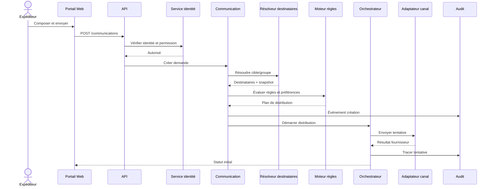
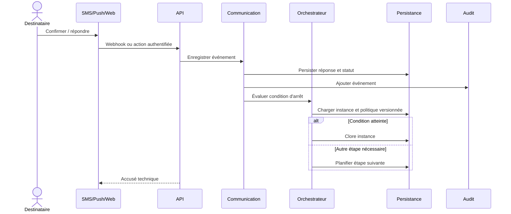
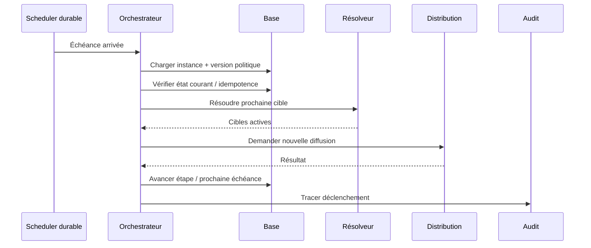
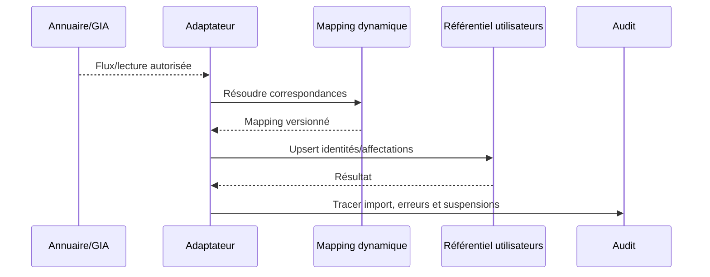
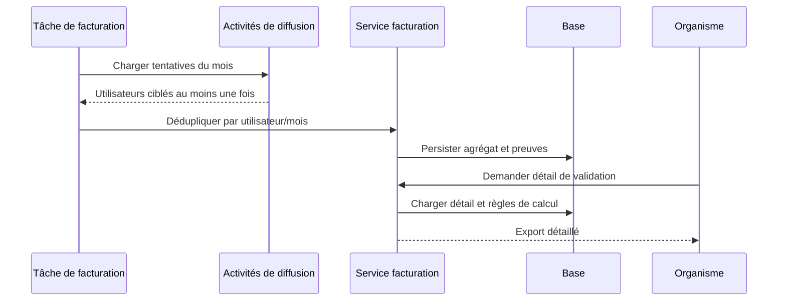

# Diagrammes de séquence

## SQ-01 — Envoi et distribution d'une communication

## SQ-02 — Réponse, confirmation et arrêt de cascade

## SQ-03 — Déclenchement d'une escalade

## SQ-04 — Synchronisation annuaire

## SQ-05 — Extraction des utilisateurs actifs facturables

