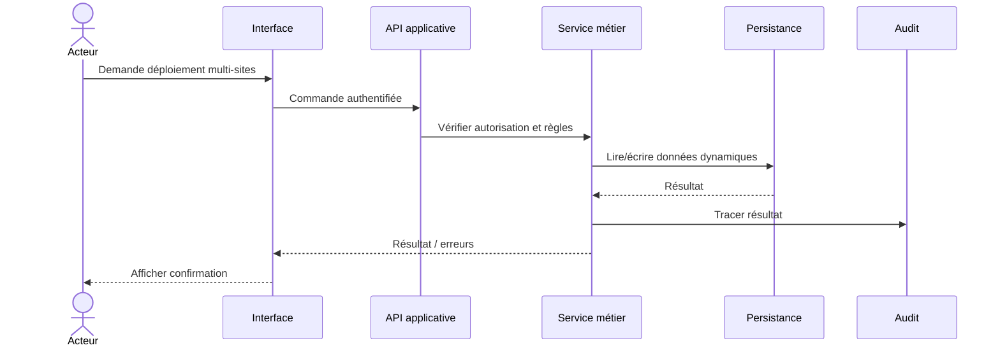

# ST-022 — Déploiement multi-sites

## User story
En tant que pilote de site, je veux activer progressivement la solution afin de limiter les risques opérationnels.

## Valeur métier
Cette story contribue à la modernisation des communications cliniques et à la sécurité opérationnelle en rendant la capacité déploiement multi-sites contrôlable, traçable et configurable.

## Analyse fonctionnelle
Paramétrage par site; checklist; feature toggles configurables; critères go/no-go.

## Données et entités concernées
- Identité et périmètre organisationnel lorsque pertinent.
- Entités métier décrites dans `02_architecture/04_MCD_modele_donnees_dynamique.md`.
- Configuration et valeurs de référence versionnées; aucune référence métier codée en dur.

## Règles de gestion
1. Autorisation vérifiée côté serveur.
2. Toute action significative est horodatée et auditée.
3. Les règles institutionnelles prévalent sur les préférences utilisateur.
4. Les changements de configuration prennent effet selon une date/version explicite.
5. Les erreurs d'intégration sont visibles, corrélées et rejouables de façon sûre.

## Séquence (vue simplifiée)

## Critères d'acceptation
Activation par site; retour arrière; acceptation locale documentée.

## Tests requis
- Tests unitaires des règles métier et validations.
- Tests d'intégration DB/API et permissions.
- Tests de non-régression sur les flux existants.
- Tests sécurité et audit pour les actions sensibles.
- Tests d'acceptation avec représentants métier.

## Dépendances
- Décisions d'architecture et d'intégration de la phase correspondante.
- Données de référence et règles métier validées par le client.

## ADR
Aucun ADR spécifique supplémentaire requis par défaut. Les décisions transverses applicables sont ADR-001 à ADR-007. Toute exception (nouveau canal, protocole, fournisseur ou règle critique) doit déclencher un ADR dédié.

## Definition of Done
- Code revu et testé.
- Tests automatisés réussis.
- Permissions et audit vérifiés.
- Documentation et aide utilisateur mises à jour.
- Critères d'acceptation démontrés et approbation obtenue.
