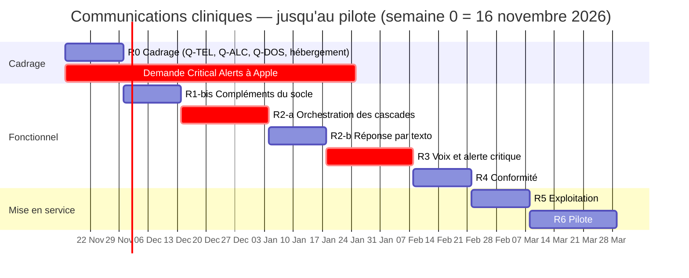

# FX-AO-20260810 : plan d'implantation du module « Communications cliniques »

> Écrit pour l'équipe de réalisation de VINA GEPS. Ce plan part de l'état réel du dépôt au
> 14 novembre 2026 : socle des alertes livré (ADR 0074, phase R1), branche `develop` au commit
> `b89a874`. Il remplace, pour l'exécution, la feuille de route de
> [05_roadmap_et_stories.md](05_roadmap_et_stories.md), qui reste la référence des stories et de
> leurs critères d'acceptation. Chaque phase dit ce qu'on bâtit, où dans le code, ce qu'on réutilise,
> comment on le vérifie, et ce qui doit être décidé avant de commencer.

## 1. En bref

| | |
|---|---|
| Point de départ | Le socle R1 est livré : envoyer une alerte priorisée, la lire, y répondre, la suivre. Il est vérifié de bout en bout contre le Java |
| Ce qui reste jusqu'au pilote | Compléments de R1 (R1-bis), relances et cascades (R2), voix et alerte critique (R3), conformité (R4), exploitation (R5), pilote (R6) |
| Durée jusqu'au pilote | **environ 19 semaines** (21 au départ : le socle en a économisé deux) |
| Décisions qui bloquent | ~~Q-TEL~~ tranché le 14 novembre 2026 : **Twilio** ; Q-ALC (*Critical Alerts* d'Apple) avant R3-b ; Q-DOS (sens de « note au dossier ») avant ST-G12 ; profil d'hébergement (A ou B) avant R5 |
| Ce qu'on ne refait pas | Identité et OIDC, messagerie, avis multi-canaux, journal, rétention, superadmin, sauvegardes, soutien, accessibilité. Voir 05, § 3 |

## 2. Point de départ : ce que le socle livre, story par story

| Story | Livré dans le socle | Reste à faire |
|---|---|---|
| ST-G01 Console d'alerte | Priorité en enum ; destinataires (personnes, unités) résolus et figés à l'envoi ; la priorité critique force tous les canaux ; envoi sans destinataire refusé | Capacité `alertes.critique` ; cible « liste de distribution » ; copie par courriel activable par organisme (critère 8) |
| ST-G02 Modèles et réponses | Réponses à sémantique fermée (`PRISE_EN_CHARGE`, `REFUS`, `INFORMATION`) ; modèles et réponses désactivés, jamais effacés ; libellés copiés dans l'alerte | **Version** et date de chaque modèle ; modèles visibles selon le périmètre de l'expéditeur |
| ST-G03 Suivi | Par alerte et par destinataire : lue, répondue, prise en charge ; suivi partagé entre expéditeurs | Filtres (période, priorité, état, expéditeur) ; état « relancée » (vient avec R2) ; export CSV, XLSX et PDF/A |
| ST-G09 Groupes transverses | Les **unités** servent de groupes ; les **listes de distribution** existent dans la messagerie | Groupes de spécialité, de garde et de comité, avec appartenance datée et modérateurs, sans module d'effectifs |
| ST-G04 à ST-G13 | — | Tout |

Le code du socle est dans `backend-java/.../alertes/{domaine,application,infrastructure}` (changeset
`0006-alertes.xml`) et `frontend/src/alertes/`. Ses essais :
- `AlertesTest` et `ControleurAlertesHttpTest` ;
- la BDD `13-alertes.feature` ;
- l'e2e `urgences-sante-alertes.spec.ts`.

### Ce que le dépôt fournit déjà aux phases suivantes

| Besoin | Brique existante | Où |
|---|---|---|
| Étapes de cascade qui survivent à un redémarrage | Ordonnanceur durable : tâches différées avec échéance, verrou, reprises (`PolitiqueRetentative`) | `ordonnanceur/` (`TacheDifferee`, `Executeur`, `BoucleOrdonnanceur`) |
| Envoyer sur un canal | Port de publication des avis, canaux et préférences par événement | `notifications/` (ADR 0029), `PublicationAvis` |
| Appel sortant | Port `Appels.PorteurAppelSortant`, adaptateur `AppelHttp` (Twilio), numéro de l'organisme | `notifications/domaine/Appels.java` (ADR 0022) |
| Disponibilité d'une personne | Disponibilités et horaires publiés | `effectifs/` (port à exposer en lecture : `DisponibiliteDestinataires`) |
| Exports | Moteur de rapports CSV, XLSX et PDF | `rapports/` (`ExportsRapports`, `MoteurRapports`) |
| Listes de personnes | Listes de distribution | `communication/domaine/ListesDistribution.java` |
| Journal des gestes | Journal d'actions (ADR 0041) | `partage/journal` |

## 3. Règles d'implantation communes

- **Un contexte, `alertes`**, découpé en `domaine` / `application` / `infrastructure/{web,persistance,configuration}`.
  Il ne lit jamais les tables d'un autre contexte : il passe par un port, déclaré dans `partage/…`
  s'il est partagé (`ArchitectureTest` refuse les cycles).
- **Normes Java (ADR 0030)** : enums pour tout ensemble fermé (étape, état, canal, résultat d'appel) ;
  horloge et aléatoire injectés ; un gestionnaire par cas d'utilisation ; méthode de 20 lignes au plus.
  `normes-java-plafonds.properties` : `alertes=0`, à garder.
- **Schéma** : un changeset Liquibase par livraison (`0009-…`, `0010-…`), inclus dans le master,
  jamais la modification d'un changeset appliqué ; la table s'ajoute aussi à `SchemaEssai`, et
  `SchemaLiquibaseTest` se met à jour.
- **Module** : tout reste derrière le module `alertes`, activable par organisme. Une route coupée
  répond 403 nommé.
- **Définition de « terminé »** pour chaque story :
  - un essai d'acceptation et un scénario BDD par critère de la grille cité ;
  - JaCoCo ≥ 96 % par classe ;
  - axe-core à zéro violation, et l'écran ajouté à l'audit géométrique (`audit-wcag22`), avec ses états ;
  - aucune commande collée à une autre (8 px) ;
  - fiche d'aide et guide des écrans à jour ;
  - OpenAPI à jour ;
  - un ADR si une décision structurante est prise.
- **Avant chaque commit** : `gitnexus detect_changes` sur un index **à jour**. Avertir sur un risque
  HIGH ou CRITICAL.

## 4. Les phases

### R0 — Cadrage · 2 semaines · à commencer maintenant

| Décision | Qui | Bloque |
|---|---|---|
| Q-TEL : fournisseur voix et texto — **tranché : Twilio** (décision technologique de l'équipe VINA, 14 novembre 2026). Reste : les numéros par organisme | Équipe VINA | Plus rien : R2-b et R3-a peuvent suivre R2-a |
| Q-ALC : demande d'autorisation *Critical Alerts* à Apple | Client (compte développeur) | R3-b, côté iOS. **Délai d'Apple inconnu : déposer la demande dès R0** |
| Q-DOS : « note au dossier » = note interne à VINA GEPS, ou écriture au dossier patient ? | Client (clinique) | ST-G12 seulement |
| Profil d'hébergement A (infonuagique) ou B (chez l'établissement : Windows Server, VMware) | Client et TI | R5 |
| ADR 0074 accepté pour les phases R2 et suivantes | Équipe VINA | Tout R2 |

**Sortie** : décisions consignées dans l'ADR 0074 (section « Points ouverts » fermée).

### R1-bis — Compléments du socle · 2 semaines · **livré le 14 novembre 2026**

> **Livré** : capacité `alertes.critique` (administration et direction ; un modèle critique n'est pas
> proposé sans elle) ; cible « liste de distribution » ; réglage « copie par courriel » ; modèles
> versionnés (`alr_modele_versions`, changeset `0009`) et visibles selon leur périmètre ; suivi filtrable et
> exportable (CSV, XLSX, PDF, JSON, cellules neutralisées contre l'injection de formule) ; groupes
> transverses dans le contexte `communication` (changeset `0010`), vus par la messagerie, les listes et les
> alertes, jamais par l'acheminement des appels. Vérifié : essais Java (`ControleurAlertesHttpTest`,
> `GroupesTransversesTest`, `ControleurGroupesTransversesHttpTest`), BDD `13-alertes.feature`, vitest
> (`alertes.test.tsx`, `alertes-r1bis.test.tsx`), audit d'interface, e2e `urgences-sante-alertes.spec.ts`
> contre le Java. Grille fonctionnelle : 21 acquis sur 32.

| Story | Tâches |
|---|---|
| ST-G01 | Capacité `alertes.critique` dans `politique-acces.json`, exigée par `GestionnaireEnvoiAlertes` pour `Priorite.CRITIQUE` (mettre à jour `DecisionAccesTest`). Cible « liste » : `AnnuaireAlertes` résout aussi une liste de distribution, par un port de lecture de `communication`. Option d'organisme « copie par courriel », lue par l'envoi |
| ST-G02 | Table `alr_modele_versions` (changeset `0009`) : chaque modification crée une version datée ; l'alerte retient la version envoyée. Visibilité des modèles par périmètre (unités de l'expéditeur) |
| ST-G03 | Filtres de `/api/alertes/envoyees` (période, priorité, état, expéditeur), validés à la frontière. Export par le moteur de rapports : une source `alertes_suivi` au catalogue |
| ST-G09 | Groupes transverses : `alr_groupes` et `alr_groupe_membres` (appartenance datée, modérateurs). `AnnuaireAlertes` les résout comme les unités. Écran d'administration ; visibles aussi dans la messagerie, par un port partagé |

**Vérification** : BDD des critères 1, 5, 6, 7, 8, 9, 10, 11, 12, 27, 31, 32 ; e2e
`urgences-sante-alertes.spec.ts` étendu (liste, groupe transverse, export).
**Sortie** : démonstration interne. Une alerte critique part vers un groupe de garde, se suit et
s'exporte.

### R2 — Relances et cascades · 5 semaines

**R2-a · Orchestration (3 semaines, ST-G04)** — ne dépend d'aucune décision externe.

> **Livré le 14 novembre 2026** (ADR 0077) : politiques versionnées (changeset `0013`), cascades armées à l'envoi,
> étapes « relancer les sans-réaction », « groupe », « personne », « prochain disponible » (port partagé
> `DisponibiliteDestinatairesPort`, implanté par les effectifs) ; arrêt à la prise en charge ou quand tous ont lu,
> aussitôt la réaction ; reprise manuelle tracée ; trace en ajout seul. Deux tâches durables par étape (`alerte.etape`
> décide sous verrou optimiste, `alerte.relance` envoie). Vérifié : `CascadesTest`, `ControleurCascadesHttpTest`
> (redémarrage avant et après l'écriture, concurrence), BDD `13-alertes.feature`, vitest `alertes-cascades.test.tsx`,
> audit d'interface, e2e `urgences-sante-alertes.spec.ts` contre le Java (étape exécutée par l'ordonnanceur réel).
> Grille fonctionnelle : 26 acquis sur 32.

| Couche | Ce qu'on bâtit |
|---|---|
| Domaine | `Politique` (suite d'étapes : cible, canaux, délai ; critère d'arrêt `PRISE_EN_CHARGE` ou `TOUTES_LUES`), **versionnée** ; `Cascade` (état d'une alerte dans sa politique : étape courante, prochaine échéance, arrêtée et pourquoi). Pur, horloge injectée |
| Application | `GestionnaireCascades` : armer à l'envoi, avancer à l'échéance, **arrêter** à la première prise en charge, **reprendre** à une étape choisie (geste journalisé) |
| Infrastructure | Un `Executeur` de l'ordonnanceur, de type `alerte.etape` : une tâche différée par échéance, idempotente (clé alerte et étape), pour qu'un redémarrage ne perde ni ne double rien. Tables `alr_politiques`, `alr_politique_etapes`, `alr_cascades` (changeset `0010`) |
| Option « prochain disponible » | Port `DisponibiliteDestinataires`, implanté côté `effectifs` (horaire publié, absences) |
| Écrans | Politiques (administration) ; dans le suivi, l'étape courante, l'état « relancée », et le bouton « Reprendre à l'étape… » |

**Essais obligatoires** :
- Java « redémarrage en cours de cascade » : arrêter la boucle entre deux étapes, puis reprendre ;
  ni perte ni doublon ;
- essais de concurrence : deux instances, une seule exécute l'étape ;
- BDD des critères 15, 16, 17, 19, 25 et 32.

**R2-b · Réponse par texto (2 semaines, ST-G05)** — par Twilio (Q-TEL tranché).

> **Livré le 14 novembre 2026** (ADR 0078) : `POST /api/alertes/webhooks/texto`, public, gardé par la signature
> `X-Twilio-Signature` (vérifiée avant toute lecture ; le pare-feu applicatif borne le débit), réponse TwiML. Le texto
> se rattache à la remise sans réponse la plus récente de ce numéro (fiche, normalisée en E.164) ; « 1 »/« OK » prend
> en charge, « 2 »/« NON » refuse, et la réponse passe par la même porte qu'à l'écran — elle arrête donc la cascade.
> Un mot inconnu reçoit l'aide, jamais compté ; un `MessageSid` rejoué est ignoré (changeset `0014`, contenu non
> conservé). La signature et la normalisation des numéros vivent désormais dans `partage/telephonie`. Vérifié :
> `TextosEntrantsTest`, `ControleurWebhooksAlertesHttpTest`, BDD (porte refusée sans signature). Grille : 27 sur 32.
- Webhook entrant `/api/alertes/webhooks/texto`, avec la **signature Twilio vérifiée**
  (`X-Twilio-Signature`, HMAC-SHA1 de l'URL et des paramètres), sans session, limité en débit.
- Rattachement à la dernière alerte ouverte vers ce numéro. « 1 » ou « OK » vaut prise en charge,
  « 2 » vaut refus ; un mot inconnu reçoit une réponse d'aide et n'est **jamais** compté comme une
  confirmation.
- Essais : signature fausse (403), rejeu, numéro inconnu, mot inconnu ; BDD des critères 4, 9, 10.

**Sortie** : une cascade de 3 étapes s'arrête à une prise en charge par texto, et se rejoue
correctement après une panne simulée.

### R3 — Voix et alerte critique · 3 semaines

**R3-a · Appel automatique (ST-G06)** — par Twilio (Q-TEL tranché).

> **Livré le 14 novembre 2026** (ADR 0079) : canal d'étape `appel` (jamais imposé par la priorité critique) ; une tâche
> durable `alerte.appel` par personne, idempotente ; port partagé `AppelsVocauxPort` implanté par les notifications
> (Twilio : `<Gather>` en synthèse `fr-CA`, détection de répondeur, rappel de statut ; simulateur sinon) ; rappels
> signés `/api/alertes/webhooks/voix` (touche) et `/voix/statut` (résultat, durée) ; « 1 » passe par la même porte
> qu'à l'écran et arrête la cascade. Résultats en enum, trace `alr_appels` (changeset `0015`, numéro non conservé),
> visibles dans la fiche du suivi. Vérifié : `AppelsAlertesTest`, `ControleurCascadesHttpTest` (appel, touche, signature
> fausse, rejeu de tâche, messagerie, sans numéro, refus), `AdaptateursFournisseursTest`, BDD, vitest, audit. Grille :
> 29 sur 32.
- L'étape de cascade de canal `APPEL` passe par le port `Appels`. On l'étend : message en
  synthèse vocale française, saisie d'un chiffre (DTMF), puis un rappel du fournisseur signé vers
  `/api/alertes/webhooks/voix`.
- « Appuyez sur 1 » vaut prise en charge et arrête la cascade. Le résultat (répondu, messagerie
  vocale, échec, occupé) et la durée sont journalisés, en enum.
- Essais : un faux fournisseur rejoue chaque issue ; BDD des critères 13 et 14.

**R3-b · Alerte critique sur mobile (ST-G07)**

> **Livré côté serveur le 14 novembre 2026** (ADR 0080) : événement d'avis `alerte.critique` (essentiel) pour toute
> alerte et toute relance de priorité critique ; poussée étiquetée `critique` : Expo en priorité haute, canal Android
> `critique`, `interruptionLevel: critical` et son critique iOS ; navigateur : `requireInteraction` et vibration
> prolongée. **Reste hors de ce dépôt** : l'application mobile déclare le canal `critique` (importance maximale,
> contournement du « ne pas déranger » si l'utilisateur l'autorise) ; iOS attend Q-ALC. Repli documenté : la cascade
> (texto, puis appel).
- Android : canal de notification « Critique », importance maximale, contournement du mode
  silencieux si la permission est accordée.
- iOS : *Critical Alerts* si Apple l'a accordé (Q-ALC). Sinon, le **repli documenté** : son
  prolongé, puis texto, puis appel, déjà assuré par la cascade de R2.
- Le destinataire ne peut pas couper un canal que la priorité rend obligatoire. C'est la règle R8
  du socle, étendue au mobile.

**Sortie** : une alerte critique sans réponse escalade jusqu'à l'appel, et l'appel est confirmé au clavier.

### R4 — Conformité · 2 semaines

| Story | Tâches |
|---|---|
| ST-G08 Utilisateurs actifs | **Livré le 15 novembre 2026** : compté à la lecture, sans table d'agrégat à tenir — les tentatives sont déjà tracées (remises, étapes de cascade, appels). Une fois par mois civil de Toronto, première tentative et alerte en cause ; `GET /api/alertes/utilisateurs-actifs` et son export (CSV, XLSX, PDF, JSON), réservés à `alertes.configure` ; section « Utilisateurs actifs » des Paramètres des alertes. Vérifié : `ControleurUtilisateursActifsHttpTest` (frontière de minuit à Toronto, heure d'été, trois sources), BDD, vitest, audit |
| ST-G10 Mots de passe, PDF/A | **Livré le 15 novembre 2026** (ADR 0081) : historique dans `DepotComptes.modifier`, seul point d'écriture du mot de passe (changeset `0016`) ; `DocumentPdf`, seul producteur de PDF, produit du PDF/A-2b (Liberation Sans incorporée, sRGB, XMP, identifiant). veraPDF : `scripts/verifier-pdfa.sh`, en CI après `mvn verify` — **pas encore exécuté** |
| ST-G11 Microsoft 365, LDAPS | **Graph livré le 15 novembre 2026** (ADR 0082) : `CourrierGraph`, troisième adaptateur du port `Courrier`, choisi dès que `GRAPH_CLIENT_ID` est posé ; essais contre un faux Entra et un faux Graph. **LDAPS différé** : l'OIDC générique couvre Entra, Keycloak et un AD fédéré ; à bâtir sur réponse à Q-LDAP, avec un serveur LDAP d'essai (UnboundID) pour l'éprouver |
| ST-G12 Note | **Livré le 15 novembre 2026, dans la lecture « note interne » de Q-DOS** : une note par destinataire (280 caractères), datée et signée, tenue dans la fiche du suivi par qui a `alertes.envoyer` ; rien de son texte au journal. Vérifié : `ControleurNotesHttpTest`, BDD, vitest, audit. Si Q-DOS répond « dossier patient » : intégration à part |

**Sortie** : grille fonctionnelle à 31 sur 32, puis 32 sur 32 selon la réponse à Q-DOS. Le
tableau de [02_conformite_115_criteres.md](02_conformite_115_criteres.md) est mis à jour critère par critère.

### R5 — Exploitation · 2 semaines

- ST-G13 selon le profil retenu : guide Windows Server 2019+ et VMware vSphere 8 (profil B), ou
  la pile Docker et Terraform existante (profil A).

> **ST-G13, partie documentaire et retour arrière : livrés le 15 novembre 2026.** Guide du profil B
> ([09_exploitation_chez_l_etablissement.md](09_exploitation_chez_l_etablissement.md) : installation Windows Server 2019+
> et vSphere 8, service, frontal TLS, sauvegardes chiffrées, archivage, surveillance) ; profil A déjà décrit
> (COPIES-DE-SECURITE.md, Terraform). Retour arrière de schéma : un script de retour par changeset depuis `0006`
> (`db/retour/`), éprouvé par `RetourArriereSchemaTest`. **Reste**, après le choix du profil : l'essai de restauration
> sur l'infrastructure retenue et la campagne JMeter à 2 000 utilisateurs (go ou no-go).
- Archivage, sauvegardes chiffrées, **retour arrière** de version et de schéma (changesets de
  retour pour `0006` et les suivants).
- Campagne JMeter à 2 000 utilisateurs : envoi d'alertes, cascades simultanées, rappels de
  webhooks. Lire la couverture utile (part de réponses 2xx) avant toute latence. Essai de restauration.

**Sortie** : décision technique de mise en service (go ou no-go).

### R6 — Pilote · 3 semaines

Formation de deux pilotes, import initial (personnes, groupes, politiques), un site (par exemple
l'Hôpital de Saint-Jérôme). Les réglages par organisme se font depuis le superadmin : module
`alertes`, politiques, groupes. **Sortie** : acceptation du pilote.

### R7 — Déploiement · selon le calendrier du client

Les cinq autres sites, vague par vague. **Sortie** : acceptation par site.

## 5. Calendrier et chemin critique

Le **chemin critique** passe par R2-a, puis R3. L'orchestration durable est le seul morceau
neuf et difficile ; la voix en dépend. Deux pistes se mènent en parallèle si l'équipe compte
deux personnes : ST-G10 et ST-G11 (R4) n'attendent rien et peuvent avancer pendant R2.

| Jalon | Semaine | Preuve |
|---|---|---|
| Décisions de cadrage | 2 | ADR 0074 sans point ouvert |
| Alerte vers un groupe de garde, suivie et exportée | 4 | e2e contre le Java |
| Cascade arrêtée par texto, rejouée après panne | 9 | Essai « redémarrage » et e2e |
| Escalade jusqu'à l'appel confirmé au clavier | 12 | e2e avec un faux fournisseur de voix |
| Grille à 31 sur 32 | 14 | 02_conformite à jour, BDD vertes |
| Décision de mise en service | 16 | Rapport JMeter, essai de restauration |
| Pilote accepté | 19 | Procès-verbal du client |

## 6. Risques

| Risque | Effet | Parade |
|---|---|---|
| Apple tarde ou refuse *Critical Alerts* | iOS sans alerte qui contourne le silencieux | Repli documenté dès R2 (texto puis appel) ; demande déposée en R0 |
| Fournisseur de voix imposé tardivement | R3 glisse | Port `Appels` et faux fournisseur : on bâtit et on vérifie sans le fournisseur réel ; seul l'adaptateur attend |
| Doublons ou pertes d'étapes de cascade | Une alerte critique part deux fois, ou jamais | Tâches différées idempotentes, essais de redémarrage et de concurrence obligatoires avant R2-b |
| Webhooks entrants falsifiés | Fausse prise en charge | Signature vérifiée, rejeu refusé, limite de débit ; essais dédiés |
| Charge à 2 000 utilisateurs | Cascades en retard | JMeter en R5 ; budget de latence des échéances fixé en R2-a |
| Index GitNexus périmé | Analyses de changements aveugles aux symboles neufs | Réindexer avant chaque commit (la réindexation échouait le 14 novembre : base tenue par d'autres processus MCP, à régler) |
