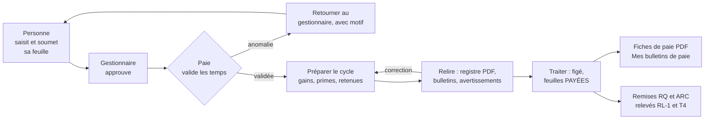
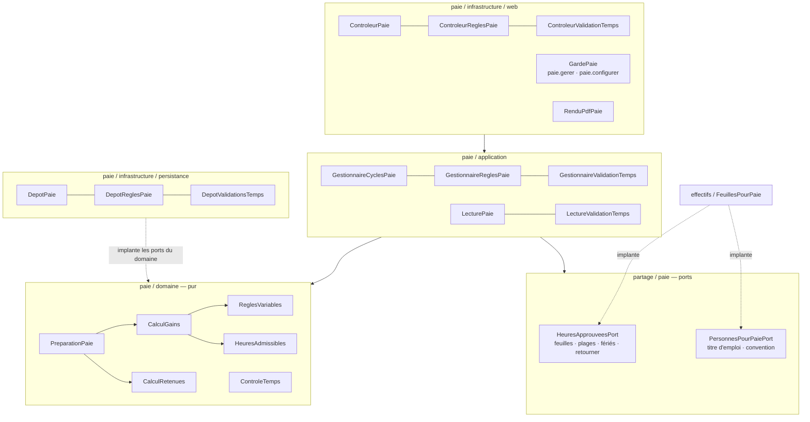
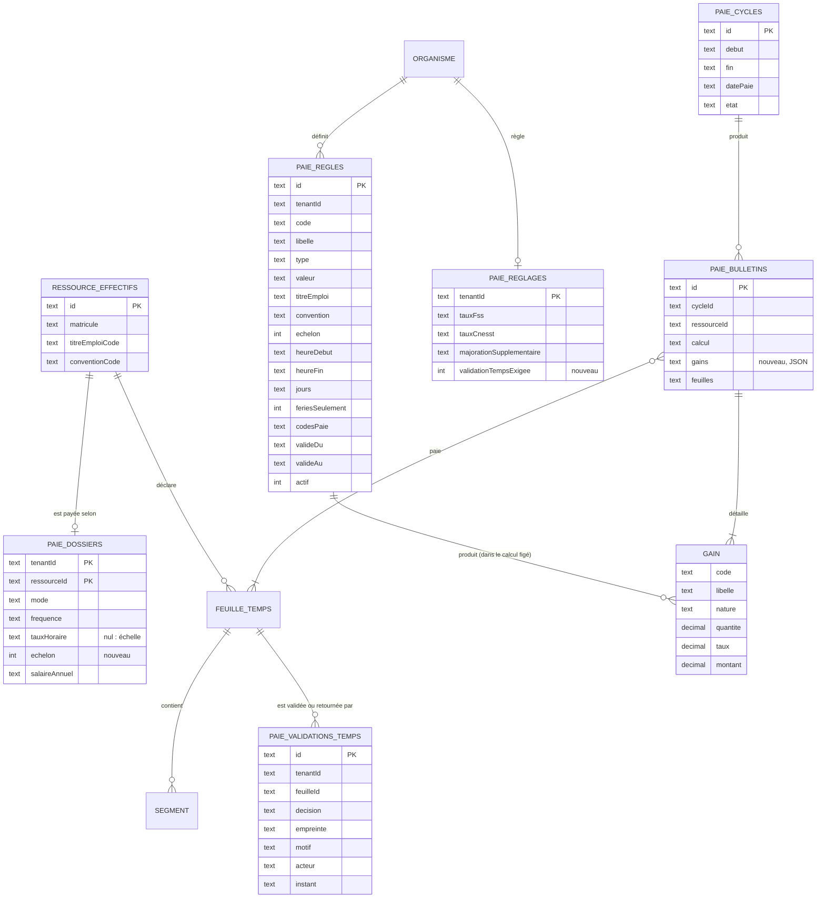

# Produire la paie d'un personnel de la santé — étude, conception et mode d'emploi

> Demande du 15 novembre 2026 : « Comment un profil RH ou comptable peut produire une paie pour un personnel ?
> Valider les temps, puis produire la paie, l'export PDF (fiche de paie), et gérer des règles de paie variable
> depuis l'espace d'administration de l'organisme, comme dans Nexu VINA. »
>
> Décision structurante : [ADR 0084](../adr/0084-regles-de-paie-variable-et-validation-des-temps.md).
> Socle repris : [ADR 0076](../adr/0076-module-de-paie-quebecois.md) (cycle, retenues, remises, relevés).

## 1. Le métier

### 1.1 Ce qu'était le produit avant cette demande

Le module de paie (ADR 0076) calculait déjà un bulletin québécois complet à partir des feuilles **approuvées** : brut,
impôts fédéral et du Québec, RRQ, AE, RQAP, cotisations de l'employeur, remises et relevés. Trois manques
empêchaient pourtant un service de la paie de s'en servir :

| Manque | Conséquence |
|---|---|
| Seule l'**administration** détenait `paie.gerer` | Un profil RH ou comptable n'avait aucun écran de paie. |
| Le brut ne connaissait que **heures × taux** et les heures supplémentaires | Les primes du réseau de la santé (soir, nuit, fin de semaine, férié, soins critiques) n'existaient pas. Le taux horaire était saisi à la main, personne par personne, sans échelle salariale. |
| Rien entre l'approbation du gestionnaire et le calcul | La paie payait ce que le gestionnaire approuvait, sans contrôle propre. Aucune fiche de paie ne pouvait être remise en PDF. |

### 1.2 Comment se paie un personnel de la santé au Québec

- **Le taux de base** découle du **titre d'emploi** (infirmière, infirmière auxiliaire, préposé aux bénéficiaires,
  paramédic…) et de l'**échelon**, qui reflète l'expérience reconnue. C'est l'**échelle salariale** de la convention
  collective (FIQ, APTS, CSN…), revue à date fixe. Un taux hors échelle reste possible, par dossier.
- **Les primes** se calculent sur les heures **travaillées** dans une plage, un jour ou une circonstance :
  - **soir** et **nuit** : un pourcentage du taux de base, pour chaque heure comprise dans la plage horaire ;
  - **fin de semaine** : un pourcentage, pour les heures du samedi et du dimanche ;
  - **férié travaillé** : une majoration, pour les heures d'un jour férié du calendrier de l'organisme ;
  - **soins critiques**, **responsabilité** ou **chef d'équipe** : un montant horaire ou un pourcentage, selon le titre
    d'emploi ;
  - **forfait** : un montant fixe par paie, par exemple une allocation de rétention.
- **Les heures supplémentaires** sont majorées de 50 % au moins (LNT, art. 55), davantage si la convention le prévoit.
  C'est la majoration des réglages ; une prime s'y ajoute quand l'heure supplémentaire tombe la nuit.

### 1.3 Les acteurs et la séparation des tâches

| Acteur | Ce qu'il fait | Ce qu'il ne fait pas |
|---|---|---|
| Personne salariée | Saisit et soumet sa feuille ; lit et télécharge **ses** fiches de paie | Voir la paie des autres |
| Gestionnaire (`manager`, `director`) | **Approuve** les heures de son équipe, ou les retourne | Toucher à la paie |
| **RH** (`rh`) | Tient les **échelles et les règles de paie variable**, les dossiers de rémunération et les réglages ; **valide les temps**, prépare et traite la paie | Approuver une feuille à la place du gestionnaire |
| **Comptable** (`accountant`) | **Valide les temps**, prépare et traite la paie ; lit le registre, les remises et les relevés | Modifier une règle, un taux ou un dossier |
| Administration (`admin`) | Tout ce qui précède, et l'abonnement au module | — |

Le gestionnaire approuve ce qu'il a vu travailler. La paie valide ce qu'elle va payer. **Les deux contrôles restent
distincts** : la paie ne réapprouve pas une feuille, et le gestionnaire n'entre pas dans la paie. Le comptable paie
selon des règles qu'il ne peut pas modifier lui-même.

### 1.4 Le processus, de la feuille au bulletin

## 2. Les règles de paie variable

Le modèle reprend celui de Nexu VINA : une règle est un **effet** déclenché par des **conditions**, sur une
**fenêtre de validité**. Les activités scolaires et les multiplicateurs de Nexu VINA deviennent ici les plages, les
jours et les titres d'emploi du réseau de la santé.

| Type | Valeur | Ce qu'elle produit |
|---|---|---|
| `taux-de-base` | $ / h | Le taux horaire de l'échelle pour un titre d'emploi, et un échelon s'il est précisé |
| `prime-pourcentage` | fraction (0,12 = 12 %) | Heures admissibles × taux de base × valeur |
| `prime-horaire` | $ / h | Heures admissibles × valeur |
| `forfait` | $ par paie | La valeur, une fois par bulletin, dès que la personne a des heures payées |

**Conditions** (toutes facultatives ; une condition absente ne filtre rien, et elles se combinent par « et ») :

- titre d'emploi et convention collective (ceux de la ressource d'effectifs) ;
- échelon (pour `taux-de-base` seulement) ;
- plage horaire (`heureDebut` – `heureFin`, en heure de Montréal ; une plage 23 h – 7 h passe minuit) ;
- jours de la semaine ;
- jours fériés seulement (calendrier des jours fériés de l'organisme) ;
- codes de paie des heures visées (par exemple `REG` seulement).

**Le calcul des heures admissibles.** Chaque segment payé d'une feuille garde son début et sa fin, convertis en heure
de Montréal. Pour chaque jour civil qu'il touche, si le jour remplit les conditions de jour (semaine, férié), on
compte le chevauchement du segment avec la plage horaire de ce jour, ou avec le jour entier sans plage. Un quart de
22 h à 6 h, la nuit du samedi au dimanche, compte donc 2 h de samedi et 6 h de dimanche pour une prime de fin de
semaine, et 8 h pour une prime de nuit de 0 h à 8 h et de 22 h à 24 h (deux règles, ou une plage 22 h – 8 h).

**Le taux de base** d'une heure se résout dans cet ordre :

1. le taux horaire **du dossier**, s'il est saisi (un taux hors échelle prime) ;
2. sinon, la règle `taux-de-base` en vigueur **à la date de l'heure** qui vise son titre d'emploi. Une règle qui
   précise l'échelon l'emporte sur celle qui ne le précise pas, puis celle qui précise la convention, puis la plus
   récente ;
3. sinon, la personne n'est pas payée et elle est nommée dans « taux introuvable ». Elle n'est jamais payée à 0 $ en
   silence.

Une augmentation au 1er avril se paie donc d'elle-même dans un cycle à cheval sur cette date : les heures de mars au
taux de mars, celles d'avril au taux d'avril. Le bulletin montre deux lignes, une par taux.

## 3. La validation des temps

Le réglage « Exiger la validation des temps par la paie » est désactivé par défaut, pour garder le comportement de
l'ADR 0076. Activé, il change la préparation : **seules les feuilles approuvées et validées** entrent dans un cycle.
Les autres sont nommées dans « non validées ».

L'écran **Validation des temps** montre, pour une période, chaque feuille et chaque personne active avec ses
anomalies :

| Anomalie | Bloque la validation ? | Sens |
|---|---|---|
| `aucune-feuille` | — | Personne active sans aucune feuille dans la période |
| `non-approuvee` | oui | Brouillon, soumise ou retournée : le gestionnaire n'a pas fini |
| `incalculable` | oui | Les effectifs ne savent pas coder ses heures (un type d'heure manque) |
| `sans-dossier` | non (elle ne sera pas payée) | Aucun dossier de rémunération |
| `sans-taux` | non (elle ne sera pas payée) | Ni taux au dossier, ni échelle pour son titre d'emploi |
| `heures-elevees` | non | Plus de 60 h dans la semaine : à vérifier |
| `validation-perimee` | non | Validée, mais ses heures ont changé depuis : à valider de nouveau |

**Une validation porte l'empreinte des heures validées** (SHA-256 de ses lignes). Si le gestionnaire rouvre la feuille,
qu'elle est corrigée puis réapprouvée, l'empreinte ne correspond plus : la validation est périmée, et la feuille
n'entre pas dans la paie sans un nouveau regard. On ne paie jamais des heures que personne à la paie n'a vues.

**Retourner** une feuille approuvée la rouvre au nom de la paie, avec un motif obligatoire : elle revient à la
personne, comme le geste « rouvrir » du gestionnaire. Une feuille payée ne se retourne pas.

## 4. Architecture

### 4.1 Les couches

- **Le domaine reste pur.** `CalculGains` reçoit les plages, les règles, le dossier, le profil et les jours fériés ; il
  ne lit ni horloge ni base. Les heures admissibles sont une fonction de dates locales.
- **La paie ne lit jamais les tables des effectifs.** Elle passe par les ports partagés, qui gagnent les plages en heure
  de Montréal, les jours fériés, la liste de toutes les feuilles d'une période (avec leur état) et le geste « retourner ».
- **Ouvert à l'extension** : un nouveau type de prime est une constante de `TypeRegle` et une branche du `switch`
  exhaustif de `CalculGains`, pas une condition dispersée.
- **Ports étroits** : lecture et écriture des règles d'un côté, des validations de l'autre ; le rendu PDF est un port
  de l'application (`RenduPaie`), implanté par PDFBox dans l'infrastructure (PDF/A-2b, ADR 0081).

### 4.2 Les droits

| Capacité | Rôles | Routes |
|---|---|---|
| (module seul) | tous | `GET /api/paie/mes-bulletins`, `GET /api/paie/mes-bulletins/{id}/pdf` (le sien seulement) |
| `paie.gerer` | admin, rh, accountant | validation des temps, cycles, bulletins d'un cycle, registre et fiches PDF, remises, relevés |
| `paie.configurer` | admin, rh | règles et échelles, dossiers de rémunération, réglages, barème |

## 5. Modèle conceptuel des données (MCD)

- Changeset **`0018-paie-regles-et-validation.xml`** : tables `paie_regles` et `paie_validations_temps`, colonnes
  `paie_dossiers.echelon`, `paie_reglages.validationTempsExigee` et `paie_bulletins.gains`.
- Les gains d'un bulletin sont **figés en JSON** avec lui, comme ses retenues. Une règle modifiée après le traitement ne
  réécrit pas une paie passée. Un bulletin antérieur au changeset (sans gains) se relit avec ses gains reconstitués des
  heures.
- Les validations s'**ajoutent** et ne se remplacent pas : la plus récente fait foi, l'historique reste lisible.

## 6. Les écrans

| Écran | Adresse | Qui | Ce qu'on y fait |
|---|---|---|---|
| Règles de paie variable | `/admin/paieregles` | admin, rh | Créer, modifier, désactiver une règle ; échelle salariale et primes, par type |
| Validation des temps | `/admin/paietemps` | admin, rh, comptable | Choisir une période ; valider une feuille ou toutes celles sans anomalie ; retourner avec motif |
| Cycles de paie | `/admin/paiecycles` | admin, rh, comptable | Préparer, relire, recalculer, traiter ; **registre PDF** ; fiche PDF de chaque bulletin |
| Dossiers de rémunération | `/admin/paiedossiers` | admin, rh | Mode, fréquence, **échelon** ou taux hors échelle ; titre d'emploi lu des effectifs |
| Paramètres de la paie | `/admin/paieparametres` | admin, rh | FSS, CNESST, majoration, **validation exigée** |
| Remises et relevés | `/admin/paiedeclarations` | admin, rh, comptable | Remises mensuelles, RL-1 et T4 |
| Mes bulletins de paie | `/admin/mesbulletins` | tous | Lire le détail (gains, retenues, net) et **télécharger la fiche PDF** |

## 7. Mode d'emploi — produire la paie d'une période

**Une fois, à la mise en place** (RH ou administration) :

1. *Paramètres de la paie* : taux FSS et CNESST de l'organisme, majoration des heures supplémentaires, et cocher
   « Exiger la validation des temps par la paie ».
2. *Règles de paie variable* : l'échelle (une règle `taux-de-base` par titre d'emploi et échelon), puis les primes
   (soir, nuit, fin de semaine, férié…).
3. *Dossiers de rémunération* : pour chaque personne, le mode, la fréquence et l'échelon. On ne saisit un taux horaire
   que pour une personne hors échelle.

**À chaque paie** (RH ou comptable) :

1. Les personnes soumettent leurs feuilles, et les gestionnaires les approuvent.
2. *Validation des temps* : choisir la période ; lire les anomalies ; « Valider les feuilles sans anomalie », puis
   traiter les autres une à une. Une feuille fautive se retourne avec un motif, qui dit quoi corriger.
3. *Cycles de paie* : « Préparer un cycle » (période et date de paie). Relire les avertissements : non validées, sans
   dossier, taux introuvable. Télécharger le **registre de paie (PDF)** et le vérifier. Recalculer après une correction.
4. « Traiter » : le cycle est figé et les feuilles passent à « payée ».
5. Chacun trouve sa fiche dans *Mes bulletins de paie* : « Voir » pour le détail, « Fiche PDF » pour la télécharger.
6. *Remises et relevés* : les montants à remettre à Revenu Québec et à l'ARC avant le 15 du mois suivant ; les relevés
   en fin d'année.

## 8. Ce qui reste hors du périmètre

Les éléments suivants restent hors périmètre, comme dans l'ADR 0076 : le dépôt direct (fichier bancaire), la
transmission XML des relevés, les paies rétroactives et la ventilation comptable. Les primes sont toutes traitées comme
des gains assujettis à toutes les retenues, ce qui est le cas des primes de quart, de fin de semaine et de férié.
