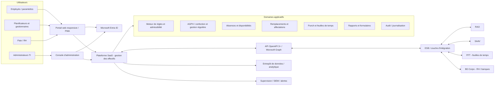

# Référentiel et limites de l'analyse

- **Source principale :** Appel d'offres 26-015-DO, *Système de gestion des effectifs (Solution infonuagique)*, Urgences-santé.
- **Fichier analysé :** `26-015-DO_AO (1).pdf`, 199 pages.
- **Parties repérées :** Régie, Contrat, Cahier de charges et devis technique, Formulaire de soumission, Questionnaire d'évaluation de la qualité et annexe/grille des critères de conformité.
- **Traçabilité :** les exigences E-* et P-* sont reprises des pages 194 à 198 du PDF (annexe 7.00 / critères de conformité). Le contexte d'affaires est repris principalement des pages PDF 145 à 151.
- **Précaution :** les annexes Excel externes mentionnées dans le PDF (grille détaillée des critères, bordereau de prix, questionnaire d'évaluation distinct) ne sont pas présentes comme fichiers séparés dans la pièce jointe. L'analyse ne prétend donc pas couvrir des éléments qui n'apparaissent pas dans le PDF.
- **Nature du document :** analyse de solution proposée, pas un avis juridique ni une preuve de conformité d'un produit fournisseur. Les choix d'architecture ci-dessous sont des recommandations à valider avec Urgences-santé et l'éditeur.

# 1. Synthèse exécutive

L'appel d'offres vise l'acquisition, l'implantation, l'intégration et l'exploitation en mode SaaS d'un système de gestion des effectifs. La portée fonctionnelle couvre la confection annuelle des horaires (AGPH), la gestion continue des horaires, les disponibilités, les absences, les remplacements, les déclarations de temps (« punch »), les feuilles de temps, les validations, les rapports et les échanges avec l'écosystème applicatif existant.

## 1.1 Contexte et objectifs métier

Le document décrit un environnement actuel fragmenté, peu automatisé et difficile à intégrer. Les règles de planification sont complexes et dépendent notamment des conventions collectives, ententes locales, ancienneté, compétences, statuts d'emploi et besoins opérationnels.

Les résultats attendus sont :
- une expérience employé moderne, conviviale et multi-appareils;
- l'automatisation maximale de la planification et de l'affectation;
- la réduction des validations manuelles par les gestionnaires;
- un meilleur contrôle des absences, présences et coûts de main-d'œuvre;
- des données RH/temps plus fiables pour la paie et l'analyse;
- la simplification de l'architecture TI et le décommissionnement des systèmes actuels ciblés.

## 1.2 Parties prenantes et volumétrie

| Partie prenante | Rôle décrit dans le cahier | Volumétrie explicite |
|---|---|---:|
| Direction Gestion des effectifs | Responsable affaires du projet, planification/suivi/réalisation des lots | 100 |
| Centre de communication santé | Client utilisateur du système des horaires | Non précisée |
| Direction des interventions | Client utilisateur du système des horaires | Non précisée |
| Direction de la logistique | Client utilisateur du système des horaires | Non précisée |
| Bureau de transformation | Encadrement en gestion de projet | Non précisée |
| Direction des ressources humaines | Directives RH, avantages sociaux, acquisition, relations de travail | Non précisée |
| Centre de formation | Planification des formations | Non précisée |
| Service de planification des horaires | Définition des besoins d'affaires | Non précisée |
| Service de la paie | Directives organisationnelles de paie | Non précisée |
| Direction des ressources informationnelles | Appui technique, analystes et techniciens | 10 mentionnés |
| Paramédics | Principaux bénéficiaires de la solution | Environ 1 000 |
| Personnel administratif | Accès via postes de travail et télétravail | Environ 100 |

## 1.3 Écosystème cible à interfacer

Le cahier cite explicitement :
- **RAO** — Répartition assistée par ordinateur;
- **SAAV** — Système d'attitrage automatique de véhicules;
- **PFT** — Production des feuilles de temps, pour téléverser les données des horaires réelles;
- **BD Corpo** — dossier employés/RH, notamment banques de congés et d'absences;
- **Microsoft Entra ID** pour l'authentification;
- **Microsoft Graph** comme passerelle bidirectionnelle mentionnée dans l'architecture cible;
- **ESB** et interfaces **OpenAPI 3 ou supérieure** dans les critères technologiques.

Le détail des contrats d'interface, objets échangés, systèmes maîtres, fréquences et règles de réconciliation n'est pas défini dans le PDF : ces éléments doivent faire l'objet d'ateliers de conception.

## 1.4 Principaux domaines fonctionnels

1. Référentiels organisationnels, employés, statuts, postes, compétences et lieux.
2. Règles d'affaires et conformité des disponibilités.
3. Gestion des absences et droits associés.
4. Confection annuelle des horaires et attribution des postes (AGPH).
5. Gestion régulière des horaires, périodes, quarts ouverts, quotas et échanges.
6. Remplacements long terme et court terme.
7. Déclaration des présences et heures (« punch »), y compris saisie rétroactive.
8. Feuilles de temps, anomalies, approbations et préparation des données de paie.
9. Notifications, formulaires électroniques et rapports.
10. Administration, audit, sécurité, intégrations et exploitation SaaS.

# 2. Exigences du soumissionnaire et du fournisseur

Cette section distingue les obligations de **soumission** (avant adjudication) des obligations de **livraison/exploitation** du Fournisseur (après adjudication). Les références de clauses ci-dessous renvoient à la Régie, au Contrat et au Questionnaire d'évaluation inclus dans le PDF.

## 2.1 Admissibilité et conformité de la soumission

| Domaine | Exigence / preuve attendue | Référence source | Risque si non respecté |
|---|---|---|---|
| Établissement | Établissement permanent au Québec ou dans un territoire visé par un accord intergouvernemental, identifié au nom du soumissionnaire et accessible en heures normales | Régie 1.03 | Inadmissibilité |
| Langue | Soumission rédigée en français | Régie 1.07.01 | Non-conformité |
| Formulaire | Formulaire officiel complet, avec annexes et documents demandés | Régie 1.07.04, 1.07.08 | Non-conformité |
| Double enveloppe | Offre qualitative séparée de l'offre financière; aucun prix dans l'offre qualitative | Régie 1.07.05 | Rejet automatique si prix dans l'enveloppe A |
| Signature | Formulaire et annexes signés par une personne autorisée | Régie 1.07.06-1.07.07 | Non-conformité |
| Dépôt | Dépôt au plus tard le 3 novembre 2026 à 14:00:59, selon les modalités applicables papier/SEAO | Régie, sommaire et 1.07.13-1.07.15 | Rejet si tardif ou mauvais lieu |
| Validité | Soumission valide 180 jours après l'échéance, avec prolongation possible selon les limites prévues | Régie 1.07.16 | Engagement contractuel |
| Critères essentiels | Répondre OUI/NON à chaque ligne, justifier et indiquer les références documentaires; un NON sur un essentiel entraîne le rejet | Régie 1.07.20; Annexe 7.00 P | Rejet automatique |
| Revendeur | Si non manufacturier : preuve de revendeur autorisé et validation de la capacité du manufacturier à honorer les licences/obligations | Régie 1.07.21 | Non-conformité / risque de capacité |
| Autorisation AMP | Autorisation de contracter lorsque le seuil et les conditions de prépondérance des services professionnels s'appliquent | Régie 1.07.22 | Inadmissibilité |
| Revenu Québec | Attestation valide lorsque requise selon l'établissement du soumissionnaire | Régie 1.07.24 | Non-conformité |
| Intégrité et lobbyisme | Déclarations exigées au formulaire de soumission | Régie 7.04 et annexes | Non-conformité |
| Hébergement | Décrire l'emplacement exact, l'hébergeur et les infrastructures; conformité complète au plus tard 60 jours après avis d'adjudication si engagement différé | Régie 1.07.02-1.07.03; Contrat 17.07 | Risque majeur de conformité |
| Sécurité | Joindre les preuves/documentation de sécurité demandées dans la grille et l'annexe sécurité | Régie 1.07.03; annexes 7.00 N/P | Critère essentiel / risque de rejet |
| Références | Au moins trois projets de référence terminés et trois clients joignables dans les critères essentiels E-TN-28/29 | Grille E-TN-28/29 | Non-conformité |
| Personnel clé | Chargé de projet et personnel stratégique proposés non remplaçables sans autorisation; restrictions de conflit d'intérêts | Régie 1.08 | Risque contractuel |
| Prix | Bordereau détaillé, prix en dollars canadiens, selon les inclusions et règles du contrat | Régie 2.00; Formulaire annexe 2.00 | Risque financier / rejet |

## 2.2 Évaluation qualitative : pondération annoncée

| Partie | Objet | Pondération du document |
|---|---|---:|
| 1 | Expérience générale du soumissionnaire | 15 % |
| 2 | Capacité à fournir la solution et les services | 25 % |
| 3 | Organisation du mandat | 10 % |
| 4 | Assurance qualité | 5 % |
| 5 | Services professionnels (formation, intégration, support) | **Incohérence à clarifier** |
| 6 | Critères préférentiels | 25 % |

**Incohérence documentaire à soumettre en clarification :** l'annexe 1.16.03 A de la Régie (PDF p. 45) affiche 20 % pour la Partie 5; le Questionnaire d'évaluation (PDF p. 191) affiche 25 % en titre, alors que les sous-sections visibles indiquent 5 % formation, 10 % intégration et 5 % support, soit 20 %. Les pondérations globales ne doivent pas être recalculées sans addenda/clarification officielle.

Le questionnaire demande notamment : présentation du soumissionnaire, deux projets similaires, compréhension du mandat, CV des ressources stratégiques, démarche/jalons, mesures anti-retard, transfert de connaissances, outils collaboratifs, plan d'assurance qualité, plan de formation, vision d'intégration et plan de soutien.

## 2.3 Obligations du Fournisseur après adjudication

| Domaine | Obligation synthétisée | Référence |
|---|---|---|
| Solution SaaS | Fournir les licences et exploiter la solution SaaS, sans installation serveur côté client selon la définition demandée | Cahier, 2.2; E-TN-1 |
| Configuration | Paramétrer les modules, règles, accès, flux, rapports, journaux et environnements avec l'organisation | E-TN-31; Contrat |
| Intégration | Réaliser les interfaces aux systèmes internes, y compris API/ESB et flux convenus | Cahier 2.3 et 4; E-TN-7/20 |
| Déploiement | Environnements de formation, tests et production; livraison en production pour inspection finale au plus tard 16 semaines après la rencontre de démarrage (contrat, calendrier de livraison) | Contrat 2.03; P-TN-1 |
| Tests et acceptation | Fournir procédures de tests d'acceptation, réussir le banc d'essai et l'inspection finale | E-TN-12; Contrat 2.10-3.03 |
| Formation | Former les usagers pilotes et le soutien TI; former les administrateurs; fournir documentation/capsules en français | E-TN-18/25/26; P-TN-18/19 |
| Transfert de connaissances | Rendre les administrateurs et formateurs autonomes; fournir documentation de modèle de données et d'administration | E-TN-13/27; P-TN-16 |
| Disponibilité | SLA mensuel minimum de 99,7 % selon les règles contractuelles; rapport mensuel et mesures correctives | Cahier 2.4; Contrat 6.01 |
| Support | Soutien en français, notamment 6 h à 20 h du lundi au vendredi selon le fuseau indiqué, et niveaux/priorités/délais du contrat | E-TN-10/11; Régie 1.07.31-32 |
| Continuité | Maintenir plan de relève, tests de reprise, sauvegardes, rollback et continuité; le plan de relève est validé au banc d'essai | Contrat 6.04-6.05; E-TN-15/16; P-TN-3/4/5 |
| Sécurité | Maintenir les mesures, certifications/standards requis, journaux accessibles et conservés au minimum 12 mois | Contrat 6.02-6.03 |
| Mises à jour | Mises à jour régulières, conformité législative et cyber, support inclus aux mises à jour SaaS | E-TN-3/14/30 |
| Réversibilité | Prévoir transition, transfert des données et support minimal de 30 jours dans les circonstances contractuelles prévues | Contrat 6.01.08 |
| Évolution | Fournir des services professionnels additionnels selon le bordereau pour changements de conventions, règles ou besoins non couverts | Cahier 2.5 |

## 2.4 Dossier de réponse fournisseur recommandé

- Matrice de conformité E-* / P-* complétée avec OUI/NON, commentaires et références précises (document/page/section).
- Description de l'hébergement au Québec : fournisseur cloud, adresses/régions, sous-traitants, zones de sauvegarde, accès d'administration et flux transfrontaliers.
- Architecture SaaS et modèle d'isolation des données clients.
- Description Entra ID, Microsoft Graph, OpenAPI 3+, ESB, RAO, SAAV, PFT et BD Corpo.
- Catalogue des rôles/profils et modèle de séparation organisationnelle.
- Politique de sauvegarde, rétention, restauration, rollback, DR et preuves des tests.
- Dossier de sécurité : chiffrement, DDoS, détection d'intrusion, journalisation, gestion des vulnérabilités, accès privilégiés, réponse aux incidents.
- SLA, calendrier de maintenance, rapport mensuel de disponibilité et procédure d'escalade.
- Trois fiches de projets de référence et trois références client autorisées.
- Plan de projet, ressources, CV, calendrier de 16 semaines, gestion des risques et dépendances.
- Plan de formation « train the trainer », capsules paramédics et documentation éditable en français.
- Plan d'assurance qualité et stratégie de tests traçables aux exigences.
- Prix complet : licences, configuration, intégration, formation, capsules, support et services professionnels.


---

# Référentiel et limites de l'analyse

- **Source principale :** Appel d'offres 26-015-DO, *Système de gestion des effectifs (Solution infonuagique)*, Urgences-santé.
- **Fichier analysé :** `26-015-DO_AO (1).pdf`, 199 pages.
- **Parties repérées :** Régie, Contrat, Cahier de charges et devis technique, Formulaire de soumission, Questionnaire d'évaluation de la qualité et annexe/grille des critères de conformité.
- **Traçabilité :** les exigences E-* et P-* sont reprises des pages 194 à 198 du PDF (annexe 7.00 / critères de conformité). Le contexte d'affaires est repris principalement des pages PDF 145 à 151.
- **Précaution :** les annexes Excel externes mentionnées dans le PDF (grille détaillée des critères, bordereau de prix, questionnaire d'évaluation distinct) ne sont pas présentes comme fichiers séparés dans la pièce jointe. L'analyse ne prétend donc pas couvrir des éléments qui n'apparaissent pas dans le PDF.
- **Nature du document :** analyse de solution proposée, pas un avis juridique ni une preuve de conformité d'un produit fournisseur. Les choix d'architecture ci-dessous sont des recommandations à valider avec Urgences-santé et l'éditeur.

# 3. Architecture de solution proposée

## 3.1 Principes directeurs

1. **SaaS multi-tenant avec séparation logique forte** : une base de code partagée, mais données opérationnelles, sauvegardées et archivées séparées par client, conformément à E-TN-1 et E-TN-6.
2. **Identité fédérée** : authentification via Microsoft Entra ID; autorisation applicative par rôles, périmètres organisationnels et attributs métier (E-TN-2, E-TN-5, E-GN-7/8).
3. **API-first** : API REST documentées OpenAPI 3+, intégration par ESB et Microsoft Graph pour les échanges prévus (E-TN-7, E-TN-20).
4. **Configuration plutôt que personnalisation du code** : règles, profils, quotas, workflows, modèles de messages et paramètres administrables.
5. **Traçabilité de bout en bout** : événements horodatés, utilisateur/mécanisme auteur, historique des changements et audit (E-GN-9/10).
6. **Résilience opérationnelle** : disponibilité contractuelle 99,7 %, supervision, sauvegardes, DR, rollback et reprise des transactions.
7. **Expérience responsive et française** : portail web adaptatif et parcours mobile pour les employés; interfaces d'administration adaptées au bureau.
8. **Séparation des responsabilités** : les systèmes maîtres RH/paie/opérationnels restent propriétaires de leurs données de référence; la solution de gestion des effectifs orchestre horaires, affectations et temps dans son périmètre.

## 3.2 Vue logique cible



## 3.3 Composants recommandés

| Composant | Responsabilités | Principales exigences |
|---|---|---|
| Portail employé | Horaires, disponibilités, absences, demandes, choix de postes, notifications, punch | E-GN-13/15/16; E-CH; E-GR; E-GP |
| Poste de pilotage gestionnaire | Calendrier, quarts à couvrir, exceptions, approbations, ajustements et suivi des effectifs | E-GN-1/4/11; E-GR; E-CH |
| Moteur de règles | Ancienneté, tour de rôle, statut, corps d'emploi, compétences, conventions, repos, admissibilité, quotas et priorités | E-GN-12/14/15; E-CH; E-GR |
| Service de planification AGPH | Processus annuel, postes, tours de rôle, sélection, publication, statut TC/TPR/TP | E-CH-1 à E-CH-10; P-CH-1 à P-CH-9 |
| Service de gestion régulière | Périodes, quarts ouverts, quotas, échanges, quarts ad hoc, ajustements journaliers | E-GR-1 à E-GR-13 |
| Service absences/disponibilités | Déclaration, contrôle, approbation/exception, banque de droits, disponibilités par période | E-GN-5/12-16; P-GN-2/3; P-GH |
| Service temps et présence | Punch en temps réel ou rétroactif, segments, géolocalisation/mécanismes de présence, pauses, validation | E-GP-1 à E-GP-15; P-GP-1 à P-GP-4 |
| Feuilles de temps | Préparation, enrichissement, anomalies, approbations, heures supplémentaires, export paie | E-RF-1 à E-RF-14 |
| Notifications | Courriel/SMS ou canal configuré, alertes d'opérations et notifications de quarts | Besoins d'affaires §2.1; P-GH-3 |
| Reporting / analytique | Rapports opérationnels, statistiques, exports, alimentation Data Warehouse | E-RF-7/8; P-RF-1; P-TN-7/8 |
| Administration / sécurité | Entra ID, rôles, groupes, paramètres, audit, sécurité, gabarits | E-TN-2/5/31; E-GN-7/10; E-TN-27 |

## 3.4 Architecture d'intégration

| Interface | Sens logique proposé | Données candidates | Points à confirmer |
|---|---|---|---|
| Microsoft Entra ID | IdP vers SaaS (authentification) | Identité, groupes, claims, MFA/conditions d'accès | SSO, provisioning, cycle de vie, comptes externes |
| Microsoft Graph | Bidirectionnel selon cahier | Données organisationnelles et collaboration à préciser | Ressources Graph autorisées, consentements, sens exact |
| BD Corpo | BD Corpo → SaaS; retours possibles à valider | Employés, statuts, ancienneté, banques d'absence | Système maître, fréquence, identifiants, conflits |
| RAO | À définir avec propriétaire | Affectations et besoins opérationnels selon processus | Événements, données de quart, latence |
| SAAV | À définir avec propriétaire | Données d'attitrage / véhicules en relation avec opérations | Périmètre exact, source maître, événements |
| PFT | SaaS → PFT (données horaires réelles) | Heures, affectations, feuilles de temps | Format, accusé de réception, corrections |
| ESB | Médiation | Routage, transformation, reprise, supervision | Protocoles, sécurité, versionning |
| Entrepôt de données | SaaS → DWH | Données historiques et agrégées | Schéma, fréquence, minimisation et anonymisation |

### Contrats d'interface à produire
Pour chaque interface : propriétaire métier, système maître, dictionnaire de données, contrat OpenAPI/schéma, mode synchrone/asynchrone, fréquence, idempotence, pagination, chiffrement, authentification, journalisation, gestion des erreurs, reprise, réconciliation, SLA, tests de contrat et stratégie de version.

## 3.5 Modèle de données conceptuel

Entités proposées (modèle conceptuel à valider) :
- `Employe`, `Identite`, `GroupeOrganisationnel`, `CorpsEmploi`, `StatutEmploi`, `Competence`, `Anciennete`;
- `Convention`, `RegleAffaires`, `RegleAdmissibilite`, `QuotaComblement`, `PeriodePlanification`;
- `Poste`, `Quart`, `BesoinRessource`, `Affectation`, `Remplacement`, `EchangeQuart`;
- `Disponibilite`, `Absence`, `TypeAbsence`, `BanqueAbsence`, `CodeAbsence`;
- `DeclarationTemps`, `SegmentTemps`, `Pause`, `Presence`, `LieuTravail`, `ValidationPresence`;
- `FeuilleTemps`, `AnomalieTemps`, `Approbation`, `TypeHeure`, `ExportPaie`;
- `Notification`, `ModeleMessage`, `Demande`, `Rapport`, `EvenementAudit`.

Les clés d'intégration et la source de vérité doivent être définies avant migration. Le cahier exige un métamodèle fourni (E-TN-13), mais ne fournit pas le dictionnaire cible détaillé.

## 3.6 Sécurité et conformité

| Contrôle | Cible de conception |
|---|---|
| Identité | Entra ID, SSO, MFA/accès conditionnel selon politiques organisationnelles |
| Autorisation | RBAC + attributs (groupe, rôle, corps d'emploi, site, fonction); moindre privilège |
| Isolation | Cloisonnement des données et sauvegardes entre clients; tests d'isolation |
| Chiffrement | TLS en transit; chiffrement au repos; gestion et rotation des clés |
| Journalisation | Événements métier et sécurité, auteur, horodatage, avant/après, corrélation; rétention au moins 12 mois selon contrat |
| Sécurité périmétrique | Protection DDoS, WAF/contrôles équivalents, détection d'intrusion |
| Accès admin | Comptes nominatifs, MFA, élévation contrôlée, revue périodique et journalisée |
| Données personnelles | Minimisation, classification, accès par finalité, rétention et destruction contrôlée |
| Hébergement | Hébergement au Québec selon clauses; documenter tous les lieux et sous-traitants |
| Vulnérabilités | Correctifs réguliers, scans, gestion des dépendances et réponse aux vulnérabilités |
| Audit fournisseur | Accès organisationnel aux journaux; preuves des contrôles et certifications demandés |

**À valider :** la qualification juridique des données RH et des informations de temps, l'analyse des facteurs relatifs à la vie privée, les exigences exactes de la zone d'accueil infonuagique du MCN, les sous-traitants et les lieux de sauvegarde. Ne pas assimiler automatiquement les données RH des employés aux renseignements de santé des patients : le contrat précise une distinction pour les renseignements du personnel recueillis à des fins RH.

## 3.7 Disponibilité, performance et continuité

- SLA contractuel : disponibilité mensuelle **≥ 99,7 %**, calculée sur 24/7, hors maintenance planifiée approuvée.
- Le cahier mentionne également une exploitation de 20 h / 7 j / 365 j pour la solution (E-TN-9); le contrat décrit le calcul de disponibilité sur une base 24/7. Retenir le niveau contractuel le plus exigeant jusqu'à clarification.
- Transaction de base : exécution en moins de 2 secondes (E-TN-17); les parcours et seuils de charge doivent être précisés (percentile, charge, taille de données).
- Rollback : maximum 24 heures (E-TN-16).
- Copies de sécurité : fournir fréquence, contenu, rétention, localisation et procédures de restauration (E-TN-15).
- Tests DR : au moins annuels selon le critère préférentiel P-TN-3; démontrer la reprise et la récupération des transactions incomplètes (P-TN-5).
- Les objectifs RTO/RPO détaillés ne sont pas explicitement quantifiés dans la grille visible : ils sont à faire préciser contractuellement.
- Rapports mensuels de disponibilité, incidents, durées, causes et actions correctives.

## 3.8 Architecture logicielle logique

```mermaid
flowchart TB
  UI[Web UI responsive] --> BFF[API Gateway / BFF]
  BFF --> IAM[Adaptateur identité Entra ID]
  BFF --> SVC[Services métier]
  subgraph SVC[Services métier modulaires]
    SCH[Scheduling]
    ABS[Absence & Availability]
    RULE[Rules Engine]
    TIME[Time Capture]
    TS[Timesheet]
    NOTIF[Notification]
    REP[Reporting]
    ADM[Administration]
  end
  SCH <--> RULE
  ABS <--> RULE
  TIME <--> RULE
  TS <--> TIME
  SVC --> DB[(Operational data store)]
  SVC --> EVT[(Event / audit store)]
  SVC --> MQ[Message broker]
  MQ --> INT[Integration adapters]
  INT --> ESB[Enterprise Service Bus]
  REP --> DWH[(Data warehouse)]
  OBS[Monitoring / SIEM] <-- EVT
```

Recommandation : architecture modulaire orientée domaines, avec transactions métier cohérentes dans le périmètre du service et événements pour les échanges asynchrones. Ne pas imposer de microservices distribués si l'éditeur SaaS fournit un produit monolithique modulaire : la conformité fonctionnelle, la résilience et l'intégrabilité priment sur le style d'implémentation.

## 3.9 Environnements et cycle de livraison

| Environnement | Usage | Contrôles |
|---|---|---|
| Formation | Formation employés, formateurs et administrateurs | Données fictives ou masquées; profils de formation |
| Tests | Paramétrage, intégration, tests fonctionnels, sécurité, performance, UAT | Jeux de données maîtrisés; accès restreints |
| Production | Exploitation réelle | Supervision, sauvegardes, changement approuvé, accès privilégiés |
| Reprise après sinistre | Continuité | Tests réguliers, procédures à jour, même niveau de service attendu selon P-TN-4 |

Le Contrat prévoit une livraison de la solution en production pour inspection finale au plus tard 16 semaines après la rencontre de démarrage, avec étapes de configuration, intégration, banc d'essai, formation et installation production. Échéancier de référence à confirmer lors du démarrage.

## 3.10 Proposition de découpage du projet

| Période indicative | Activités | Livrables / jalons |
|---|---|---|
| Sem. 1-2 | Démarrage, gouvernance, ateliers, inventaire des règles, interfaces, sécurité | Charte, backlog, matrice de décisions, architecture validée |
| Sem. 2-5 | Environnements, modèle de données, configuration des groupes/rôles et règles | Environnements prêts, modèle et règles de base |
| Sem. 4-8 | Configuration AGPH, disponibilités, absences, horaires réguliers, remplacements | Démonstrations métier, configuration fonctionnelle |
| Sem. 5-10 | Interfaces Entra, Graph, ESB, RAO, SAAV, BD Corpo, PFT | Contrats et tests d'intégration |
| Sem. 8-12 | Punch, feuilles de temps, rapports, notifications | Parcours intégrés et rapports |
| Sem. 11-13 | Tests système, sécurité, performance, UAT, corrections | Cahier de tests, anomalies closes |
| Sem. 13-15 | Formation formateurs, administrateurs, pilotes, répétition bascule | Guides français, capsules, plan de bascule |
| Sem. 16 | Mise en production et inspection finale | PV de livraison/inspection, support renforcé |

Ce calendrier est une proposition de planification, pas une échéance contractuelle substituée au Contrat. Les dépendances d'accès aux systèmes et la disponibilité des experts métiers sont critiques.

## 3.11 Risques majeurs et mesures

| Risque | Impact | Mesure |
|---|---|---|
| Complexité des conventions collectives | Affectations non conformes, rejets utilisateurs | Catalogue de règles, cas de tests représentatifs, validation RH/relations de travail |
| Qualité des données RH | Erreurs de droits, ancienneté, admissibilité | Profilage, rapprochement, règles de qualité et responsables de données |
| Interfaces externes non documentées | Retard de 16 semaines | Ateliers propriétaires, mocks, contrats API, tests anticipés |
| Ambiguïtés sur règles d'attribution manuelle | Blocage opérationnel ou contournements non tracés | Parcours exceptionnel avec justification, habilitation et audit |
| Disponibilité critique | Impact sur opérations d'urgence | SLA, supervision, DR, exercices et mode opératoire de continuité |
| Adoption de 1 000 paramédics | Adoption faible, erreurs de saisie | Mobile-first, capsules, accompagnement et soutien de proximité |
| Divergences de pondération de l'évaluation | Risque de soumission | Demande de clarification/addenda officiel |
| Localisation des sauvegardes et sous-traitants | Non-conformité d'hébergement | Cartographie des flux et preuves d'emplacement |
| Périmètre réel de RAO/SAAV/Graph | Dérapage d'intégration | Architecture d'intégration et contrats de données signés |

## 3.12 Décisions ouvertes à obtenir

1. Quelle est la liste exhaustive des systèmes maîtres et la propriété de chaque attribut employé?
2. Quel est le rôle exact de Microsoft Graph et quelles données doivent circuler dans les deux sens?
3. Quelles interfaces RAO/SAAV sont dans le périmètre de réalisation?
4. Quels mécanismes de preuve de présence sont acceptables (poste, réseau, badge, GPS, autre)?
5. Quelles règles de conventions collectives et ententes locales doivent être paramétrées dès le lot initial?
6. Quels sont les RTO/RPO attendus et la rétention des sauvegardes?
7. Quelle est la définition opérationnelle du délai de 2 secondes?
8. Quelle pondération de la Partie 5 prévaut : 20 % ou 25 %?
9. Quelle est la stratégie de migration et de décommissionnement des systèmes actuels?
10. Quelles données exactes doivent alimenter le Data Warehouse et à quelle fréquence?


---

# Référentiel et limites de l'analyse

- **Source principale :** Appel d'offres 26-015-DO, *Système de gestion des effectifs (Solution infonuagique)*, Urgences-santé.
- **Fichier analysé :** `26-015-DO_AO (1).pdf`, 199 pages.
- **Parties repérées :** Régie, Contrat, Cahier de charges et devis technique, Formulaire de soumission, Questionnaire d'évaluation de la qualité et annexe/grille des critères de conformité.
- **Traçabilité :** les exigences E-* et P-* sont reprises des pages 194 à 198 du PDF (annexe 7.00 / critères de conformité). Le contexte d'affaires est repris principalement des pages PDF 145 à 151.
- **Précaution :** les annexes Excel externes mentionnées dans le PDF (grille détaillée des critères, bordereau de prix, questionnaire d'évaluation distinct) ne sont pas présentes comme fichiers séparés dans la pièce jointe. L'analyse ne prétend donc pas couvrir des éléments qui n'apparaissent pas dans le PDF.
- **Nature du document :** analyse de solution proposée, pas un avis juridique ni une preuve de conformité d'un produit fournisseur. Les choix d'architecture ci-dessous sont des recommandations à valider avec Urgences-santé et l'éditeur.
# 6. Architecture logicielle et conception technique

## 6.1 Style d'architecture

Architecture logique modulaire orientée domaines métier, exposée par API. La solution réelle étant un produit SaaS éditeur, cette architecture décrit les capacités logicielles et les frontières d'intégration attendues; elle n'impose pas une implémentation interne non spécifiée par l'appel d'offres.

## 6.2 Modules et responsabilités

| Module | Responsabilités | Données maîtres / dépendances |
|---|---|---|
| Identity & Access | Fédération Entra, profils, habilitations, périmètres organisationnels | Entra ID + matrice de rôles locale |
| Organization & Workforce | Employés, unités, sites, corps d'emploi, compétences, statuts | BD Corpo / RH |
| Rules & Eligibility | Règles de convention, ancienneté, disponibilité, admissibilité, priorités | Référentiels RH + paramètres |
| Absence & Availability | Demandes, banques, calendriers, disponibilité, décisions | BD Corpo pour soldes/droits à confirmer |
| Annual Scheduling (AGPH) | Cycle annuel, postes, tours de rôle, publication | Rules + workforce |
| Operational Scheduling | Horaires courants, quarts ad hoc, quotas, échanges, couverture | AGPH + règles |
| Staffing & Replacement | Offres de quarts, remplacements court/long terme, sélection | Availability + Rules |
| Time Capture | Punch temps réel/différé, segments, présence, site | RAO/SAAV éventuels |
| Timesheet | Consolidation, validation, heures sup, approbation, export paie | Time Capture + horaires |
| Notification | Courriel/SMS/canaux configurés, modèles, événements | Référentiel de contacts |
| Reporting | Opérationnel, statistiques, export, alimentation DWH | Données métier |
| Audit & Compliance | Historique des opérations, changements de paramètres, consultations | Tous modules |
| Integration Hub | Connecteurs API/ESB/Graph, transformation, retries, dead-letter | Systèmes externes |

## 6.3 Contrats API candidats

Exemples de ressources REST à spécifier dans OpenAPI 3+ :
- `GET/POST /employees`, `GET /organizational-groups`, `GET /work-sites`
- `GET/POST /availability-periods`, `POST /availability-submissions`
- `GET/POST /absence-requests`, `POST /absence-requests/{id}/decision`
- `GET/POST /planning-periods`, `GET/POST /shifts`, `GET/POST /positions`
- `POST /scheduling-runs`, `GET /scheduling-runs/{id}/results`
- `GET /open-shifts`, `POST /shift-offers`, `POST /shift-assignments`
- `POST /shift-exchanges`, `POST /manual-overrides`
- `POST /time-entries`, `POST /presence-events`, `POST /timesheets/{id}/approve`
- `GET /reports`, `POST /exports`, `GET /audit-events`

Les endpoints sont des propositions de conception; ils ne sont pas des URI contractuelles du document source.

## 6.4 Événements métier candidats

`EmployeeUpdated`, `AvailabilitySubmitted`, `AbsenceRequested`, `AbsenceApproved`, `AbsenceOverridden`, `PlanningPeriodOpened`, `PositionPublished`, `PositionSelected`, `ShiftUncovered`, `ShiftOffered`, `ShiftAssigned`, `ShiftExchanged`, `PunchRecorded`, `PresenceValidated`, `TimeAnomalyDetected`, `TimesheetApproved`, `PayrollExportPrepared`.

Chaque événement devrait inclure `eventId`, `occurredAt`, `actorId` ou `actorType=SYSTEM`, `correlationId`, `sourceSystem`, `aggregateId`, `schemaVersion` et les données strictement nécessaires.

## 6.5 Règles de cohérence

- Idempotence sur les opérations d'intégration et de reprise.
- Contrôle de concurrence lors des sélections de postes et affectations pour éviter les doubles attributions.
- Transactions atomiques pour décision d'absence + code d'absence + relance du comblement.
- Versionnement des règles et paramètres; aucune modification rétroactive des quotas temporaires (E-GR-9).
- Conservation des instantanés de règle ayant servi à calculer une attribution pour expliquer a posteriori une décision.
- Gestion des fuseaux horaires et des quarts traversant minuit; définir le fuseau de référence opérationnel.
- Réconciliation des horaires planifiés, déclarations de temps et sources tierces.

## 6.6 Stratégie de tests

| Niveau | Tests |
|---|---|
| Unitaire | Calculs de règles, admissibilité, quotas, temps, heures supplémentaires |
| Contrat API | Schémas OpenAPI, compatibilité, erreurs, versionnement |
| Intégration | Entra, Graph, ESB, RAO, SAAV, BD Corpo, PFT |
| Système | Parcours AGPH → gestion régulière → punch → feuille de temps → export |
| Règles métier | Jeux de tests issus des conventions, statuts et cas limites |
| Sécurité | Authentification, autorisation, isolation, vulnérabilités, DDoS, journaux |
| Performance | Transactions de base < 2 secondes dans un scénario de charge convenu |
| Résilience | Panne connecteur, reprise transaction, restauration, DR, rollback ≤ 24 h |
| Acceptation | Scénarios d'affaires signés par planification, RH, paie, opérations et TI |

## 6.7 Observabilité

- Logs structurés et centralisés; pas de secrets ni de données personnelles superflues.
- Métriques : disponibilité, latence p50/p95/p99, taux d'erreur, files d'attente, succès d'intégration, échecs de règles, anomalies de temps.
- Traces distribuées corrélées par `correlationId`.
- Alertes sur indisponibilité, dégradation, échec d'interface, accumulation de messages, anomalies de sécurité et dépassement des seuils.
- Tableaux de bord distincts exploitation fournisseur, sécurité TI, planification et paie.

## 6.8 Exigences non fonctionnelles et vérification

| NFR | Cible source | Vérification proposée |
|---|---|---|
| Disponibilité | ≥ 99,7 % mensuel | Rapport mensuel et calcul vérifiable |
| Disponibilité opérationnelle | 20 h / 7 j / 365 j dans E-TN-9; contrat basé sur 24/7 | Clarification et mesure continue |
| Performance | Transactions de base < 2 s | Test de charge avec percentile et scénario documentés |
| Authentification | Microsoft Entra ID | Test SSO, MFA/politiques et révocation |
| API | OpenAPI 3+ | Validation des contrats et essais d'intégration |
| Interface | Français, responsive, Chrome/Edge récents | Tests multi-écrans/navigateurs |
| Isolation | Données opérationnelles, sauvegardes, archives séparées | Tests de séparation et revue d'architecture |
| Audit | Traces conservées au moins 12 mois au contrat | Recherche d'événement et contrôle de rétention |
| Reprise | Rollback ≤ 24 h; DR à tester annuellement en préférence | Exercices et preuves |
| Support | Français, plage 6 h-20 h du lundi au vendredi | SLA, tickets, escalades |
| Hébergement | Québec | Attestation et cartographie des régions/flux |

## 6.9 Découpage de livraison logiciel

1. Socle identité, organisation, référentiels, groupes et audit.
2. Règles d'affaires, disponibilité et absences.
3. AGPH et sélection des postes.
4. Gestion régulière, quarts et remplacements.
5. Punch et validation de présence.
6. Feuilles de temps, approbations, paie et rapports.
7. Interfaces, Data Warehouse, exploitation et sécurité.
8. Formation, bascule, stabilisation et réversibilité.


---

# 4. Référentiel des exigences fonctionnelles et techniques

## 4.1 Règles de lecture

- Les exigences **E-*** sont présentées dans la section « Critères essentiels » de l'annexe 7.00 / grille de conformité : la réponse négative à un critère essentiel rend la soumission non conforme selon les consignes du document.
- Les exigences **P-*** sont présentées comme critères préférentiels : elles sont évaluées qualitativement et contribuent à la pondération indiquée dans la grille.
- Les libellés ci-dessous sont repris du PDF; les coquilles manifestes du document source sont conservées lorsqu'elles apparaissent dans le texte.
- Les exigences technologiques E-TN-* sont classées dans le référentiel car elles conditionnent la solution, mais ne sont pas des fonctions métier visibles par l'utilisateur.

## 4.2 Critères essentiels (E-*)

| # | Famille | Description de la fonctionnalité | Réponse du soumissionnaire | Commentaires du soumissionnaire | Références dans la documentation |
|---|---|---|---|---|---|
| **E-GN-1** | Généralité | La solution doit permettre de configurer des quarts de travail nécessitant une ou plusieurs ressources selon le corps d’emploi ou le contexte. | OUI / NON |  |  |
| **E-GN-2** | Généralité | La solution doit permettre de définir le nombre minimal de ressources requises pour qu’un quart de travail soit considéré opérationnel. | OUI / NON |  |  |
| **E-GN-3** | Généralité | La solution doit permettre la création de quarts de travail ponctuels ou ad hoc à des fins opérationnelles particulières. | OUI / NON |  |  |
| **E-GN-4** | Généralité | La solution doit permettre de choisir, pour un quart de travail, un mode d’attribution automatisé ou manuel par un utilisateur autorisé. | OUI / NON |  |  |
| **E-GN-5** | Généralité | La solution doit permettre l’autorisation manuelle d’un congé ayant été refusé par une automatisation avec attribution du code d’absence applicable. | OUI / NON |  |  |
| **E-GN-6** | Généralité | La solution doit appliquer automatiquement les règles de comblement à la suite d’une autorisation manuelle. | OUI / NON |  |  |
| **E-GN-7** | Généralité | La solution doit permettre la segmentation complète de la planification et des règles par groupes organisationnels distincts. | OUI / NON |  |  |
| **E-GN-8** | Généralité | La solution doit permettre de restreindre l’accès et les opérations d’un utilisateur à des groupes organisationnels précis. | OUI / NON |  |  |
| **E-GN-9** | Généralité | La solution doit consigner de manière horodatée toute interaction, action, modification ou décision ayant un impact sur les horaires, les quarts, les absences, les paramètres ou les données de temps, incluant l’identification de l’utilisateur ou du mécanisme automatisé à l’origine de l’action. | OUI / NON |  |  |
| **E-GN-10** | Généralité | La solution doit permettre l’audit, l’analyse et la consultation a posteriori de l’ensemble des traces d’exécution et de paramétrage. | OUI / NON |  |  |
| **E-GN-11** | Généralité | Lorsqu’un quart est attribué manuellement par un utilisateur autorisé dans un contexte d’exception opérationnelle, la solution ne doit pas empêcher l’attribution même si certaines règles de priorisation automatisées ne sont pas respectées, tout en assurant la traçabilité complète de la décision. | OUI / NON |  |  |
| **E-GN-12** | Généralité | La solution doit permettre de définir des règles de conformité des disponibilités selon les conventions collectives, le statut d’emploi, le type de poste ou le contexte opérationnel. | OUI / NON |  |  |
| **E-GN-13** | Généralité | La solution doit permettre aux employés d'inscrire leurs disponibilités pour une période donnée. | OUI / NON |  |  |
| **E-GN-14** | Généralité | La solution doit exclure automatiquement une ressource du bassin de candidats à un quart lorsque ses disponibilités ne respectent pas les règles de conformité définies. | OUI / NON |  |  |
| **E-GN-15** | Généralité | La solution doit valider la conformité des disponibilités au moment de leur saisie et empêcher ou signaler toute non-conformité selon des paramètres configurables. | OUI / NON |  |  |
| **E-GN-16** | Généralité | La solution doit informer l’utilisateur des motifs d’inadmissibilité liés à la non-conformité de ses disponibilités. | OUI / NON |  |  |
| **E-GN-17** | Généralité | La solution doit permettre l'identification du milieu physique lié au quart de travail planifié. | OUI / NON |  |  |
| **E-CH-1** | Confection des horaires | La solution doit permettre la réalisation d’un processus annuel structuré de planification et de révision des horaires (AGPH) pour l'attribution des postes. La solution permet donc aux ressources d'émettre leurs disponibilités (journée/horaire), en respectant les règles prédéfinies de la Convention collective (nombre, durée des quarts et optimisation des budgets) et Conditions particulières ; et paramétrables, selon les besoins, par les personnes identifiées au sein du service de planification des effectifs. | OUI / NON |  |  |
| **E-CH-2** | Confection des horaires | La solution doit permettre la création de quarts de travail et de postes liés aux quarts de travail | OUI / NON |  |  |
| **E-CH-3** | Confection des horaires | La solution doit permettre la modification de quarts de travail et de postes liés aux quarts de travail (1 ou plusieurs postes) | OUI / NON |  |  |
| **E-CH-4** | Confection des horaires | La solution doit permettre la publication de quarts de travail et de postes liés aux quarts de travail | OUI / NON |  |  |
| **E-CH-5** | Confection des horaires | La solution doit permettre d’associer à chaque poste ses paramètres fonctionnels. | OUI / NON |  |  |
| **E-CH-6** | Confection des horaires | La solution doit identifier automatiquement les postes vacants causés par des absences planifiées. | OUI / NON |  |  |
| **E-CH-7** | Confection des horaires | La solution doit permettre l’ouverture d’un processus de remplacements long terme. | OUI / NON |  |  |
| **E-CH-8** | Confection des horaires | La solution doit permettre aux employés admissibles de se manifester pour des remplacements long terme. | OUI / NON |  |  |
| **E-CH-9** | Confection des horaires | La solution doit permettre que certains remplacements demeurent non comblés. | OUI / NON |  |  |
| **E-CH-10** | Confection des horaires | La solution doit permettre le transfert automatique des quarts avec postes non couverts vers la gestion régulière. | OUI / NON |  |  |
| **E-GR-1** | Gestion régulière des horaires | La solution doit permettre la gestion continue des horaires en dehors du processus AGPH. | OUI / NON |  |  |
| **E-GR-2** | Gestion régulière des horaires | La solution doit prendre en charge les quarts non couverts à l’issue de l’AGPH. | OUI / NON |  |  |
| **E-GR-3** | Gestion régulière des horaires | La solution doit évaluer l’impact d’une absence sur le taux de comblement. | OUI / NON |  |  |
| **E-GR-4** | Gestion régulière des horaires | La solution doit identifier automatiquement les quarts à offrir pour comblement. | OUI / NON |  |  |
| **E-GR-5** | Gestion régulière des horaires | La solution doit permettre la gestion d’ajustements journaliers. | OUI / NON |  |  |
| **E-GR-6** | Gestion régulière des horaires | La solution doit permettre la création et la gestion de quarts ad hoc. | OUI / NON |  |  |
| **E-GR-7** | Gestion régulière des horaires | La solution doit permettre la gestion des échanges de quarts incluant les validations d’admissibilité et de contiguïté. | OUI / NON |  |  |
| **E-GR-8** | Gestion régulière des horaires | La solution doit permettre la définition de quotas de comblement distincts par période, plage horaire ou type de quart. | OUI / NON |  |  |
| **E-GR-9** | Gestion régulière des horaires | La solution doit permettre l’ajustement temporaire de paramètres opérationnels incluant les quotas en cours de période sans effet rétroactif. | OUI / NON |  |  |
| **E-GR-10** | Gestion régulière des horaires | La solution doit permettre la gestion des horaires par périodes de planification incluant l’ouverture et la fermeture contrôlées. | OUI / NON |  |  |
| **E-GR-11** | Gestion régulière des horaires | La solution doit permettre le dépôt et l’ajustement des disponibilités par période ouverte. | OUI / NON |  |  |
| **E-GR-12** | Gestion régulière des horaires | La solution doit permettre de configurer si les échanges de quarts entre différentes périodes de planification sont autorisés, restreints ou interdits. | OUI / NON |  |  |
| **E-GR-13** | Gestion régulière des horaires | La solution doit permettre de configurer des quarts de travail non lié à des postes (Quarts ad hoc). | OUI / NON |  |  |
| **E-GP-1** | Gestion du "punch" | La solution doit permettre aux employés la déclaration des heures de travail en temps réel selon des profils configurables | OUI / NON |  |  |
| **E-GP-2** | Gestion du "punch" | La solution doit permettre la saisie manuelle des pauses, repas et périodes de repos non payé selon des profils configurables. | OUI / NON |  |  |
| **E-GP-3** | Gestion du "punch" | La solution doit restreindre la modification des heures selon des règles configurables. | OUI / NON |  |  |
| **E-GP-4** | Gestion du "punch" | La solution doit valider les heures saisies selon les règles d’affaires applicables au quart de travail | OUI / NON |  |  |
| **E-GP-5** | Gestion du "punch" | La solution doit aviser l'utilisateur de la présence d'une anomalie lors de la saisie en cas de non respect d'un ou pluseiurs paramètres identifiés dans les règles d'affaire. | OUI / NON |  |  |
| **E-GP-6** | Gestion du "punch" | La solution doit permettre l’approbation des heures saisies selon des flux configurables. | OUI / NON |  |  |
| **E-GP-7** | Gestion du "punch" | La solution doit permettre la gestion multi-site de la déclaration de présence. | OUI / NON |  |  |
| **E-GP-8** | Gestion du "punch" | La solution doit permettre la comparaison entre heures planifiées et heures déclarées. | OUI / NON |  |  |
| **E-GP-9** | Gestion du "punch" | La solution doit permettre de définir des exigences de présence préalable rémunérée avant un quart de travail | OUI / NON |  |  |
| **E-GP-10** | Gestion du "punch" | La solution doit permettre de valider que la déclaration de présence est effectuée à partir d’un emplacement conforme au milieu de travail associé au quart. | OUI / NON |  |  |
| **E-GP-11** | Gestion du "punch" | La solution doit supporter un ou plusieurs mécanismes de validation de la présence physique à un milieu de travail identifié au quart de travail. | OUI / NON |  |  |
| **E-GP-12** | Gestion du "punch" | La solution doit permettre de configurer les exigences de validation de présence. | OUI / NON |  |  |
| **E-GP-13** | Gestion du "punch" | La solution doit valider la cohérence entre le lieu de déclaration de présence et le milieu de travail associé au quart, et déclencher une action configurable en cas d’écart. | OUI / NON |  |  |
| **E-GP-14** | Gestion du "punch" | La solution doit consigner les informations de localisation associées aux déclarations de présence et permettre leur audit | OUI / NON |  |  |
| **E-GP-15** | Gestion du "punch" | La solution doit permettre a un utilisateur autorisé de saisir des heures et des activitée à postérior | OUI / NON |  |  |
| **E-RF-1** | Rapports et formulaires | La solution doit préparer automatiquement la feuille de temps à partir des horaires et affectations. | OUI / NON |  |  |
| **E-RF-2** | Rapports et formulaires | La solution doit permettre la saisie manuelle ou automatisée des données de temps dans la feuille de temps | OUI / NON |  |  |
| **E-RF-3** | Rapports et formulaires | La solution doit permettre la validation en temps réel des données de feuille de temps. | OUI / NON |  |  |
| **E-RF-4** | Rapports et formulaires | La solution doit permettre l’approbation des feuilles de temps selon des profils autorisés. | OUI / NON |  |  |
| **E-RF-5** | Rapports et formulaires | La solution doit permettre l’évaluation automatique des heures supplémentaires. | OUI / NON |  |  |
| **E-RF-6** | Rapports et formulaires | La solution doit permettre la distinction des types d’heures. | OUI / NON |  |  |
| **E-RF-7** | Rapports et formulaires | La solution doit permettre la production de rapports opérationnels. | OUI / NON |  |  |
| **E-RF-8** | Rapports et formulaires | La solution doit permettre l’exportation des données dans des formats standards. | OUI / NON |  |  |
| **E-RF-9** | Rapports et formulaires | La solution doit détecter automatiquement des anomalies de temps et de présence. | OUI / NON |  |  |
| **E-RF-10** | Rapports et formulaires | La solution doit permettre la configuration de règles de contrôle temporel. | OUI / NON |  |  |
| **E-RF-11** | Rapports et formulaires | La solution doit afficher clairement les anomalies dans la feuille de temps. | OUI / NON |  |  |
| **E-RF-12** | Rapports et formulaires | La solution doit structurer les données de temps afin de permettre leur traitement adéquat par les systèmes de paie | OUI / NON |  |  |
| **E-RF-13** | Rapports et formulaires | La solution doit permettre de corréler des horodatages provenant de sources multiples (provenance de logiciels tiers) pour la validation de la présence et du temps. | OUI / NON |  |  |
| **E-RF-14** | Rapports et formulaires | La solution doit permettre d'effectuer des modifications aux entrées déjà effectuées selon les profils autorisés. | OUI / NON |  |  |
| **E-TN-1** | Technologie | La solution est un logiciel-service de type infonuagique SaaS (Software as a Service) conforme à la définition SaaS suivante : La solution SaaS doit être composée d’un seul ensemble de lignes de codes partagées par tous les clients et ne doit nécessiter aucune programmation ni installation sur serveur du client. | OUI / NON |  |  |
| **E-TN-2** | Technologie | La solution authorise (authentification) les utilisateurs via la plateforme Microsoft Entra Id. | OUI / NON |  |  |
| **E-TN-3** | Technologie | La solution SaaS doit doit bénéficier d’une paramétrisation supportant des mises à jour périodiques des fonctionnalités proposées par le fournisseur et rendue disponibles à tous les clients en même temps selon un calendrier d’évolution. Après un processus de validation, les correctifs et l’augmentation du niveau de stabilité et de sécurité peuvent être déployés rapidement. | OUI / NON |  |  |
| **E-TN-4** | Technologie | Le client peut décider d’activer des fonctionnalités nouvelles et des améliorations fonctionnelles. | OUI / NON |  |  |
| **E-TN-5** | Technologie | La solution supporte des profils d'utilisateurs distincts. | OUI / NON |  |  |
| **E-TN-6** | Technologie | Les données opérationnelles, sauvegardées et archivées sont séparées de celles des autres clients. | OUI / NON |  |  |
| **E-TN-7** | Technologie | La solution s'intègre à d'autres applications utilisant un "Entreprise Service Bus" (ESB). | OUI / NON |  |  |
| **E-TN-8** | Technologie | La solution garantit la confidentialité, liaison et disponibilité pour chaque type de transmission (exemples: HTTPS sur Internet, IPSec VPN , MPLS, extension LAN). | OUI / NON |  |  |
| **E-TN-9** | Technologie | L’adjudicataire devra assurer la haute disponibilité et la fiabilité de la Solution pour supporter une exploitation sur une base de 20 heures / 7 jours / 365 jours. | OUI / NON |  |  |
| **E-TN-10** | Technologie | Le support technique pour la solution doit être disponible en français. | OUI / NON |  |  |
| **E-TN-11** | Technologie | Le fournisseur doit être en mesure d'assurer le support technique de la solution durant les heures ouvrables de l'Organisation, soit de 6h00 le matin à 20h00 le soir, du lundi au vendredi selon le fuseau horaire UTC-05:00. | OUI / NON |  |  |
| **E-TN-12** | Technologie | L’adjudicataire s’engage à fournir les procédures de tests d'acceptation pour démontrer que les spécifications de performance et les fonctionnalités décrites dans ce devis sont remplies et respectées. | OUI / NON |  |  |
| **E-TN-13** | Technologie | Une documentation du métamodèle de données est fournie avec la solution. | OUI / NON |  |  |
| **E-TN-14** | Technologie | La solution doit être mise à jour sur une base fréquente et régulière par le fournisseur pour se conformer aux exigences législatives et de cybersécurité. | OUI / NON |  |  |
| **E-TN-15** | Technologie | Le fournisseur doit fournir l'information relative aux sujets des copies de sécurité des données de la solution et de la période de conservation de ces copies de sécurité. | OUI / NON |  |  |
| **E-TN-16** | Technologie | La solution offre des mécanismes de retour en arrière (Rollback). Un maximum de 24 heures est requis. | OUI / NON |  |  |
| **E-TN-17** | Technologie | Les fonctionnalités transactionnelles de base doivent s'exécuter à l'intérieur de 2 secondes. | OUI / NON |  |  |
| **E-TN-18** | Technologie | Le fournisseur doit prévoir un environnement de formation pour les utilisateurs de l'Organisation. | OUI / NON |  |  |
| **E-TN-19** | Technologie | La solution doit provenir d'un fournisseur hébergé au QUÉBEC | OUI / NON |  |  |
| **E-TN-20** | Technologie | La solution offre des interfaces de communication Open-API version 3 ou supérieure afin de partager les données qu'elle contient avec le reste du parc applicatif d’Urgences-santé. | OUI / NON |  |  |
| **E-TN-21** | Technologie | La solution doit avoir une interface en français. | OUI / NON |  |  |
| **E-TN-22** | Technologie | La solution prend en charge un rendu adaptatif sur les ordinateurs de bureau, les ordinateurs portables et les appareils mobiles suivants ainsi que sur les dernières versions des principaux navigateurs web Google Chrome et Microsoft Edge. | OUI / NON |  |  |
| **E-TN-23** | Technologie | La solution offre une protection contre le déni de service (DDoS). | OUI / NON |  |  |
| **E-TN-24** | Technologie | La solution fournit une détection d'intrusion. | OUI / NON |  |  |
| **E-TN-25** | Technologie | Les services professionnels sont disponibles en français. | OUI / NON |  |  |
| **E-TN-26** | Technologie | La documentation et les contenus de formation sont disponibles en français. Dans quel pays et/ou province sont héberger les données? Quel est le nom de l’hébergeur? # Famille Description de la fonctinnalité Réponse du soumissionnaire (Oui ou Non) Commentaires du soumissionnaire Vous pouvez ajuster la hauteur des lignes pour des réponses plus élaborées Références dans la documentation Nom du document, # page…. | OUI / NON |  |  |
| **E-TN-27** | Technologie | La documentation destinée aux administrateurs utilisant la console d'administration, des flux d'affaires, des gabarits de messages et des rapports est disponible. | OUI / NON |  |  |
| **E-TN-28** | Technologie | L’intégrateur est en mesure de présenter au moins trois (3) projets de référence en configuration de la solution (remplir les 3 fiches de référence) terminés en date de la publication de cet appel d’offre. | OUI / NON |  |  |
| **E-TN-29** | Technologie | L'intégrateur est en mesure de présenter les coordonnées (nom, prénom, numéro de téléphone, courriel, nom de l'entreprise) d'au moins trois (3) clients informés et autorisant une prise de référence par l'équipe d'approvisionnement du client. | OUI / NON |  |  |
| **E-TN-30** | Technologie | L'intégrateur propose un service de soutien aux mises à jour SaaS inclus dans la proposition pour la durée du contrat. | OUI / NON |  |  |
| **E-TN-31** | Technologie | Le fournisseur est responsable du paramétrage de la solution et ce paramétrage sera conforme aux exigences du ministère de la cybersécurité et du numérique documenté dans la Liste de vérification de la conformité de la zone d’accueil du nuage externe avant le déploiement des charges de travail, et ce, de concert avec l'équipe de l'organisation. Le paramétrage de la solution consiste à configurer la solution, selon les besoins, les requis, les exigences fonctionnelles, de sécurité applicative et technologique. Le paramétrage comprend aussi les accès sécurisés à la solution, aux rapports de sécurité ainsi que la sécurité des journaux transmis, sauvegardés et gérés par la solution. # Famille Description de la fonctinnalité Réponse du soumissionnaire (Oui, Non, Avec réserves) Commentaires du soumissionnaire Vous pouvez ajuster la hauteur des lignes pour des réponses plus élaborées Références dans la documentation Nom du document, # page…. | OUI / NON |  |  |

## 4.3 Critères préférentiels (P-*)

| # | Famille | Description de la fonctionnalité | Réponse du soumissionnaire | Commentaires du soumissionnaire | Références dans la documentation |
|---|---|---|---|---|---|
| **P-GN-1** | Généralités | La solution doit permettre l’attribution automatique d’un quart à la ressource prioritaire selon les règles applicables. | OUI / NON / AVEC RÉSERVES |  |  |
| **P-GN-2** | Généralités | La solution doit valider automatiquement l’admissibilité des absences et les restrictions applicables. | OUI / NON / AVEC RÉSERVES |  |  |
| **P-GN-3** | Généralités | La solution doit accepter automatiquement une absence lorsque l’ensemble des règles applicables sont respectées. | OUI / NON / AVEC RÉSERVES |  |  |
| **P-GH-1** | Gestion des horaires | La solution doit permettre aux employés la déclaration d’absences ponctuelles ou planifiées paramétrable selon le titre d'emploi | OUI / NON / AVEC RÉSERVES |  |  |
| **P-GH-2** | Gestion des horaires | La solution doit valider automatiquement la conformité des absences déclarées. | OUI / NON / AVEC RÉSERVES |  |  |
| **P-GH-3** | Gestion des horaires | La solution doit notifier les ressources admissibles à un quart disponible. | OUI / NON / AVEC RÉSERVES |  |  |
| **P-GH-4** | Gestion des horaires | La solution doit attribuer automatiquement un quart de travail disponible à un employé ayant émis une disponibilité correspondante au quart de travail à la fin d'une période de planification et de récupéraiton des disponibilitées déterminée | OUI / NON / AVEC RÉSERVES |  |  |
| **P-CH-1** | Confection des horaires | La solution doit permettre à un employé admissible de visualiser les postes encore disponibles à son tour de rôle déterminé par les règles de convention collective. | OUI / NON / AVEC RÉSERVES |  |  |
| **P-CH-2** | Confection des horaires | La solution doit permettre à un employé de sélectionner un seul poste dans un délai défini lors de son tour de rôle. | OUI / NON / AVEC RÉSERVES |  |  |
| **P-CH-3** | Confection des horaires | La solution doit empêcher toute sélection de poste non admissible selon les règles applicables. | OUI / NON / AVEC RÉSERVES |  |  |
| **P-CH-4** | Confection des horaires | La solution doit permettre l’attribution automatisée des postes selon le tour de rôle. | OUI / NON / AVEC RÉSERVES |  |  |
| **P-CH-5** | Confection des horaires | La solution doit attribuer le statut temps complet (TC) aux employés ayant obtenu un poste de type temps complet (TC) | OUI / NON / AVEC RÉSERVES |  |  |
| **P-CH-6** | Confection des horaires | La solution doit attribuer le statut temps partiel régulier (TPR) aux employés ayant obtenu un poste de type temps partiel régulier (TPR) | OUI / NON / AVEC RÉSERVES |  |  |
| **P-CH-7** | Confection des horaires | La solution doit attribuer le statut temps partiel aux employés n’ayant pas obtenu de poste. | OUI / NON / AVEC RÉSERVES |  |  |
| **P-CH-8** | Confection des horaires | La solution doit permettre l’application de codes d’absence planifiés de moyen ou long terme. | OUI / NON / AVEC RÉSERVES |  |  |
| **P-CH-9** | Confection des horaires | La solution doit attribuer automatiquement les remplacements long terme selon les règles définies. | OUI / NON / AVEC RÉSERVES |  |  |
| **P-GP-1** | Gestion du "punch" | La solution doit permettre aux employés la déclaration des heures de travail de manière asynchrone (postériorie) selon des profils configurables | OUI / NON / AVEC RÉSERVES |  |  |
| **P-GP-2** | Gestion du "punch" | La solution doit valider les heures saisies selon les règles d’affaires applicables au quart de travail | OUI / NON / AVEC RÉSERVES |  |  |
| **P-GP-3** | Gestion du "punch" | La solution doit permettre la saisie manuelle de plusieurs segments de temps pour un quart exceptionnel. | OUI / NON / AVEC RÉSERVES |  |  |
| **P-GP-4** | Gestion du "punch" | La solution doit permettre le cumul cohérent de plusieurs saisies associées à un même quart. | OUI / NON / AVEC RÉSERVES |  |  |
| **P-RF-1** | Rapport et formulaires | La solution doit produire des relevés statistiques selon différents paramètres définis par l'organisation | OUI / NON / AVEC RÉSERVES |  |  |
| **P-TN-1** | Technologie | Le fournisseur doit configurer les modules de la solution dans les environnements de formation, de tests et de production. | OUI / NON / AVEC RÉSERVES |  |  |
| **P-TN-2** | Technologie | La solution permet l'intégration à plusieurs annuaires actifs (Tel que: Active Directories). | OUI / NON / AVEC RÉSERVES |  |  |
| **P-TN-3** | Technologie | La solution effectue des tests de reprise après sinistre (Disaster Recovery) avec révision des plans au besoin, a minima une fois par année. | OUI / NON / AVEC RÉSERVES |  |  |
| **P-TN-4** | Technologie | Les environnements de reprise après sinistre offrent le même niveau de service qu'en temps normal. | OUI / NON / AVEC RÉSERVES |  |  |
| **P-TN-5** | Technologie | La solution garantie la récupération des processus transactionnels incomplets au moment où une panne ou une défaillance survient. | OUI / NON / AVEC RÉSERVES |  |  |
| **P-TN-6** | Technologie | La solution utilisera les plages d’entretien pour les mises en place de correctifs hors de la période de disponibilité. | OUI / NON / AVEC RÉSERVES |  |  |
| **P-TN-7** | Technologie | La solution permet de verser ses données dans un entrepôt de données (Data Warehouse) à des fins d'analyse via un protocole sécurisé. | OUI / NON / AVEC RÉSERVES |  |  |
| **P-TN-8** | Technologie | La solution doit permettre d'exporter les résultats de recherche sur demande dans ces différents formats : Excel, PDF, CSV, JSON... | OUI / NON / AVEC RÉSERVES |  |  |
| **P-TN-9** | Technologie | La solution doit permettre de personnaliser l'apparence générale de la solution, en intégrant l'image graphique (logo et couleurs officielles) de l'organisation. | OUI / NON / AVEC RÉSERVES |  |  |
| **P-TN-10** | Technologie | La solution permet de définir des règles d'alertage par courriel lors de certaines opérations par les utilisateurs (ex: téléchargement de données). # Famille Description de la fonctinnalité Réponse du soumissionnaire (Oui, Non, Avec réserves) Commentaires du soumissionnaire Vous pouvez ajuster la hauteur des lignes pour des réponses plus élaborées Références dans la documentation Nom du document, # page…. | OUI / NON / AVEC RÉSERVES |  |  |
| **P-TN-11** | Technologie | La solution permet de restreindre les authentifications des utilisateurs en provenance des seuls pays qu'elle autorisera. | OUI / NON / AVEC RÉSERVES |  |  |
| **P-TN-12** | Technologie | La solution devra avoir une procédure de destruction sécuritaire des données dont la vie utile est terminée. | OUI / NON / AVEC RÉSERVES |  |  |
| **P-TN-13** | Technologie | Le prestataire de services détient une expérience pertinente dans le domaine spécifique au contrat à adjuger, soit trois (3) années, et dans des projets de nature et d'importance similaire réalisés. | OUI / NON / AVEC RÉSERVES |  |  |
| **P-TN-14** | Technologie | Le prestataire de services dispose d'une équipe projet disponible au Québec pour accompagner l'organisation au moment du démarrage du projet et soutenir le projet avec vélocité et une continuité de service. | OUI / NON / AVEC RÉSERVES |  |  |
| **P-TN-15** | Technologie | Le prestatairte de services fournit un plan projet indiquant les meilleures pratiques déployées préalablement dans les projets de référence et pouvant aider l'organisation à se préparer, à se mobiliser et à s'organiser pour respecter les échéances du projet. | OUI / NON / AVEC RÉSERVES |  |  |
| **P-TN-16** | Technologie | Le prestatairte de services indique dans son plan de projet le recours à des méthodes de transfert de connaissances de l'équipe d'intégrateur vers les administrateurs et les usagers formateurs. | OUI / NON / AVEC RÉSERVES |  |  |
| **P-TN-17** | Technologie | Le prestatairte de services inclus dans son plan de projet le développement d'interface de programmation d'applications (IPA) ou (API). | OUI / NON / AVEC RÉSERVES |  |  |
| **P-TN-18** | Technologie | La formation des administrateurs de la plateforme lors de la mise en production est incluse dans la proposition. | OUI / NON / AVEC RÉSERVES |  |  |
| **P-TN-19** | Technologie | Une documentation de formation en français et éditable par le client (guide usagers, aide à la tâche, autre) est incluse dans le plan de projet au moment de la mise en production. | OUI / NON / AVEC RÉSERVES |  |  |
| **P-TN-20** | Technologie | Le prestatairte de services indique une date à partir de laquelle l'équipe projet peut se mobiliser pour débuter le projet. | OUI / NON / AVEC RÉSERVES |  |  |
| **P-TN-21** | Technologie | Le prestatairte de services donne un estimé du nombre d'ateliers compte tenu du contexte de l'organisation décrit dans les documents de l'appel d'offre décrivant le contexte organisationnel et les besoins fonctionnels. | OUI / NON / AVEC RÉSERVES |  |  |
| **P-TN-22** | Technologie | Le prestatairte de services indique dans son plan de projet les outils de gestion de projet, de communication et de collaboration qui pourront être utilisés par l'équipe d'intégration avec l'équipe projet (exemple: Portail de communauté) dans le respect des règles de sécurité et de confidentialité de l'organisation. | OUI / NON / AVEC RÉSERVES |  |  |
| **P-TN-23** | Technologie | Le prestatairte de services fournit dans son plan de projet un estimé de la durée totale en mois pour atteindre la mise en production. | OUI / NON / AVEC RÉSERVES |  |  |

## 4.4 Lecture fonctionnelle par domaine

| Domaine | Capacités à couvrir | Identifiants principaux |
|---|---|---|
| Généralités et règles | Configuration des quarts, ressources minimales, mode manuel/automatique, segmentation organisationnelle, audit, disponibilités, admissibilité | E-GN-1 à E-GN-17 |
| Confection annuelle des horaires (AGPH) | Processus annuel, création/modification/publication, postes, postes vacants, remplacements long terme | E-CH-1 à E-CH-10 |
| Gestion régulière | Horaires continus, quarts non couverts, absences, comblement, ajustements, échanges, quotas et périodes | E-GR-1 à E-GR-13 |
| Gestion du punch | Déclaration temps réel/rétroactive, pauses, contrôle, approbation, multi-site, comparaison planifié/réel, localisation | E-GP-1 à E-GP-15 |
| Rapports et formulaires | Feuilles de temps, validation, approbation, heures supplémentaires, anomalies, exports, paie et sources multiples | E-RF-1 à E-RF-14 |
| Technologie | SaaS, Entra, isolation, ESB, sécurité, disponibilité, API, français, responsive, DDoS, intrusion, documentation, paramétrage | E-TN-1 à E-TN-31 |
| Préférentiels métier | Attribution prioritaire, absences, notifications, choix de postes, tour de rôle, statuts, punch différé | P-GN, P-GH, P-CH, P-GP, P-RF |
| Préférentiels techniques/projet | Environnements, DR, Data Warehouse, exports, marque, alertes, destruction, équipe locale, formation, plan de projet | P-TN-1 à P-TN-23 |

## 4.5 Points de vigilance sur les exigences

- **Règles d'attribution :** la sélection prioritaire, le tour de rôle, l'ancienneté, les statuts TC/TPR/TP et les exceptions manuelles doivent être modélisés et testés explicitement.
- **Disponibilités :** la validation doit intervenir à la saisie et à la constitution du bassin de candidats; les motifs d'inadmissibilité doivent être explicites.
- **Absences :** la grille mentionne la validation automatique et l'acceptation automatique lorsque les règles sont respectées, mais aussi l'autorisation manuelle après refus automatisé. Il faut donc distinguer décision automatique et dérogation contrôlée.
- **Présence :** les exigences de localisation et de validation physique nécessitent une politique opérationnelle, des appareils/mécanismes compatibles et une analyse de confidentialité.
- **Temps/paie :** les sources multiples d'horodatage et la préparation de feuilles de temps impliquent des règles de priorité, de rapprochement et de correction.
- **Audit :** toute dérogation, modification et opération sensible doit avoir un auteur (personne ou mécanisme automatisé), horodatage et justification.
- **Performance :** le seuil inférieur à 2 secondes concerne les transactions de base; les opérations lourdes (calcul annuel, rapports volumineux) exigent des seuils spécifiques à convenir.


---

# Référentiel et limites de l'analyse

- **Source principale :** Appel d'offres 26-015-DO, *Système de gestion des effectifs (Solution infonuagique)*, Urgences-santé.
- **Fichier analysé :** `26-015-DO_AO (1).pdf`, 199 pages.
- **Parties repérées :** Régie, Contrat, Cahier de charges et devis technique, Formulaire de soumission, Questionnaire d'évaluation de la qualité et annexe/grille des critères de conformité.
- **Traçabilité :** les exigences E-* et P-* sont reprises des pages 194 à 198 du PDF (annexe 7.00 / critères de conformité). Le contexte d'affaires est repris principalement des pages PDF 145 à 151.
- **Précaution :** les annexes Excel externes mentionnées dans le PDF (grille détaillée des critères, bordereau de prix, questionnaire d'évaluation distinct) ne sont pas présentes comme fichiers séparés dans la pièce jointe. L'analyse ne prétend donc pas couvrir des éléments qui n'apparaissent pas dans le PDF.
- **Nature du document :** analyse de solution proposée, pas un avis juridique ni une preuve de conformité d'un produit fournisseur. Les choix d'architecture ci-dessous sont des recommandations à valider avec Urgences-santé et l'éditeur.
# 5. Analyse fonctionnelle détaillée — traçabilité exigence par exigence

Chaque exigence est traitée individuellement. La proposition ci-dessous traduit le libellé source en comportement observable, propose un parcours UI et identifie le contrôle/critère d'acceptation. Les critères d'acceptation sont des propositions de conception à confirmer en atelier, et non des formulations contractuelles ajoutées à l'appel d'offres.

## 5.1 Matrice d'analyse individuelle

| ID | Analyse / comportement à concevoir | Écran principal | Contrôle ou résultat vérifiable |
|---|---|---|---|
| **E-GN-1** | Configurer la règle, le périmètre organisationnel ou le quart; afficher la validation et conserver l'historique. | S01 — Tableau de bord gestionnaire | Une règle active s'applique au bon groupe; toute exception ou modification est auditée. |
| **E-GN-2** | Configurer la règle, le périmètre organisationnel ou le quart; afficher la validation et conserver l'historique. | S01 — Tableau de bord gestionnaire | Une règle active s'applique au bon groupe; toute exception ou modification est auditée. |
| **E-GN-3** | Configurer la règle, le périmètre organisationnel ou le quart; afficher la validation et conserver l'historique. | S01 — Tableau de bord gestionnaire | Une règle active s'applique au bon groupe; toute exception ou modification est auditée. |
| **E-GN-4** | Configurer la règle, le périmètre organisationnel ou le quart; afficher la validation et conserver l'historique. | S01 — Tableau de bord gestionnaire | Une règle active s'applique au bon groupe; toute exception ou modification est auditée. |
| **E-GN-5** | Configurer la règle, le périmètre organisationnel ou le quart; afficher la validation et conserver l'historique. | S01 — Tableau de bord gestionnaire | Une règle active s'applique au bon groupe; toute exception ou modification est auditée. |
| **E-GN-6** | Configurer la règle, le périmètre organisationnel ou le quart; afficher la validation et conserver l'historique. | S01 — Tableau de bord gestionnaire | Une règle active s'applique au bon groupe; toute exception ou modification est auditée. |
| **E-GN-7** | Configurer la règle, le périmètre organisationnel ou le quart; afficher la validation et conserver l'historique. | S01 — Tableau de bord gestionnaire | Une règle active s'applique au bon groupe; toute exception ou modification est auditée. |
| **E-GN-8** | Configurer la règle, le périmètre organisationnel ou le quart; afficher la validation et conserver l'historique. | S01 — Tableau de bord gestionnaire | Une règle active s'applique au bon groupe; toute exception ou modification est auditée. |
| **E-GN-9** | Configurer la règle, le périmètre organisationnel ou le quart; afficher la validation et conserver l'historique. | S01 — Tableau de bord gestionnaire | Une règle active s'applique au bon groupe; toute exception ou modification est auditée. |
| **E-GN-10** | Configurer la règle, le périmètre organisationnel ou le quart; afficher la validation et conserver l'historique. | S01 — Tableau de bord gestionnaire | Une règle active s'applique au bon groupe; toute exception ou modification est auditée. |
| **E-GN-11** | Configurer la règle, le périmètre organisationnel ou le quart; afficher la validation et conserver l'historique. | S01 — Tableau de bord gestionnaire | Une règle active s'applique au bon groupe; toute exception ou modification est auditée. |
| **E-GN-12** | Configurer la règle, le périmètre organisationnel ou le quart; afficher la validation et conserver l'historique. | S01 — Tableau de bord gestionnaire | Une règle active s'applique au bon groupe; toute exception ou modification est auditée. |
| **E-GN-13** | Configurer la règle, le périmètre organisationnel ou le quart; afficher la validation et conserver l'historique. | S01 — Tableau de bord gestionnaire | Une règle active s'applique au bon groupe; toute exception ou modification est auditée. |
| **E-GN-14** | Configurer la règle, le périmètre organisationnel ou le quart; afficher la validation et conserver l'historique. | S01 — Tableau de bord gestionnaire | Une règle active s'applique au bon groupe; toute exception ou modification est auditée. |
| **E-GN-15** | Configurer la règle, le périmètre organisationnel ou le quart; afficher la validation et conserver l'historique. | S01 — Tableau de bord gestionnaire | Une règle active s'applique au bon groupe; toute exception ou modification est auditée. |
| **E-GN-16** | Configurer la règle, le périmètre organisationnel ou le quart; afficher la validation et conserver l'historique. | S01 — Tableau de bord gestionnaire | Une règle active s'applique au bon groupe; toute exception ou modification est auditée. |
| **E-GN-17** | Configurer la règle, le périmètre organisationnel ou le quart; afficher la validation et conserver l'historique. | S01 — Tableau de bord gestionnaire | Une règle active s'applique au bon groupe; toute exception ou modification est auditée. |
| **E-CH-1** | Orchestrer le cycle AGPH, les postes, les tours de rôle, la sélection, les vacances et les remplacements long terme. | S04 — AGPH — choix et attribution des postes | Le cycle publie des postes admissibles; l'ordre et les décisions sont traçables. |
| **E-CH-2** | Orchestrer le cycle AGPH, les postes, les tours de rôle, la sélection, les vacances et les remplacements long terme. | S04 — AGPH — choix et attribution des postes | Le cycle publie des postes admissibles; l'ordre et les décisions sont traçables. |
| **E-CH-3** | Orchestrer le cycle AGPH, les postes, les tours de rôle, la sélection, les vacances et les remplacements long terme. | S04 — AGPH — choix et attribution des postes | Le cycle publie des postes admissibles; l'ordre et les décisions sont traçables. |
| **E-CH-4** | Orchestrer le cycle AGPH, les postes, les tours de rôle, la sélection, les vacances et les remplacements long terme. | S04 — AGPH — choix et attribution des postes | Le cycle publie des postes admissibles; l'ordre et les décisions sont traçables. |
| **E-CH-5** | Orchestrer le cycle AGPH, les postes, les tours de rôle, la sélection, les vacances et les remplacements long terme. | S04 — AGPH — choix et attribution des postes | Le cycle publie des postes admissibles; l'ordre et les décisions sont traçables. |
| **E-CH-6** | Orchestrer le cycle AGPH, les postes, les tours de rôle, la sélection, les vacances et les remplacements long terme. | S04 — AGPH — choix et attribution des postes | Le cycle publie des postes admissibles; l'ordre et les décisions sont traçables. |
| **E-CH-7** | Orchestrer le cycle AGPH, les postes, les tours de rôle, la sélection, les vacances et les remplacements long terme. | S04 — AGPH — choix et attribution des postes | Le cycle publie des postes admissibles; l'ordre et les décisions sont traçables. |
| **E-CH-8** | Orchestrer le cycle AGPH, les postes, les tours de rôle, la sélection, les vacances et les remplacements long terme. | S04 — AGPH — choix et attribution des postes | Le cycle publie des postes admissibles; l'ordre et les décisions sont traçables. |
| **E-CH-9** | Orchestrer le cycle AGPH, les postes, les tours de rôle, la sélection, les vacances et les remplacements long terme. | S04 — AGPH — choix et attribution des postes | Le cycle publie des postes admissibles; l'ordre et les décisions sont traçables. |
| **E-CH-10** | Orchestrer le cycle AGPH, les postes, les tours de rôle, la sélection, les vacances et les remplacements long terme. | S04 — AGPH — choix et attribution des postes | Le cycle publie des postes admissibles; l'ordre et les décisions sont traçables. |
| **E-GR-1** | Gérer les périodes ouvertes, quarts non couverts, quotas, ajustements, échanges et quarts ad hoc. | S05 — Centre de couverture des quarts | Le tableau de couverture reflète les changements et applique les règles de période. |
| **E-GR-2** | Gérer les périodes ouvertes, quarts non couverts, quotas, ajustements, échanges et quarts ad hoc. | S05 — Centre de couverture des quarts | Le tableau de couverture reflète les changements et applique les règles de période. |
| **E-GR-3** | Gérer les périodes ouvertes, quarts non couverts, quotas, ajustements, échanges et quarts ad hoc. | S05 — Centre de couverture des quarts | Le tableau de couverture reflète les changements et applique les règles de période. |
| **E-GR-4** | Gérer les périodes ouvertes, quarts non couverts, quotas, ajustements, échanges et quarts ad hoc. | S05 — Centre de couverture des quarts | Le tableau de couverture reflète les changements et applique les règles de période. |
| **E-GR-5** | Gérer les périodes ouvertes, quarts non couverts, quotas, ajustements, échanges et quarts ad hoc. | S05 — Centre de couverture des quarts | Le tableau de couverture reflète les changements et applique les règles de période. |
| **E-GR-6** | Gérer les périodes ouvertes, quarts non couverts, quotas, ajustements, échanges et quarts ad hoc. | S05 — Centre de couverture des quarts | Le tableau de couverture reflète les changements et applique les règles de période. |
| **E-GR-7** | Gérer les périodes ouvertes, quarts non couverts, quotas, ajustements, échanges et quarts ad hoc. | S05 — Centre de couverture des quarts | Le tableau de couverture reflète les changements et applique les règles de période. |
| **E-GR-8** | Gérer les périodes ouvertes, quarts non couverts, quotas, ajustements, échanges et quarts ad hoc. | S05 — Centre de couverture des quarts | Le tableau de couverture reflète les changements et applique les règles de période. |
| **E-GR-9** | Gérer les périodes ouvertes, quarts non couverts, quotas, ajustements, échanges et quarts ad hoc. | S05 — Centre de couverture des quarts | Le tableau de couverture reflète les changements et applique les règles de période. |
| **E-GR-10** | Gérer les périodes ouvertes, quarts non couverts, quotas, ajustements, échanges et quarts ad hoc. | S05 — Centre de couverture des quarts | Le tableau de couverture reflète les changements et applique les règles de période. |
| **E-GR-11** | Gérer les périodes ouvertes, quarts non couverts, quotas, ajustements, échanges et quarts ad hoc. | S05 — Centre de couverture des quarts | Le tableau de couverture reflète les changements et applique les règles de période. |
| **E-GR-12** | Gérer les périodes ouvertes, quarts non couverts, quotas, ajustements, échanges et quarts ad hoc. | S05 — Centre de couverture des quarts | Le tableau de couverture reflète les changements et applique les règles de période. |
| **E-GR-13** | Gérer les périodes ouvertes, quarts non couverts, quotas, ajustements, échanges et quarts ad hoc. | S05 — Centre de couverture des quarts | Le tableau de couverture reflète les changements et applique les règles de période. |
| **E-GP-1** | Permettre la déclaration, la validation, l'approbation et l'audit des heures et de la présence. | S08 — Pointage et présence | Les heures sont validées selon le quart, le site et le profil; les anomalies sont visibles. |
| **E-GP-2** | Permettre la déclaration, la validation, l'approbation et l'audit des heures et de la présence. | S08 — Pointage et présence | Les heures sont validées selon le quart, le site et le profil; les anomalies sont visibles. |
| **E-GP-3** | Permettre la déclaration, la validation, l'approbation et l'audit des heures et de la présence. | S08 — Pointage et présence | Les heures sont validées selon le quart, le site et le profil; les anomalies sont visibles. |
| **E-GP-4** | Permettre la déclaration, la validation, l'approbation et l'audit des heures et de la présence. | S08 — Pointage et présence | Les heures sont validées selon le quart, le site et le profil; les anomalies sont visibles. |
| **E-GP-5** | Permettre la déclaration, la validation, l'approbation et l'audit des heures et de la présence. | S08 — Pointage et présence | Les heures sont validées selon le quart, le site et le profil; les anomalies sont visibles. |
| **E-GP-6** | Permettre la déclaration, la validation, l'approbation et l'audit des heures et de la présence. | S08 — Pointage et présence | Les heures sont validées selon le quart, le site et le profil; les anomalies sont visibles. |
| **E-GP-7** | Permettre la déclaration, la validation, l'approbation et l'audit des heures et de la présence. | S08 — Pointage et présence | Les heures sont validées selon le quart, le site et le profil; les anomalies sont visibles. |
| **E-GP-8** | Permettre la déclaration, la validation, l'approbation et l'audit des heures et de la présence. | S08 — Pointage et présence | Les heures sont validées selon le quart, le site et le profil; les anomalies sont visibles. |
| **E-GP-9** | Permettre la déclaration, la validation, l'approbation et l'audit des heures et de la présence. | S08 — Pointage et présence | Les heures sont validées selon le quart, le site et le profil; les anomalies sont visibles. |
| **E-GP-10** | Permettre la déclaration, la validation, l'approbation et l'audit des heures et de la présence. | S08 — Pointage et présence | Les heures sont validées selon le quart, le site et le profil; les anomalies sont visibles. |
| **E-GP-11** | Permettre la déclaration, la validation, l'approbation et l'audit des heures et de la présence. | S08 — Pointage et présence | Les heures sont validées selon le quart, le site et le profil; les anomalies sont visibles. |
| **E-GP-12** | Permettre la déclaration, la validation, l'approbation et l'audit des heures et de la présence. | S08 — Pointage et présence | Les heures sont validées selon le quart, le site et le profil; les anomalies sont visibles. |
| **E-GP-13** | Permettre la déclaration, la validation, l'approbation et l'audit des heures et de la présence. | S08 — Pointage et présence | Les heures sont validées selon le quart, le site et le profil; les anomalies sont visibles. |
| **E-GP-14** | Permettre la déclaration, la validation, l'approbation et l'audit des heures et de la présence. | S08 — Pointage et présence | Les heures sont validées selon le quart, le site et le profil; les anomalies sont visibles. |
| **E-GP-15** | Permettre la déclaration, la validation, l'approbation et l'audit des heures et de la présence. | S08 — Pointage et présence | Les heures sont validées selon le quart, le site et le profil; les anomalies sont visibles. |
| **E-RF-1** | Préparer, corriger, approuver et exporter les feuilles de temps et rapports. | S09 — Feuille de temps et anomalies | La feuille de temps rapproche planifié/réel et expose anomalies et statuts d'approbation. |
| **E-RF-2** | Préparer, corriger, approuver et exporter les feuilles de temps et rapports. | S09 — Feuille de temps et anomalies | La feuille de temps rapproche planifié/réel et expose anomalies et statuts d'approbation. |
| **E-RF-3** | Préparer, corriger, approuver et exporter les feuilles de temps et rapports. | S09 — Feuille de temps et anomalies | La feuille de temps rapproche planifié/réel et expose anomalies et statuts d'approbation. |
| **E-RF-4** | Préparer, corriger, approuver et exporter les feuilles de temps et rapports. | S09 — Feuille de temps et anomalies | La feuille de temps rapproche planifié/réel et expose anomalies et statuts d'approbation. |
| **E-RF-5** | Préparer, corriger, approuver et exporter les feuilles de temps et rapports. | S09 — Feuille de temps et anomalies | La feuille de temps rapproche planifié/réel et expose anomalies et statuts d'approbation. |
| **E-RF-6** | Préparer, corriger, approuver et exporter les feuilles de temps et rapports. | S09 — Feuille de temps et anomalies | La feuille de temps rapproche planifié/réel et expose anomalies et statuts d'approbation. |
| **E-RF-7** | Préparer, corriger, approuver et exporter les feuilles de temps et rapports. | S09 — Feuille de temps et anomalies | La feuille de temps rapproche planifié/réel et expose anomalies et statuts d'approbation. |
| **E-RF-8** | Préparer, corriger, approuver et exporter les feuilles de temps et rapports. | S09 — Feuille de temps et anomalies | La feuille de temps rapproche planifié/réel et expose anomalies et statuts d'approbation. |
| **E-RF-9** | Préparer, corriger, approuver et exporter les feuilles de temps et rapports. | S09 — Feuille de temps et anomalies | La feuille de temps rapproche planifié/réel et expose anomalies et statuts d'approbation. |
| **E-RF-10** | Préparer, corriger, approuver et exporter les feuilles de temps et rapports. | S09 — Feuille de temps et anomalies | La feuille de temps rapproche planifié/réel et expose anomalies et statuts d'approbation. |
| **E-RF-11** | Préparer, corriger, approuver et exporter les feuilles de temps et rapports. | S09 — Feuille de temps et anomalies | La feuille de temps rapproche planifié/réel et expose anomalies et statuts d'approbation. |
| **E-RF-12** | Préparer, corriger, approuver et exporter les feuilles de temps et rapports. | S09 — Feuille de temps et anomalies | La feuille de temps rapproche planifié/réel et expose anomalies et statuts d'approbation. |
| **E-RF-13** | Préparer, corriger, approuver et exporter les feuilles de temps et rapports. | S09 — Feuille de temps et anomalies | La feuille de temps rapproche planifié/réel et expose anomalies et statuts d'approbation. |
| **E-RF-14** | Préparer, corriger, approuver et exporter les feuilles de temps et rapports. | S09 — Feuille de temps et anomalies | La feuille de temps rapproche planifié/réel et expose anomalies et statuts d'approbation. |
| **E-TN-1** | Exposer le contrôle technique correspondant dans la console d'administration ou la documentation fournisseur. | S12 — Administration technique et intégrations | Preuve de configuration, test, rapport ou document vérifiable; plusieurs éléments sont non-UI. |
| **E-TN-2** | Exposer le contrôle technique correspondant dans la console d'administration ou la documentation fournisseur. | S12 — Administration technique et intégrations | Preuve de configuration, test, rapport ou document vérifiable; plusieurs éléments sont non-UI. |
| **E-TN-3** | Exposer le contrôle technique correspondant dans la console d'administration ou la documentation fournisseur. | S12 — Administration technique et intégrations | Preuve de configuration, test, rapport ou document vérifiable; plusieurs éléments sont non-UI. |
| **E-TN-4** | Exposer le contrôle technique correspondant dans la console d'administration ou la documentation fournisseur. | S12 — Administration technique et intégrations | Preuve de configuration, test, rapport ou document vérifiable; plusieurs éléments sont non-UI. |
| **E-TN-5** | Exposer le contrôle technique correspondant dans la console d'administration ou la documentation fournisseur. | S12 — Administration technique et intégrations | Preuve de configuration, test, rapport ou document vérifiable; plusieurs éléments sont non-UI. |
| **E-TN-6** | Exposer le contrôle technique correspondant dans la console d'administration ou la documentation fournisseur. | S12 — Administration technique et intégrations | Preuve de configuration, test, rapport ou document vérifiable; plusieurs éléments sont non-UI. |
| **E-TN-7** | Exposer le contrôle technique correspondant dans la console d'administration ou la documentation fournisseur. | S12 — Administration technique et intégrations | Preuve de configuration, test, rapport ou document vérifiable; plusieurs éléments sont non-UI. |
| **E-TN-8** | Exposer le contrôle technique correspondant dans la console d'administration ou la documentation fournisseur. | S12 — Administration technique et intégrations | Preuve de configuration, test, rapport ou document vérifiable; plusieurs éléments sont non-UI. |
| **E-TN-9** | Exposer le contrôle technique correspondant dans la console d'administration ou la documentation fournisseur. | S12 — Administration technique et intégrations | Preuve de configuration, test, rapport ou document vérifiable; plusieurs éléments sont non-UI. |
| **E-TN-10** | Exposer le contrôle technique correspondant dans la console d'administration ou la documentation fournisseur. | S12 — Administration technique et intégrations | Preuve de configuration, test, rapport ou document vérifiable; plusieurs éléments sont non-UI. |
| **E-TN-11** | Exposer le contrôle technique correspondant dans la console d'administration ou la documentation fournisseur. | S12 — Administration technique et intégrations | Preuve de configuration, test, rapport ou document vérifiable; plusieurs éléments sont non-UI. |
| **E-TN-12** | Exposer le contrôle technique correspondant dans la console d'administration ou la documentation fournisseur. | S12 — Administration technique et intégrations | Preuve de configuration, test, rapport ou document vérifiable; plusieurs éléments sont non-UI. |
| **E-TN-13** | Exposer le contrôle technique correspondant dans la console d'administration ou la documentation fournisseur. | S12 — Administration technique et intégrations | Preuve de configuration, test, rapport ou document vérifiable; plusieurs éléments sont non-UI. |
| **E-TN-14** | Exposer le contrôle technique correspondant dans la console d'administration ou la documentation fournisseur. | S12 — Administration technique et intégrations | Preuve de configuration, test, rapport ou document vérifiable; plusieurs éléments sont non-UI. |
| **E-TN-15** | Exposer le contrôle technique correspondant dans la console d'administration ou la documentation fournisseur. | S12 — Administration technique et intégrations | Preuve de configuration, test, rapport ou document vérifiable; plusieurs éléments sont non-UI. |
| **E-TN-16** | Exposer le contrôle technique correspondant dans la console d'administration ou la documentation fournisseur. | S12 — Administration technique et intégrations | Preuve de configuration, test, rapport ou document vérifiable; plusieurs éléments sont non-UI. |
| **E-TN-17** | Exposer le contrôle technique correspondant dans la console d'administration ou la documentation fournisseur. | S12 — Administration technique et intégrations | Preuve de configuration, test, rapport ou document vérifiable; plusieurs éléments sont non-UI. |
| **E-TN-18** | Exposer le contrôle technique correspondant dans la console d'administration ou la documentation fournisseur. | S12 — Administration technique et intégrations | Preuve de configuration, test, rapport ou document vérifiable; plusieurs éléments sont non-UI. |
| **E-TN-19** | Exposer le contrôle technique correspondant dans la console d'administration ou la documentation fournisseur. | S12 — Administration technique et intégrations | Preuve de configuration, test, rapport ou document vérifiable; plusieurs éléments sont non-UI. |
| **E-TN-20** | Exposer le contrôle technique correspondant dans la console d'administration ou la documentation fournisseur. | S12 — Administration technique et intégrations | Preuve de configuration, test, rapport ou document vérifiable; plusieurs éléments sont non-UI. |
| **E-TN-21** | Exposer le contrôle technique correspondant dans la console d'administration ou la documentation fournisseur. | S12 — Administration technique et intégrations | Preuve de configuration, test, rapport ou document vérifiable; plusieurs éléments sont non-UI. |
| **E-TN-22** | Exposer le contrôle technique correspondant dans la console d'administration ou la documentation fournisseur. | S12 — Administration technique et intégrations | Preuve de configuration, test, rapport ou document vérifiable; plusieurs éléments sont non-UI. |
| **E-TN-23** | Exposer le contrôle technique correspondant dans la console d'administration ou la documentation fournisseur. | S12 — Administration technique et intégrations | Preuve de configuration, test, rapport ou document vérifiable; plusieurs éléments sont non-UI. |
| **E-TN-24** | Exposer le contrôle technique correspondant dans la console d'administration ou la documentation fournisseur. | S12 — Administration technique et intégrations | Preuve de configuration, test, rapport ou document vérifiable; plusieurs éléments sont non-UI. |
| **E-TN-25** | Exposer le contrôle technique correspondant dans la console d'administration ou la documentation fournisseur. | S12 — Administration technique et intégrations | Preuve de configuration, test, rapport ou document vérifiable; plusieurs éléments sont non-UI. |
| **E-TN-26** | Exposer le contrôle technique correspondant dans la console d'administration ou la documentation fournisseur. | S12 — Administration technique et intégrations | Preuve de configuration, test, rapport ou document vérifiable; plusieurs éléments sont non-UI. |
| **E-TN-27** | Exposer le contrôle technique correspondant dans la console d'administration ou la documentation fournisseur. | S12 — Administration technique et intégrations | Preuve de configuration, test, rapport ou document vérifiable; plusieurs éléments sont non-UI. |
| **E-TN-28** | Exposer le contrôle technique correspondant dans la console d'administration ou la documentation fournisseur. | S12 — Administration technique et intégrations | Preuve de configuration, test, rapport ou document vérifiable; plusieurs éléments sont non-UI. |
| **E-TN-29** | Exposer le contrôle technique correspondant dans la console d'administration ou la documentation fournisseur. | S12 — Administration technique et intégrations | Preuve de configuration, test, rapport ou document vérifiable; plusieurs éléments sont non-UI. |
| **E-TN-30** | Exposer le contrôle technique correspondant dans la console d'administration ou la documentation fournisseur. | S12 — Administration technique et intégrations | Preuve de configuration, test, rapport ou document vérifiable; plusieurs éléments sont non-UI. |
| **E-TN-31** | Exposer le contrôle technique correspondant dans la console d'administration ou la documentation fournisseur. | S12 — Administration technique et intégrations | Preuve de configuration, test, rapport ou document vérifiable; plusieurs éléments sont non-UI. |
| **P-GN-1** | Appliquer l'attribution automatique prioritaire et le contrôle des absences. | S05 — Centre de couverture des quarts | Le candidat prioritaire est choisi selon les règles et le résultat est consultable. |
| **P-GN-2** | Appliquer l'attribution automatique prioritaire et le contrôle des absences. | S05 — Centre de couverture des quarts | Le candidat prioritaire est choisi selon les règles et le résultat est consultable. |
| **P-GN-3** | Appliquer l'attribution automatique prioritaire et le contrôle des absences. | S05 — Centre de couverture des quarts | Le candidat prioritaire est choisi selon les règles et le résultat est consultable. |
| **P-GH-1** | Saisir une absence/disponibilité et notifier les employés admissibles. | S02 — Portail employé — disponibilités et absences | La demande est validée et le bon bassin reçoit une notification. |
| **P-GH-2** | Saisir une absence/disponibilité et notifier les employés admissibles. | S02 — Portail employé — disponibilités et absences | La demande est validée et le bon bassin reçoit une notification. |
| **P-GH-3** | Saisir une absence/disponibilité et notifier les employés admissibles. | S02 — Portail employé — disponibilités et absences | La demande est validée et le bon bassin reçoit une notification. |
| **P-GH-4** | Saisir une absence/disponibilité et notifier les employés admissibles. | S02 — Portail employé — disponibilités et absences | La demande est validée et le bon bassin reçoit une notification. |
| **P-CH-1** | Présenter les postes au tour de rôle, autoriser un seul choix et appliquer le statut associé. | S04 — AGPH — choix et attribution des postes | Un seul choix valide est accepté dans la fenêtre prévue. |
| **P-CH-2** | Présenter les postes au tour de rôle, autoriser un seul choix et appliquer le statut associé. | S04 — AGPH — choix et attribution des postes | Un seul choix valide est accepté dans la fenêtre prévue. |
| **P-CH-3** | Présenter les postes au tour de rôle, autoriser un seul choix et appliquer le statut associé. | S04 — AGPH — choix et attribution des postes | Un seul choix valide est accepté dans la fenêtre prévue. |
| **P-CH-4** | Présenter les postes au tour de rôle, autoriser un seul choix et appliquer le statut associé. | S04 — AGPH — choix et attribution des postes | Un seul choix valide est accepté dans la fenêtre prévue. |
| **P-CH-5** | Présenter les postes au tour de rôle, autoriser un seul choix et appliquer le statut associé. | S04 — AGPH — choix et attribution des postes | Un seul choix valide est accepté dans la fenêtre prévue. |
| **P-CH-6** | Présenter les postes au tour de rôle, autoriser un seul choix et appliquer le statut associé. | S04 — AGPH — choix et attribution des postes | Un seul choix valide est accepté dans la fenêtre prévue. |
| **P-CH-7** | Présenter les postes au tour de rôle, autoriser un seul choix et appliquer le statut associé. | S04 — AGPH — choix et attribution des postes | Un seul choix valide est accepté dans la fenêtre prévue. |
| **P-CH-8** | Présenter les postes au tour de rôle, autoriser un seul choix et appliquer le statut associé. | S04 — AGPH — choix et attribution des postes | Un seul choix valide est accepté dans la fenêtre prévue. |
| **P-CH-9** | Présenter les postes au tour de rôle, autoriser un seul choix et appliquer le statut associé. | S04 — AGPH — choix et attribution des postes | Un seul choix valide est accepté dans la fenêtre prévue. |
| **P-GP-1** | Saisir les heures différées ou segments multiples et cumuler les entrées par quart. | S08 — Pointage et présence | Les segments sont consolidés sans double comptage. |
| **P-GP-2** | Saisir les heures différées ou segments multiples et cumuler les entrées par quart. | S08 — Pointage et présence | Les segments sont consolidés sans double comptage. |
| **P-GP-3** | Saisir les heures différées ou segments multiples et cumuler les entrées par quart. | S08 — Pointage et présence | Les segments sont consolidés sans double comptage. |
| **P-GP-4** | Saisir les heures différées ou segments multiples et cumuler les entrées par quart. | S08 — Pointage et présence | Les segments sont consolidés sans double comptage. |
| **P-RF-1** | Générer un relevé statistique avec paramètres définis par l'organisation. | S10 — Rapports et indicateurs | Les paramètres filtrent le rapport et les résultats sont reproductibles. |
| **P-TN-1** | Paramétrer le dispositif technique, le projet ou l'exploitation. | S12 — Administration technique et intégrations | La preuve est fournie dans les environnements, le plan projet ou les rapports. |
| **P-TN-2** | Paramétrer le dispositif technique, le projet ou l'exploitation. | S12 — Administration technique et intégrations | La preuve est fournie dans les environnements, le plan projet ou les rapports. |
| **P-TN-3** | Paramétrer le dispositif technique, le projet ou l'exploitation. | S12 — Administration technique et intégrations | La preuve est fournie dans les environnements, le plan projet ou les rapports. |
| **P-TN-4** | Paramétrer le dispositif technique, le projet ou l'exploitation. | S12 — Administration technique et intégrations | La preuve est fournie dans les environnements, le plan projet ou les rapports. |
| **P-TN-5** | Paramétrer le dispositif technique, le projet ou l'exploitation. | S12 — Administration technique et intégrations | La preuve est fournie dans les environnements, le plan projet ou les rapports. |
| **P-TN-6** | Paramétrer le dispositif technique, le projet ou l'exploitation. | S12 — Administration technique et intégrations | La preuve est fournie dans les environnements, le plan projet ou les rapports. |
| **P-TN-7** | Paramétrer le dispositif technique, le projet ou l'exploitation. | S12 — Administration technique et intégrations | La preuve est fournie dans les environnements, le plan projet ou les rapports. |
| **P-TN-8** | Paramétrer le dispositif technique, le projet ou l'exploitation. | S12 — Administration technique et intégrations | La preuve est fournie dans les environnements, le plan projet ou les rapports. |
| **P-TN-9** | Paramétrer le dispositif technique, le projet ou l'exploitation. | S12 — Administration technique et intégrations | La preuve est fournie dans les environnements, le plan projet ou les rapports. |
| **P-TN-10** | Paramétrer le dispositif technique, le projet ou l'exploitation. | S12 — Administration technique et intégrations | La preuve est fournie dans les environnements, le plan projet ou les rapports. |
| **P-TN-11** | Paramétrer le dispositif technique, le projet ou l'exploitation. | S12 — Administration technique et intégrations | La preuve est fournie dans les environnements, le plan projet ou les rapports. |
| **P-TN-12** | Paramétrer le dispositif technique, le projet ou l'exploitation. | S12 — Administration technique et intégrations | La preuve est fournie dans les environnements, le plan projet ou les rapports. |
| **P-TN-13** | Paramétrer le dispositif technique, le projet ou l'exploitation. | S12 — Administration technique et intégrations | La preuve est fournie dans les environnements, le plan projet ou les rapports. |
| **P-TN-14** | Paramétrer le dispositif technique, le projet ou l'exploitation. | S12 — Administration technique et intégrations | La preuve est fournie dans les environnements, le plan projet ou les rapports. |
| **P-TN-15** | Paramétrer le dispositif technique, le projet ou l'exploitation. | S12 — Administration technique et intégrations | La preuve est fournie dans les environnements, le plan projet ou les rapports. |
| **P-TN-16** | Paramétrer le dispositif technique, le projet ou l'exploitation. | S12 — Administration technique et intégrations | La preuve est fournie dans les environnements, le plan projet ou les rapports. |
| **P-TN-17** | Paramétrer le dispositif technique, le projet ou l'exploitation. | S12 — Administration technique et intégrations | La preuve est fournie dans les environnements, le plan projet ou les rapports. |
| **P-TN-18** | Paramétrer le dispositif technique, le projet ou l'exploitation. | S12 — Administration technique et intégrations | La preuve est fournie dans les environnements, le plan projet ou les rapports. |
| **P-TN-19** | Paramétrer le dispositif technique, le projet ou l'exploitation. | S12 — Administration technique et intégrations | La preuve est fournie dans les environnements, le plan projet ou les rapports. |
| **P-TN-20** | Paramétrer le dispositif technique, le projet ou l'exploitation. | S12 — Administration technique et intégrations | La preuve est fournie dans les environnements, le plan projet ou les rapports. |
| **P-TN-21** | Paramétrer le dispositif technique, le projet ou l'exploitation. | S12 — Administration technique et intégrations | La preuve est fournie dans les environnements, le plan projet ou les rapports. |
| **P-TN-22** | Paramétrer le dispositif technique, le projet ou l'exploitation. | S12 — Administration technique et intégrations | La preuve est fournie dans les environnements, le plan projet ou les rapports. |
| **P-TN-23** | Paramétrer le dispositif technique, le projet ou l'exploitation. | S12 — Administration technique et intégrations | La preuve est fournie dans les environnements, le plan projet ou les rapports. |

## 5.2 Parcours utilisateurs majeurs

### Employé / paramédic
1. S'authentifie via Entra ID.
2. Consulte son horaire, ses postes et quarts assignés.
3. Déclare ses disponibilités pour une période ouverte.
4. Soumet une absence ou répond à une offre de quart/remplacement.
5. Consulte les notifications et les motifs d'inadmissibilité.
6. Déclare sa présence et ses heures; consulte les anomalies ou demandes de correction.

### Planificateur
1. Configure la période AGPH, les postes, les besoins en ressources et les règles.
2. Lance le cycle et contrôle le tour de rôle.
3. Publie les postes et suit les sélections.
4. Lance les remplacements long terme.
5. Suit les postes vacants et bascule les quarts non couverts vers la gestion régulière.

### Gestionnaire opérationnel
1. Consulte le tableau de couverture et les alertes.
2. Analyse les absences et l'impact sur les seuils opérationnels.
3. Lance ou supervise le comblement.
4. Autorise une dérogation manuelle avec motif obligatoire.
5. Ajuste quotas et paramètres temporaires dans le périmètre autorisé.

### Paie / RH
1. Contrôle les feuilles de temps préparées à partir des horaires et pointages.
2. Examine les anomalies, heures supplémentaires et types d'heures.
3. Corrige ou demande correction selon habilitation.
4. Approuve les feuilles de temps et exporte les données vers PFT/paie.

### Administrateur
1. Gère les profils, rôles, groupes organisationnels et accès.
2. Paramètre les règles, gabarits de messages, rapports et flux.
3. Contrôle les interfaces, journaux, alertes et environnements.
4. Consulte les rapports de sécurité et les traces d'audit.

## 5.3 Règles UX transversales

- Français par défaut; vocabulaire métier aligné sur le cahier.
- Responsive; parcours paramédic prioritairement mobile, planification/paie optimisée bureau.
- Statuts explicites : Brouillon, Ouvert, En cours, Publié, À combler, En attente, Approuvé, Refusé, Exception.
- Toute action manuelle qui contourne une priorité automatique exige une justification et génère une trace.
- Afficher les raisons d'inadmissibilité au plus près de la sélection.
- Les actions destructrices ou de publication demandent confirmation et prévisualisation.
- Les vues de gestion affichent filtres persistants : période, groupe, site, corps d'emploi, statut et type de quart.
- Accessibilité clavier, contrastes suffisants, libellés de champs et messages d'erreur compréhensibles.
# 7. Catalogue des maquettes UI

Les maquettes sont des **wireframes de conception** et non des écrans d'un produit existant. Elles illustrent les capacités nécessaires à partir des exigences. Les données affichées sont fictives et servent uniquement à visualiser les composants.

## 7.1 Inventaire des écrans

| ID | Écran | Profils | Exigences couvertes principalement |
|---|---|---|---|
| **S01** | Tableau de bord gestionnaire | Gestionnaire, planificateur, chef opérationnel | E-GN-1 à E-GN-11; E-GR-1 à E-GR-10 |
| **S02** | Portail employé | Employé / paramédic | E-GN-12 à E-GN-16; E-GR-11; P-GH-1 à P-GH-4; P-GN-2/3 |
| **S03** | Mon horaire | Employé / paramédic | E-GR-1; E-GR-7; E-GR-10 à E-GR-12 |
| **S04** | Confection annuelle AGPH | Planificateur AGPH, employé lors de son tour | E-CH-1 à E-CH-10; P-CH-1 à P-CH-9 |
| **S05** | Centre de couverture des quarts | Planificateur, gestionnaire de quart | E-GN-1 à E-GN-6; E-GR-2 à E-GR-9; P-GN-1 |
| **S06** | Détail du quart | Gestionnaire et planificateur | E-GN-1 à E-GN-11; E-GR-4/6/7 |
| **S07** | Demandes et échanges | Employé et approbateur | E-GR-7/12; E-GN-9/10 |
| **S08** | Pointage et présence | Employé / paramédic, gestionnaire habilité | E-GP-1 à E-GP-15; P-GP-1 à P-GP-4 |
| **S09** | Feuille de temps | Gestionnaire, paie, RH | E-RF-1 à E-RF-14 |
| **S10** | Rapports et indicateurs | Gestion, paie, analyste | E-RF-7/8; P-RF-1; P-TN-7/8 |
| **S11** | Administration des règles | Administrateur fonctionnel | E-GN-7 à E-GN-16; E-TN-5/27/31 |
| **S12** | Administration technique | Administrateur TI / sécurité | E-TN-1 à E-TN-31; P-TN-1 à P-TN-23 |

## 7.2 Spécification par écran

### S01 — Tableau de bord gestionnaire


- **Objectif :** Vue opérationnelle • Aujourd'hui.
- **Profils :** Gestionnaire, planificateur, chef opérationnel.
- **Zones :** navigation latérale, titre et contexte, onglets métier, indicateurs synthétiques, grille de données, action principale.
- **Actions attendues :** filtrer, consulter le détail, modifier selon habilitation, soumettre ou approuver selon le rôle.
- **Règles UX :** afficher les statuts et motifs; confirmer les actions irréversibles; tracer les décisions sensibles.
- **Exigences :** E-GN-1 à E-GN-11; E-GR-1 à E-GR-10.

### S02 — Portail employé


- **Objectif :** Mes disponibilités et absences.
- **Profils :** Employé / paramédic.
- **Zones :** navigation latérale, titre et contexte, onglets métier, indicateurs synthétiques, grille de données, action principale.
- **Actions attendues :** filtrer, consulter le détail, modifier selon habilitation, soumettre ou approuver selon le rôle.
- **Règles UX :** afficher les statuts et motifs; confirmer les actions irréversibles; tracer les décisions sensibles.
- **Exigences :** E-GN-12 à E-GN-16; E-GR-11; P-GH-1 à P-GH-4; P-GN-2/3.

### S03 — Mon horaire


- **Objectif :** Calendrier personnel.
- **Profils :** Employé / paramédic.
- **Zones :** navigation latérale, titre et contexte, onglets métier, indicateurs synthétiques, grille de données, action principale.
- **Actions attendues :** filtrer, consulter le détail, modifier selon habilitation, soumettre ou approuver selon le rôle.
- **Règles UX :** afficher les statuts et motifs; confirmer les actions irréversibles; tracer les décisions sensibles.
- **Exigences :** E-GR-1; E-GR-7; E-GR-10 à E-GR-12.

### S04 — Confection annuelle AGPH


- **Objectif :** Cycle annuel • Tour de rôle.
- **Profils :** Planificateur AGPH, employé lors de son tour.
- **Zones :** navigation latérale, titre et contexte, onglets métier, indicateurs synthétiques, grille de données, action principale.
- **Actions attendues :** filtrer, consulter le détail, modifier selon habilitation, soumettre ou approuver selon le rôle.
- **Règles UX :** afficher les statuts et motifs; confirmer les actions irréversibles; tracer les décisions sensibles.
- **Exigences :** E-CH-1 à E-CH-10; P-CH-1 à P-CH-9.

### S05 — Centre de couverture des quarts


- **Objectif :** Gestion régulière • Période ouverte.
- **Profils :** Planificateur, gestionnaire de quart.
- **Zones :** navigation latérale, titre et contexte, onglets métier, indicateurs synthétiques, grille de données, action principale.
- **Actions attendues :** filtrer, consulter le détail, modifier selon habilitation, soumettre ou approuver selon le rôle.
- **Règles UX :** afficher les statuts et motifs; confirmer les actions irréversibles; tracer les décisions sensibles.
- **Exigences :** E-GN-1 à E-GN-6; E-GR-2 à E-GR-9; P-GN-1.

### S06 — Détail du quart


- **Objectif :** Affectations et règles.
- **Profils :** Gestionnaire et planificateur.
- **Zones :** navigation latérale, titre et contexte, onglets métier, indicateurs synthétiques, grille de données, action principale.
- **Actions attendues :** filtrer, consulter le détail, modifier selon habilitation, soumettre ou approuver selon le rôle.
- **Règles UX :** afficher les statuts et motifs; confirmer les actions irréversibles; tracer les décisions sensibles.
- **Exigences :** E-GN-1 à E-GN-11; E-GR-4/6/7.

### S07 — Demandes et échanges


- **Objectif :** Validation des échanges de quarts.
- **Profils :** Employé et approbateur.
- **Zones :** navigation latérale, titre et contexte, onglets métier, indicateurs synthétiques, grille de données, action principale.
- **Actions attendues :** filtrer, consulter le détail, modifier selon habilitation, soumettre ou approuver selon le rôle.
- **Règles UX :** afficher les statuts et motifs; confirmer les actions irréversibles; tracer les décisions sensibles.
- **Exigences :** E-GR-7/12; E-GN-9/10.

### S08 — Pointage et présence


- **Objectif :** Déclaration des heures.
- **Profils :** Employé / paramédic, gestionnaire habilité.
- **Zones :** navigation latérale, titre et contexte, onglets métier, indicateurs synthétiques, grille de données, action principale.
- **Actions attendues :** filtrer, consulter le détail, modifier selon habilitation, soumettre ou approuver selon le rôle.
- **Règles UX :** afficher les statuts et motifs; confirmer les actions irréversibles; tracer les décisions sensibles.
- **Exigences :** E-GP-1 à E-GP-15; P-GP-1 à P-GP-4.

### S09 — Feuille de temps


- **Objectif :** Période de paie • Validation.
- **Profils :** Gestionnaire, paie, RH.
- **Zones :** navigation latérale, titre et contexte, onglets métier, indicateurs synthétiques, grille de données, action principale.
- **Actions attendues :** filtrer, consulter le détail, modifier selon habilitation, soumettre ou approuver selon le rôle.
- **Règles UX :** afficher les statuts et motifs; confirmer les actions irréversibles; tracer les décisions sensibles.
- **Exigences :** E-RF-1 à E-RF-14.

### S10 — Rapports et indicateurs


- **Objectif :** Analyse opérationnelle.
- **Profils :** Gestion, paie, analyste.
- **Zones :** navigation latérale, titre et contexte, onglets métier, indicateurs synthétiques, grille de données, action principale.
- **Actions attendues :** filtrer, consulter le détail, modifier selon habilitation, soumettre ou approuver selon le rôle.
- **Règles UX :** afficher les statuts et motifs; confirmer les actions irréversibles; tracer les décisions sensibles.
- **Exigences :** E-RF-7/8; P-RF-1; P-TN-7/8.

### S11 — Administration des règles


- **Objectif :** Paramètres métier et habilitations.
- **Profils :** Administrateur fonctionnel.
- **Zones :** navigation latérale, titre et contexte, onglets métier, indicateurs synthétiques, grille de données, action principale.
- **Actions attendues :** filtrer, consulter le détail, modifier selon habilitation, soumettre ou approuver selon le rôle.
- **Règles UX :** afficher les statuts et motifs; confirmer les actions irréversibles; tracer les décisions sensibles.
- **Exigences :** E-GN-7 à E-GN-16; E-TN-5/27/31.

### S12 — Administration technique


- **Objectif :** Environnements, intégrations et sécurité.
- **Profils :** Administrateur TI / sécurité.
- **Zones :** navigation latérale, titre et contexte, onglets métier, indicateurs synthétiques, grille de données, action principale.
- **Actions attendues :** filtrer, consulter le détail, modifier selon habilitation, soumettre ou approuver selon le rôle.
- **Règles UX :** afficher les statuts et motifs; confirmer les actions irréversibles; tracer les décisions sensibles.
- **Exigences :** E-TN-1 à E-TN-31; P-TN-1 à P-TN-23.

## 7.3 Règles de comportement importantes

- Les sélections de postes AGPH doivent être bloquées si non admissibles; l'interface explique le motif sans révéler les données d'autres employés.
- Les dérogations opérationnelles doivent être disponibles uniquement aux profils autorisés, avec justification obligatoire et journal d'audit.
- Les demandes d'absence doivent distinguer décision automatique, refus et autorisation manuelle exceptionnelle.
- Le centre de couverture doit calculer le besoin minimal de ressources et présenter le taux de couverture.
- Le pointage doit distinguer heure déclarée, lieu, mode de validation et résultat; la géolocalisation n'est pas supposée obligatoire en permanence, son usage dépend des règles validées.
- Les feuilles de temps doivent présenter le rapprochement planifié/réel et les anomalies par catégorie.
- Les écrans techniques sont principalement des consoles de configuration/monitoring et des preuves documentaires; ils ne remplacent pas les obligations d'exploitation du fournisseur.
