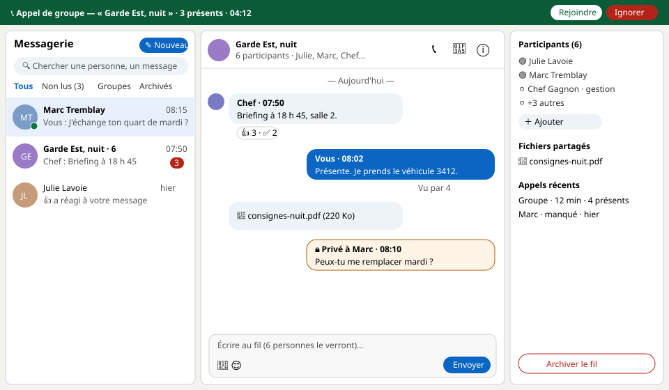

# Refonte de la messagerie sécurisée du personnel

> AO 26-015-DO — communication entre le personnel (notifications, demandes dématérialisées, cahier
> des charges § 2.1). La messagerie a **un seul foyer** (`frontend/src/santequebec/pages/sqmessages.tsx`,
> contexte Java `communication`) et deux hôtes : les horaires cliniques et Urgences-santé. La
> refonte se fait là, une fois.

## 1. Pourquoi refondre

> **État au 13 novembre 2026 : réalisé.** Serveur (sections 3 et 4), écran (section 2) et scénarios
> d'acceptation (section 5) ; détail des défauts corrigés au passage en section 8 ; cycle de vie des messages en section 7.

L'écran actuel sait tout faire, mais il le montre comme un formulaire :

- On choisit la conversation dans une liste déroulante. La liste à gauche ne fait que la doubler.
- Ouvrir un fil à deux, c'est créer une conversation, choisir sa portée et saisir un participant.
  Écrire deux fois à Marc ouvre donc deux fils.
- Un appel ne joint **qu'une** personne. Une équipe de garde ne peut pas se parler à plusieurs.
- Il n'existe aucun moyen léger d'accuser réception : « 👍 » coûte un message de plus à tout le fil.
- Les participants, les fichiers et les appels d'un fil sont dispersés sur la page.

Le personnel a pris ses habitudes sur LinkedIn et sur Messenger. La refonte reprend leurs **gestes**,
pas leur allure : une liste de fils, le fil ouvert, le contexte du fil à côté.

## 2. Ce que l'utilisateur voit

| Zone | Contenu | Repris de |
|---|---|---|
| Bandeau d'appel | Appel entrant ou en cours, sur **toutes** les pages : qui, combien de présents, depuis quand ; Rejoindre / Ignorer | Messenger |
| Colonne 1 — fils | « ✎ Nouveau message », recherche, filtres **Tous · Non lus · Groupes · Archivés**, une ligne par fil : visage, nom, auteur et début du dernier message, heure, compte de non-lus **écrit** | LinkedIn |
| Colonne 2 — fil | En-tête du fil (visage ou visage de groupe, participants) avec **📞 Appeler** ; messages en bulles groupées par jour, les miens à droite ; réactions sous la bulle ; « Vu par N » ; pièces jointes ; réponse privée signalée par 🔒 et un liseré ; zone d'écriture fixée en bas, qui dit **qui verra** le message | Messenger |
| Colonne 3 — informations | Participants et leur rôle, ajouter ou retirer, fichiers partagés, appels récents, archiver | LinkedIn |

**Nouveau message** : on cherche des personnes, qui s'ajoutent en pastilles.
- **Une personne** : le fil à deux existant s'ouvre, ou il naît s'il n'existe pas. Il n'y a jamais deux fils à deux entre les mêmes personnes.
- **Plusieurs personnes** : un fil de groupe naît, et l'écran demande son nom.

**Réactions** : un ensemble fermé de quatre, 👍 *bien reçu*, ✅ *fait*, ❤️ *merci*, 👀 *je regarde*.
- Un second clic retire la réaction.
- Le compte s'affiche avec ses **mots** pour les aides techniques (« 3 personnes : bien reçu »).
- Un ensemble fermé, parce qu'une réaction libre deviendrait un second canal de messages, non journalisé.

**Appels** :
- *à deux* : comme aujourd'hui (sonner, décrocher ou refuser, raccrocher, manqué après 45 s) ;
- *de groupe* : on appelle **depuis le fil**. Tous les participants actifs sont invités, chacun rejoint ou ignore, et peut partir puis revenir. L'appel se termine quand plus personne n'est présent. Un appel que personne n'a rejoint dans le délai de sonnerie est manqué.

## 3. Sécurité — ce qui ne change pas

- Le serveur reste seul juge. On ne lit, ne réagit et ne rejoint un appel que dans un fil auquel on **participe** ; tout autre fil est introuvable (404) et non interdit, pour ne pas en révéler l'existence.
- Une personne retirée d'un fil ne voit plus la suite, réactions et appels compris.
- Le journal des gestes (`msg_journal`) consigne qui a fait quoi, jamais un contenu (Loi 25). Réagir et rejoindre un appel sont des gestes journalisés.
- Le transport de la voix et de l'image (WebRTC) n'est **pas** dans ce lot : le serveur tient la **session** d'appel (qui est invité, qui est présent, depuis quand). Le transport s'y branche sans redécider qui a le droit de quoi. C'est la même frontière qu'aujourd'hui pour les appels à deux.

## 4. Ce que le lot ajoute au serveur

| Ajout | Route | Règle |
|---|---|---|
| Fil à deux unique | `POST /api/communication/conversations/directe` `{personId}` | Rend le fil à deux actif entre l'acteur et la personne s'il existe (200), sinon le crée (201). Refuse de s'écrire à soi-même (422) |
| Réactions | `POST /api/communication/messages/{id}/reactions` `{reaction}` | Bascule : pose ou retire. `reaction` ∈ `pouce`, `fait`, `merci`, `regarde`, sinon 422 nommé ; un fil archivé refuse (409). Les messages lus portent `reactions: [{reaction, nombre, parMoi}]` |
| Appel de groupe | `POST /api/communication/conversations/{id}/appel` | Invite les participants actifs autres que l'appelant ; 409 si un appel du fil est déjà en cours ; 422 si l'appelant est seul |
| | `POST /api/communication/appels-groupe/{id}/rejoindre` · `/quitter` · `/ignorer` | Seul un invité agit ; quitter le dernier termine l'appel |
| | `GET /api/communication/appels-groupe/en-cours` | Les appels de groupe où je suis invité ou présent, pour le bandeau |

Le schéma évolue par un **nouveau** changeset Liquibase (`0003-messagerie-reactions-appels-groupe.xml`) :
tables `msg_reactions` et `appels_groupe`, `appels_groupe_participants`.

## 5. Scénarios d'acceptation (joués à plusieurs comptes)

Ils vivent dans `backend-java/src/bdd/resources/features/12-messagerie.feature` et se jouent contre
le serveur avec trois comptes, Julie, Marc et le chef :

1. Julie écrit à Marc. Un second « Nouveau message » à Marc rouvre **le même** fil. Marc lit, et Julie voit « Lu ». Le chef ne voit pas le fil (404).
2. Le chef ouvre un groupe avec Julie et Marc, puis écrit. Julie répond **à Marc seulement**, et le chef ne voit pas cette réponse.
3. Marc réagit 👍 au message du chef : le compte est 1, `parMoi` est vrai pour Marc et faux pour Julie. Marc réagit encore : la réaction est retirée. Une réaction inconnue est refusée en la nommant.
4. Julie appelle Marc. Marc décroche, puis Julie raccroche : la durée est rendue.
5. Le chef lance un appel de groupe depuis le fil. Julie et Marc le voient en cours. Julie rejoint, Marc ignore. Julie quitte, et l'appel se termine. Un second appel pendant le premier est refusé (409).
6. Une personne retirée du groupe ne voit plus la suite, ne peut plus réagir et n'est pas invitée à l'appel suivant.

Côté écran, l'audit d'accessibilité (axe-core, géométrie à quatre largeurs) couvre la page
`/usmessages` dans ses états : aucun fil choisi, fil ouvert, « Nouveau message » ouvert, appel entrant.

## 6. Accessibilité (SGQRI 008 3.0 / WCAG 2.2 AA)

- La liste des fils est une liste de boutons ; le fil ouvert porte `aria-current`.
- Les nouveaux messages s'annoncent par `role="status"`, sans voler le focus.
- Les réactions sont des boutons à `aria-pressed`, de 24 px au moins, avec un intitulé en mots.
- Le bandeau d'appel n'occulte jamais le focus (2.4.11) : il pousse la page au lieu de la recouvrir.
- Sous 900 px, les colonnes s'empilent : les fils, puis le fil, puis les informations, repliées. Aucun débordement à 320 px.
- Aucune information ne repose sur la couleur seule : le privé porte 🔒 et le mot « Privé », et l'état de présence d'un participant est écrit.

## 7. Cycle de vie d'un message : envoyé, reçu, lu, modifié, supprimé

Chaque message porte **deux états**, que l'écran écrit en toutes lettres (jamais par une coche de
couleur seule) :

| Pour qui | États | Quand |
|---|---|---|
| **L'auteur** voit l'acheminement | **Envoyé** → **Reçu par N** → **Lu par N** (sur N destinataires) | « Envoyé » à l'enregistrement. « Reçu » quand la notification est parvenue au destinataire : son application a relevé le message dans ses avis (`GET /conversations/non-lus`), ce qui vaut accusé de réception. « Lu » quand il l'a ouvert ou marqué lu |
| **Le destinataire** voit le sien | **Non lu** → **Lu** | Comme aujourd'hui |
| **Tous les lecteurs** voient le message | **Modifié** (avec l'heure), **Supprimé** | Voir ci-dessous |

- Un message **privé** compte un seul destinataire. Un message au fil compte tous les participants actifs au moment de l'envoi, sauf l'auteur.
- **Notification** : la cloche de la barre du haut (`BarreAvis`) et la liste des fils affichent ce qui attend. Relever ces avis marque les messages « reçus ».
- **Modifier** (`PUT /messages/{id}`) : l'auteur seul, dans un fil où il peut encore écrire, sur un message non supprimé. La version précédente est gardée dans l'**historique** (`GET /messages/{id}/historique`), lisible de quiconque lit le message, comme le « modifié » de Messenger. Une modification remet le message « non lu » pour personne : ce qui a été lu l'a été.
- **Supprimer** (`DELETE /messages/{id}`) : l'auteur, ou un modérateur du fil. Le message reste à sa place et s'affiche « Message supprimé par … le … ». Son texte, ses pièces jointes et son historique **ne se servent plus à personne**, mais le journal garde le geste (qui, quand), jamais le contenu (Loi 25).
- Le journal consigne `message.modification` et `message.suppression`, comme les autres gestes.

Schéma : changeset `0004-messagerie-cycle-de-vie.xml`, avec les tables `msg_distributions` (qui a
reçu quel message, quand) et `msg_message_versions` (les versions antérieures), et les colonnes
`supprimeLe` et `supprimePar` sur `msg_messages`.

## 8. Défauts de sécurité trouvés et corrigés pendant la refonte

| Défaut | Effet avant la refonte | Correction |
|---|---|---|
| **La réponse privée partait à tout le fil.** Le serveur Java ignorait `priveA` et `repondAuMessageId`, pourtant présents en base. | « Répondre à Marc seulement » envoyait le message à **tous** les participants, alors que l'écran promettait le contraire. | `Messagerie.Adresse` : un message privé n'est lu que de son auteur et de son destinataire, partout où passe `dansLaPortee` (fil, non-lus, recherche) et pour ses pièces jointes. L'adresse est validée : pas à soi-même, à un participant actif, en réponse à un message du fil. |
| **`GET /conversations/{id}` sans contrôle de participation** | Toute personne de l'établissement lisait le sujet et la liste des participants de n'importe quel fil, à partir de son identifiant. | `LectureMessagerie.conversationLisible` : hors participation, le fil est introuvable (404). |
| **`GET /conversations/{id}/acheminement` sans contrôle** | Les canaux de joignabilité de chaque participant se lisaient de la même façon. | Même garde. |
| **`GET /messages/{id}/lectures` sans contrôle** | Qui a lu un message se lisait sans participer au fil. | La route exige de pouvoir lire le message soi-même ; sinon 404. |
| **L'écran ne reconnaissait jamais « mes » messages** | Le serveur désigne l'auteur par son nom de connexion, l'écran le comparait à l'identifiant du compte : aucune bulle « à moi », jamais « Moi ». | `acteurDe(user)`, aligné sur `GardeCommunication.acteurDe`. |
| **La doublure d'audit des non-lus n'avait pas la forme du serveur** | La liste des fils, vide dans l'audit, n'avait jamais été mesurée (axe-core, géométrie). | La doublure rend `{ total, conversations }`, et trois nouveaux états sont mesurés. |

| **Les pièces jointes ne transportaient rien** | L'écran envoyait le fichier ; le serveur exigeait une `taille` que l'écran n'envoyait pas, ne rangeait que la description et servait une description au téléchargement. | Le fichier voyage en base64 (décodage strict), sa taille se calcule. L'antivirus passe sur toutes les pièces avant toute écriture. Le contenu se range selon l'hébergement (`PIECES_JOINTES_STOCKAGE` : `base` ou `volume`), et le téléchargement sert le fichier en pièce à enregistrer (`Content-Disposition: attachment`, `nosniff`). |

