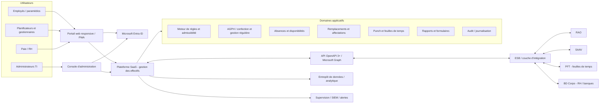

# Référentiel et limites de l'analyse

- **Source principale :** Appel d'offres 26-015-DO, *Système de gestion des effectifs (Solution infonuagique)*, Urgences-santé.
- **Fichier analysé :** `26-015-DO_AO (1).pdf`, 199 pages.
- **Parties repérées :** Régie, Contrat, Cahier de charges et devis technique, Formulaire de soumission, Questionnaire d'évaluation de la qualité et annexe/grille des critères de conformité.
- **Traçabilité :** les exigences E-* et P-* sont reprises des pages 194 à 198 du PDF (annexe 7.00 / critères de conformité). Le contexte d'affaires est repris principalement des pages PDF 145 à 151.
- **Précaution :** les annexes Excel externes mentionnées dans le PDF (grille détaillée des critères, bordereau de prix, questionnaire d'évaluation distinct) ne sont pas présentes comme fichiers séparés dans la pièce jointe. L'analyse ne prétend donc pas couvrir des éléments qui n'apparaissent pas dans le PDF.
- **Nature du document :** analyse de solution proposée, pas un avis juridique ni une preuve de conformité d'un produit fournisseur. Les choix d'architecture ci-dessous sont des recommandations à valider avec Urgences-santé et l'éditeur.

# 3. Architecture de solution proposée

## 3.1 Principes directeurs

1. **SaaS multi-tenant avec séparation logique forte** : une base de code partagée, mais données opérationnelles, sauvegardées et archivées séparées par client, conformément à E-TN-1 et E-TN-6.
2. **Identité fédérée** : authentification via Microsoft Entra ID; autorisation applicative par rôles, périmètres organisationnels et attributs métier (E-TN-2, E-TN-5, E-GN-7/8).
3. **API-first** : API REST documentées OpenAPI 3+, intégration par ESB et Microsoft Graph pour les échanges prévus (E-TN-7, E-TN-20).
4. **Configuration plutôt que personnalisation du code** : règles, profils, quotas, workflows, modèles de messages et paramètres administrables.
5. **Traçabilité de bout en bout** : événements horodatés, utilisateur/mécanisme auteur, historique des changements et audit (E-GN-9/10).
6. **Résilience opérationnelle** : disponibilité contractuelle 99,7 %, supervision, sauvegardes, DR, rollback et reprise des transactions.
7. **Expérience responsive et française** : portail web adaptatif et parcours mobile pour les employés; interfaces d'administration adaptées au bureau.
8. **Séparation des responsabilités** : les systèmes maîtres RH/paie/opérationnels restent propriétaires de leurs données de référence; la solution de gestion des effectifs orchestre horaires, affectations et temps dans son périmètre.

## 3.2 Vue logique cible



## 3.3 Composants recommandés

| Composant | Responsabilités | Principales exigences |
|---|---|---|
| Portail employé | Horaires, disponibilités, absences, demandes, choix de postes, notifications, punch | E-GN-13/15/16; E-CH; E-GR; E-GP |
| Poste de pilotage gestionnaire | Calendrier, quarts à couvrir, exceptions, approbations, ajustements et suivi des effectifs | E-GN-1/4/11; E-GR; E-CH |
| Moteur de règles | Ancienneté, tour de rôle, statut, corps d'emploi, compétences, conventions, repos, admissibilité, quotas et priorités | E-GN-12/14/15; E-CH; E-GR |
| Service de planification AGPH | Processus annuel, postes, tours de rôle, sélection, publication, statut TC/TPR/TP | E-CH-1 à E-CH-10; P-CH-1 à P-CH-9 |
| Service de gestion régulière | Périodes, quarts ouverts, quotas, échanges, quarts ad hoc, ajustements journaliers | E-GR-1 à E-GR-13 |
| Service absences/disponibilités | Déclaration, contrôle, approbation/exception, banque de droits, disponibilités par période | E-GN-5/12-16; P-GN-2/3; P-GH |
| Service temps et présence | Punch en temps réel ou rétroactif, segments, géolocalisation/mécanismes de présence, pauses, validation | E-GP-1 à E-GP-15; P-GP-1 à P-GP-4 |
| Feuilles de temps | Préparation, enrichissement, anomalies, approbations, heures supplémentaires, export paie | E-RF-1 à E-RF-14 |
| Notifications | Courriel/SMS ou canal configuré, alertes d'opérations et notifications de quarts | Besoins d'affaires §2.1; P-GH-3 |
| Reporting / analytique | Rapports opérationnels, statistiques, exports, alimentation Data Warehouse | E-RF-7/8; P-RF-1; P-TN-7/8 |
| Administration / sécurité | Entra ID, rôles, groupes, paramètres, audit, sécurité, gabarits | E-TN-2/5/31; E-GN-7/10; E-TN-27 |

## 3.4 Architecture d'intégration

| Interface | Sens logique proposé | Données candidates | Points à confirmer |
|---|---|---|---|
| Microsoft Entra ID | IdP vers SaaS (authentification) | Identité, groupes, claims, MFA/conditions d'accès | SSO, provisioning, cycle de vie, comptes externes |
| Microsoft Graph | Bidirectionnel selon cahier | Données organisationnelles et collaboration à préciser | Ressources Graph autorisées, consentements, sens exact |
| BD Corpo | BD Corpo → SaaS; retours possibles à valider | Employés, statuts, ancienneté, banques d'absence | Système maître, fréquence, identifiants, conflits |
| RAO | À définir avec propriétaire | Affectations et besoins opérationnels selon processus | Événements, données de quart, latence |
| SAAV | À définir avec propriétaire | Données d'attitrage / véhicules en relation avec opérations | Périmètre exact, source maître, événements |
| PFT | SaaS → PFT (données horaires réelles) | Heures, affectations, feuilles de temps | Format, accusé de réception, corrections |
| ESB | Médiation | Routage, transformation, reprise, supervision | Protocoles, sécurité, versionning |
| Entrepôt de données | SaaS → DWH | Données historiques et agrégées | Schéma, fréquence, minimisation et anonymisation |

### Contrats d'interface à produire
Pour chaque interface : propriétaire métier, système maître, dictionnaire de données, contrat OpenAPI/schéma, mode synchrone/asynchrone, fréquence, idempotence, pagination, chiffrement, authentification, journalisation, gestion des erreurs, reprise, réconciliation, SLA, tests de contrat et stratégie de version.

## 3.5 Modèle de données conceptuel

Entités proposées (modèle conceptuel à valider) :
- `Employe`, `Identite`, `GroupeOrganisationnel`, `CorpsEmploi`, `StatutEmploi`, `Competence`, `Anciennete`;
- `Convention`, `RegleAffaires`, `RegleAdmissibilite`, `QuotaComblement`, `PeriodePlanification`;
- `Poste`, `Quart`, `BesoinRessource`, `Affectation`, `Remplacement`, `EchangeQuart`;
- `Disponibilite`, `Absence`, `TypeAbsence`, `BanqueAbsence`, `CodeAbsence`;
- `DeclarationTemps`, `SegmentTemps`, `Pause`, `Presence`, `LieuTravail`, `ValidationPresence`;
- `FeuilleTemps`, `AnomalieTemps`, `Approbation`, `TypeHeure`, `ExportPaie`;
- `Notification`, `ModeleMessage`, `Demande`, `Rapport`, `EvenementAudit`.

Les clés d'intégration et la source de vérité doivent être définies avant migration. Le cahier exige un métamodèle fourni (E-TN-13), mais ne fournit pas le dictionnaire cible détaillé.

## 3.6 Sécurité et conformité

| Contrôle | Cible de conception |
|---|---|
| Identité | Entra ID, SSO, MFA/accès conditionnel selon politiques organisationnelles |
| Autorisation | RBAC + attributs (groupe, rôle, corps d'emploi, site, fonction); moindre privilège |
| Isolation | Cloisonnement des données et sauvegardes entre clients; tests d'isolation |
| Chiffrement | TLS en transit; chiffrement au repos; gestion et rotation des clés |
| Journalisation | Événements métier et sécurité, auteur, horodatage, avant/après, corrélation; rétention au moins 12 mois selon contrat |
| Sécurité périmétrique | Protection DDoS, WAF/contrôles équivalents, détection d'intrusion |
| Accès admin | Comptes nominatifs, MFA, élévation contrôlée, revue périodique et journalisée |
| Données personnelles | Minimisation, classification, accès par finalité, rétention et destruction contrôlée |
| Hébergement | Hébergement au Québec selon clauses; documenter tous les lieux et sous-traitants |
| Vulnérabilités | Correctifs réguliers, scans, gestion des dépendances et réponse aux vulnérabilités |
| Audit fournisseur | Accès organisationnel aux journaux; preuves des contrôles et certifications demandés |

**À valider :** la qualification juridique des données RH et des informations de temps, l'analyse des facteurs relatifs à la vie privée, les exigences exactes de la zone d'accueil infonuagique du MCN, les sous-traitants et les lieux de sauvegarde. Ne pas assimiler automatiquement les données RH des employés aux renseignements de santé des patients : le contrat précise une distinction pour les renseignements du personnel recueillis à des fins RH.

## 3.7 Disponibilité, performance et continuité

- SLA contractuel : disponibilité mensuelle **≥ 99,7 %**, calculée sur 24/7, hors maintenance planifiée approuvée.
- Le cahier mentionne également une exploitation de 20 h / 7 j / 365 j pour la solution (E-TN-9); le contrat décrit le calcul de disponibilité sur une base 24/7. Retenir le niveau contractuel le plus exigeant jusqu'à clarification.
- Transaction de base : exécution en moins de 2 secondes (E-TN-17); les parcours et seuils de charge doivent être précisés (percentile, charge, taille de données).
- Rollback : maximum 24 heures (E-TN-16).
- Copies de sécurité : fournir fréquence, contenu, rétention, localisation et procédures de restauration (E-TN-15).
- Tests DR : au moins annuels selon le critère préférentiel P-TN-3; démontrer la reprise et la récupération des transactions incomplètes (P-TN-5).
- Les objectifs RTO/RPO détaillés ne sont pas explicitement quantifiés dans la grille visible : ils sont à faire préciser contractuellement.
- Rapports mensuels de disponibilité, incidents, durées, causes et actions correctives.

## 3.8 Architecture logicielle logique

```mermaid
flowchart TB
  UI[Web UI responsive] --> BFF[API Gateway / BFF]
  BFF --> IAM[Adaptateur identité Entra ID]
  BFF --> SVC[Services métier]
  subgraph SVC[Services métier modulaires]
    SCH[Scheduling]
    ABS[Absence & Availability]
    RULE[Rules Engine]
    TIME[Time Capture]
    TS[Timesheet]
    NOTIF[Notification]
    REP[Reporting]
    ADM[Administration]
  end
  SCH <--> RULE
  ABS <--> RULE
  TIME <--> RULE
  TS <--> TIME
  SVC --> DB[(Operational data store)]
  SVC --> EVT[(Event / audit store)]
  SVC --> MQ[Message broker]
  MQ --> INT[Integration adapters]
  INT --> ESB[Enterprise Service Bus]
  REP --> DWH[(Data warehouse)]
  OBS[Monitoring / SIEM] <-- EVT
```

Recommandation : architecture modulaire orientée domaines, avec transactions métier cohérentes dans le périmètre du service et événements pour les échanges asynchrones. Ne pas imposer de microservices distribués si l'éditeur SaaS fournit un produit monolithique modulaire : la conformité fonctionnelle, la résilience et l'intégrabilité priment sur le style d'implémentation.

## 3.9 Environnements et cycle de livraison

| Environnement | Usage | Contrôles |
|---|---|---|
| Formation | Formation employés, formateurs et administrateurs | Données fictives ou masquées; profils de formation |
| Tests | Paramétrage, intégration, tests fonctionnels, sécurité, performance, UAT | Jeux de données maîtrisés; accès restreints |
| Production | Exploitation réelle | Supervision, sauvegardes, changement approuvé, accès privilégiés |
| Reprise après sinistre | Continuité | Tests réguliers, procédures à jour, même niveau de service attendu selon P-TN-4 |

Le Contrat prévoit une livraison de la solution en production pour inspection finale au plus tard 16 semaines après la rencontre de démarrage, avec étapes de configuration, intégration, banc d'essai, formation et installation production. Échéancier de référence à confirmer lors du démarrage.

## 3.10 Proposition de découpage du projet

| Période indicative | Activités | Livrables / jalons |
|---|---|---|
| Sem. 1-2 | Démarrage, gouvernance, ateliers, inventaire des règles, interfaces, sécurité | Charte, backlog, matrice de décisions, architecture validée |
| Sem. 2-5 | Environnements, modèle de données, configuration des groupes/rôles et règles | Environnements prêts, modèle et règles de base |
| Sem. 4-8 | Configuration AGPH, disponibilités, absences, horaires réguliers, remplacements | Démonstrations métier, configuration fonctionnelle |
| Sem. 5-10 | Interfaces Entra, Graph, ESB, RAO, SAAV, BD Corpo, PFT | Contrats et tests d'intégration |
| Sem. 8-12 | Punch, feuilles de temps, rapports, notifications | Parcours intégrés et rapports |
| Sem. 11-13 | Tests système, sécurité, performance, UAT, corrections | Cahier de tests, anomalies closes |
| Sem. 13-15 | Formation formateurs, administrateurs, pilotes, répétition bascule | Guides français, capsules, plan de bascule |
| Sem. 16 | Mise en production et inspection finale | PV de livraison/inspection, support renforcé |

Ce calendrier est une proposition de planification, pas une échéance contractuelle substituée au Contrat. Les dépendances d'accès aux systèmes et la disponibilité des experts métiers sont critiques.

## 3.11 Risques majeurs et mesures

| Risque | Impact | Mesure |
|---|---|---|
| Complexité des conventions collectives | Affectations non conformes, rejets utilisateurs | Catalogue de règles, cas de tests représentatifs, validation RH/relations de travail |
| Qualité des données RH | Erreurs de droits, ancienneté, admissibilité | Profilage, rapprochement, règles de qualité et responsables de données |
| Interfaces externes non documentées | Retard de 16 semaines | Ateliers propriétaires, mocks, contrats API, tests anticipés |
| Ambiguïtés sur règles d'attribution manuelle | Blocage opérationnel ou contournements non tracés | Parcours exceptionnel avec justification, habilitation et audit |
| Disponibilité critique | Impact sur opérations d'urgence | SLA, supervision, DR, exercices et mode opératoire de continuité |
| Adoption de 1 000 paramédics | Adoption faible, erreurs de saisie | Mobile-first, capsules, accompagnement et soutien de proximité |
| Divergences de pondération de l'évaluation | Risque de soumission | Demande de clarification/addenda officiel |
| Localisation des sauvegardes et sous-traitants | Non-conformité d'hébergement | Cartographie des flux et preuves d'emplacement |
| Périmètre réel de RAO/SAAV/Graph | Dérapage d'intégration | Architecture d'intégration et contrats de données signés |

## 3.12 Décisions ouvertes à obtenir

1. Quelle est la liste exhaustive des systèmes maîtres et la propriété de chaque attribut employé?
2. Quel est le rôle exact de Microsoft Graph et quelles données doivent circuler dans les deux sens?
3. Quelles interfaces RAO/SAAV sont dans le périmètre de réalisation?
4. Quels mécanismes de preuve de présence sont acceptables (poste, réseau, badge, GPS, autre)?
5. Quelles règles de conventions collectives et ententes locales doivent être paramétrées dès le lot initial?
6. Quels sont les RTO/RPO attendus et la rétention des sauvegardes?
7. Quelle est la définition opérationnelle du délai de 2 secondes?
8. Quelle pondération de la Partie 5 prévaut : 20 % ou 25 %?
9. Quelle est la stratégie de migration et de décommissionnement des systèmes actuels?
10. Quelles données exactes doivent alimenter le Data Warehouse et à quelle fréquence?
