# Référentiel et limites de l'analyse

- **Source principale :** Appel d'offres 26-015-DO, *Système de gestion des effectifs (Solution infonuagique)*, Urgences-santé.
- **Fichier analysé :** `26-015-DO_AO (1).pdf`, 199 pages.
- **Parties repérées :** Régie, Contrat, Cahier de charges et devis technique, Formulaire de soumission, Questionnaire d'évaluation de la qualité et annexe/grille des critères de conformité.
- **Traçabilité :** les exigences E-* et P-* sont reprises des pages 194 à 198 du PDF (annexe 7.00 / critères de conformité). Le contexte d'affaires est repris principalement des pages PDF 145 à 151.
- **Précaution :** les annexes Excel externes mentionnées dans le PDF (grille détaillée des critères, bordereau de prix, questionnaire d'évaluation distinct) ne sont pas présentes comme fichiers séparés dans la pièce jointe. L'analyse ne prétend donc pas couvrir des éléments qui n'apparaissent pas dans le PDF.
- **Nature du document :** analyse de solution proposée, pas un avis juridique ni une preuve de conformité d'un produit fournisseur. Les choix d'architecture ci-dessous sont des recommandations à valider avec Urgences-santé et l'éditeur.
# 5. Analyse fonctionnelle détaillée — traçabilité exigence par exigence

Chaque exigence est traitée individuellement. La proposition ci-dessous traduit le libellé source en comportement observable, propose un parcours UI et identifie le contrôle/critère d'acceptation. Les critères d'acceptation sont des propositions de conception à confirmer en atelier, et non des formulations contractuelles ajoutées à l'appel d'offres.

## 5.1 Matrice d'analyse individuelle

| ID | Analyse / comportement à concevoir | Écran principal | Contrôle ou résultat vérifiable |
|---|---|---|---|
| **E-GN-1** | Configurer la règle, le périmètre organisationnel ou le quart; afficher la validation et conserver l'historique. | S01 — Tableau de bord gestionnaire | Une règle active s'applique au bon groupe; toute exception ou modification est auditée. |
| **E-GN-2** | Configurer la règle, le périmètre organisationnel ou le quart; afficher la validation et conserver l'historique. | S01 — Tableau de bord gestionnaire | Une règle active s'applique au bon groupe; toute exception ou modification est auditée. |
| **E-GN-3** | Configurer la règle, le périmètre organisationnel ou le quart; afficher la validation et conserver l'historique. | S01 — Tableau de bord gestionnaire | Une règle active s'applique au bon groupe; toute exception ou modification est auditée. |
| **E-GN-4** | Configurer la règle, le périmètre organisationnel ou le quart; afficher la validation et conserver l'historique. | S01 — Tableau de bord gestionnaire | Une règle active s'applique au bon groupe; toute exception ou modification est auditée. |
| **E-GN-5** | Configurer la règle, le périmètre organisationnel ou le quart; afficher la validation et conserver l'historique. | S01 — Tableau de bord gestionnaire | Une règle active s'applique au bon groupe; toute exception ou modification est auditée. |
| **E-GN-6** | Configurer la règle, le périmètre organisationnel ou le quart; afficher la validation et conserver l'historique. | S01 — Tableau de bord gestionnaire | Une règle active s'applique au bon groupe; toute exception ou modification est auditée. |
| **E-GN-7** | Configurer la règle, le périmètre organisationnel ou le quart; afficher la validation et conserver l'historique. | S01 — Tableau de bord gestionnaire | Une règle active s'applique au bon groupe; toute exception ou modification est auditée. |
| **E-GN-8** | Configurer la règle, le périmètre organisationnel ou le quart; afficher la validation et conserver l'historique. | S01 — Tableau de bord gestionnaire | Une règle active s'applique au bon groupe; toute exception ou modification est auditée. |
| **E-GN-9** | Configurer la règle, le périmètre organisationnel ou le quart; afficher la validation et conserver l'historique. | S01 — Tableau de bord gestionnaire | Une règle active s'applique au bon groupe; toute exception ou modification est auditée. |
| **E-GN-10** | Configurer la règle, le périmètre organisationnel ou le quart; afficher la validation et conserver l'historique. | S01 — Tableau de bord gestionnaire | Une règle active s'applique au bon groupe; toute exception ou modification est auditée. |
| **E-GN-11** | Configurer la règle, le périmètre organisationnel ou le quart; afficher la validation et conserver l'historique. | S01 — Tableau de bord gestionnaire | Une règle active s'applique au bon groupe; toute exception ou modification est auditée. |
| **E-GN-12** | Configurer la règle, le périmètre organisationnel ou le quart; afficher la validation et conserver l'historique. | S01 — Tableau de bord gestionnaire | Une règle active s'applique au bon groupe; toute exception ou modification est auditée. |
| **E-GN-13** | Configurer la règle, le périmètre organisationnel ou le quart; afficher la validation et conserver l'historique. | S01 — Tableau de bord gestionnaire | Une règle active s'applique au bon groupe; toute exception ou modification est auditée. |
| **E-GN-14** | Configurer la règle, le périmètre organisationnel ou le quart; afficher la validation et conserver l'historique. | S01 — Tableau de bord gestionnaire | Une règle active s'applique au bon groupe; toute exception ou modification est auditée. |
| **E-GN-15** | Configurer la règle, le périmètre organisationnel ou le quart; afficher la validation et conserver l'historique. | S01 — Tableau de bord gestionnaire | Une règle active s'applique au bon groupe; toute exception ou modification est auditée. |
| **E-GN-16** | Configurer la règle, le périmètre organisationnel ou le quart; afficher la validation et conserver l'historique. | S01 — Tableau de bord gestionnaire | Une règle active s'applique au bon groupe; toute exception ou modification est auditée. |
| **E-GN-17** | Configurer la règle, le périmètre organisationnel ou le quart; afficher la validation et conserver l'historique. | S01 — Tableau de bord gestionnaire | Une règle active s'applique au bon groupe; toute exception ou modification est auditée. |
| **E-CH-1** | Orchestrer le cycle AGPH, les postes, les tours de rôle, la sélection, les vacances et les remplacements long terme. | S04 — AGPH — choix et attribution des postes | Le cycle publie des postes admissibles; l'ordre et les décisions sont traçables. |
| **E-CH-2** | Orchestrer le cycle AGPH, les postes, les tours de rôle, la sélection, les vacances et les remplacements long terme. | S04 — AGPH — choix et attribution des postes | Le cycle publie des postes admissibles; l'ordre et les décisions sont traçables. |
| **E-CH-3** | Orchestrer le cycle AGPH, les postes, les tours de rôle, la sélection, les vacances et les remplacements long terme. | S04 — AGPH — choix et attribution des postes | Le cycle publie des postes admissibles; l'ordre et les décisions sont traçables. |
| **E-CH-4** | Orchestrer le cycle AGPH, les postes, les tours de rôle, la sélection, les vacances et les remplacements long terme. | S04 — AGPH — choix et attribution des postes | Le cycle publie des postes admissibles; l'ordre et les décisions sont traçables. |
| **E-CH-5** | Orchestrer le cycle AGPH, les postes, les tours de rôle, la sélection, les vacances et les remplacements long terme. | S04 — AGPH — choix et attribution des postes | Le cycle publie des postes admissibles; l'ordre et les décisions sont traçables. |
| **E-CH-6** | Orchestrer le cycle AGPH, les postes, les tours de rôle, la sélection, les vacances et les remplacements long terme. | S04 — AGPH — choix et attribution des postes | Le cycle publie des postes admissibles; l'ordre et les décisions sont traçables. |
| **E-CH-7** | Orchestrer le cycle AGPH, les postes, les tours de rôle, la sélection, les vacances et les remplacements long terme. | S04 — AGPH — choix et attribution des postes | Le cycle publie des postes admissibles; l'ordre et les décisions sont traçables. |
| **E-CH-8** | Orchestrer le cycle AGPH, les postes, les tours de rôle, la sélection, les vacances et les remplacements long terme. | S04 — AGPH — choix et attribution des postes | Le cycle publie des postes admissibles; l'ordre et les décisions sont traçables. |
| **E-CH-9** | Orchestrer le cycle AGPH, les postes, les tours de rôle, la sélection, les vacances et les remplacements long terme. | S04 — AGPH — choix et attribution des postes | Le cycle publie des postes admissibles; l'ordre et les décisions sont traçables. |
| **E-CH-10** | Orchestrer le cycle AGPH, les postes, les tours de rôle, la sélection, les vacances et les remplacements long terme. | S04 — AGPH — choix et attribution des postes | Le cycle publie des postes admissibles; l'ordre et les décisions sont traçables. |
| **E-GR-1** | Gérer les périodes ouvertes, quarts non couverts, quotas, ajustements, échanges et quarts ad hoc. | S05 — Centre de couverture des quarts | Le tableau de couverture reflète les changements et applique les règles de période. |
| **E-GR-2** | Gérer les périodes ouvertes, quarts non couverts, quotas, ajustements, échanges et quarts ad hoc. | S05 — Centre de couverture des quarts | Le tableau de couverture reflète les changements et applique les règles de période. |
| **E-GR-3** | Gérer les périodes ouvertes, quarts non couverts, quotas, ajustements, échanges et quarts ad hoc. | S05 — Centre de couverture des quarts | Le tableau de couverture reflète les changements et applique les règles de période. |
| **E-GR-4** | Gérer les périodes ouvertes, quarts non couverts, quotas, ajustements, échanges et quarts ad hoc. | S05 — Centre de couverture des quarts | Le tableau de couverture reflète les changements et applique les règles de période. |
| **E-GR-5** | Gérer les périodes ouvertes, quarts non couverts, quotas, ajustements, échanges et quarts ad hoc. | S05 — Centre de couverture des quarts | Le tableau de couverture reflète les changements et applique les règles de période. |
| **E-GR-6** | Gérer les périodes ouvertes, quarts non couverts, quotas, ajustements, échanges et quarts ad hoc. | S05 — Centre de couverture des quarts | Le tableau de couverture reflète les changements et applique les règles de période. |
| **E-GR-7** | Gérer les périodes ouvertes, quarts non couverts, quotas, ajustements, échanges et quarts ad hoc. | S05 — Centre de couverture des quarts | Le tableau de couverture reflète les changements et applique les règles de période. |
| **E-GR-8** | Gérer les périodes ouvertes, quarts non couverts, quotas, ajustements, échanges et quarts ad hoc. | S05 — Centre de couverture des quarts | Le tableau de couverture reflète les changements et applique les règles de période. |
| **E-GR-9** | Gérer les périodes ouvertes, quarts non couverts, quotas, ajustements, échanges et quarts ad hoc. | S05 — Centre de couverture des quarts | Le tableau de couverture reflète les changements et applique les règles de période. |
| **E-GR-10** | Gérer les périodes ouvertes, quarts non couverts, quotas, ajustements, échanges et quarts ad hoc. | S05 — Centre de couverture des quarts | Le tableau de couverture reflète les changements et applique les règles de période. |
| **E-GR-11** | Gérer les périodes ouvertes, quarts non couverts, quotas, ajustements, échanges et quarts ad hoc. | S05 — Centre de couverture des quarts | Le tableau de couverture reflète les changements et applique les règles de période. |
| **E-GR-12** | Gérer les périodes ouvertes, quarts non couverts, quotas, ajustements, échanges et quarts ad hoc. | S05 — Centre de couverture des quarts | Le tableau de couverture reflète les changements et applique les règles de période. |
| **E-GR-13** | Gérer les périodes ouvertes, quarts non couverts, quotas, ajustements, échanges et quarts ad hoc. | S05 — Centre de couverture des quarts | Le tableau de couverture reflète les changements et applique les règles de période. |
| **E-GP-1** | Permettre la déclaration, la validation, l'approbation et l'audit des heures et de la présence. | S08 — Pointage et présence | Les heures sont validées selon le quart, le site et le profil; les anomalies sont visibles. |
| **E-GP-2** | Permettre la déclaration, la validation, l'approbation et l'audit des heures et de la présence. | S08 — Pointage et présence | Les heures sont validées selon le quart, le site et le profil; les anomalies sont visibles. |
| **E-GP-3** | Permettre la déclaration, la validation, l'approbation et l'audit des heures et de la présence. | S08 — Pointage et présence | Les heures sont validées selon le quart, le site et le profil; les anomalies sont visibles. |
| **E-GP-4** | Permettre la déclaration, la validation, l'approbation et l'audit des heures et de la présence. | S08 — Pointage et présence | Les heures sont validées selon le quart, le site et le profil; les anomalies sont visibles. |
| **E-GP-5** | Permettre la déclaration, la validation, l'approbation et l'audit des heures et de la présence. | S08 — Pointage et présence | Les heures sont validées selon le quart, le site et le profil; les anomalies sont visibles. |
| **E-GP-6** | Permettre la déclaration, la validation, l'approbation et l'audit des heures et de la présence. | S08 — Pointage et présence | Les heures sont validées selon le quart, le site et le profil; les anomalies sont visibles. |
| **E-GP-7** | Permettre la déclaration, la validation, l'approbation et l'audit des heures et de la présence. | S08 — Pointage et présence | Les heures sont validées selon le quart, le site et le profil; les anomalies sont visibles. |
| **E-GP-8** | Permettre la déclaration, la validation, l'approbation et l'audit des heures et de la présence. | S08 — Pointage et présence | Les heures sont validées selon le quart, le site et le profil; les anomalies sont visibles. |
| **E-GP-9** | Permettre la déclaration, la validation, l'approbation et l'audit des heures et de la présence. | S08 — Pointage et présence | Les heures sont validées selon le quart, le site et le profil; les anomalies sont visibles. |
| **E-GP-10** | Permettre la déclaration, la validation, l'approbation et l'audit des heures et de la présence. | S08 — Pointage et présence | Les heures sont validées selon le quart, le site et le profil; les anomalies sont visibles. |
| **E-GP-11** | Permettre la déclaration, la validation, l'approbation et l'audit des heures et de la présence. | S08 — Pointage et présence | Les heures sont validées selon le quart, le site et le profil; les anomalies sont visibles. |
| **E-GP-12** | Permettre la déclaration, la validation, l'approbation et l'audit des heures et de la présence. | S08 — Pointage et présence | Les heures sont validées selon le quart, le site et le profil; les anomalies sont visibles. |
| **E-GP-13** | Permettre la déclaration, la validation, l'approbation et l'audit des heures et de la présence. | S08 — Pointage et présence | Les heures sont validées selon le quart, le site et le profil; les anomalies sont visibles. |
| **E-GP-14** | Permettre la déclaration, la validation, l'approbation et l'audit des heures et de la présence. | S08 — Pointage et présence | Les heures sont validées selon le quart, le site et le profil; les anomalies sont visibles. |
| **E-GP-15** | Permettre la déclaration, la validation, l'approbation et l'audit des heures et de la présence. | S08 — Pointage et présence | Les heures sont validées selon le quart, le site et le profil; les anomalies sont visibles. |
| **E-RF-1** | Préparer, corriger, approuver et exporter les feuilles de temps et rapports. | S09 — Feuille de temps et anomalies | La feuille de temps rapproche planifié/réel et expose anomalies et statuts d'approbation. |
| **E-RF-2** | Préparer, corriger, approuver et exporter les feuilles de temps et rapports. | S09 — Feuille de temps et anomalies | La feuille de temps rapproche planifié/réel et expose anomalies et statuts d'approbation. |
| **E-RF-3** | Préparer, corriger, approuver et exporter les feuilles de temps et rapports. | S09 — Feuille de temps et anomalies | La feuille de temps rapproche planifié/réel et expose anomalies et statuts d'approbation. |
| **E-RF-4** | Préparer, corriger, approuver et exporter les feuilles de temps et rapports. | S09 — Feuille de temps et anomalies | La feuille de temps rapproche planifié/réel et expose anomalies et statuts d'approbation. |
| **E-RF-5** | Préparer, corriger, approuver et exporter les feuilles de temps et rapports. | S09 — Feuille de temps et anomalies | La feuille de temps rapproche planifié/réel et expose anomalies et statuts d'approbation. |
| **E-RF-6** | Préparer, corriger, approuver et exporter les feuilles de temps et rapports. | S09 — Feuille de temps et anomalies | La feuille de temps rapproche planifié/réel et expose anomalies et statuts d'approbation. |
| **E-RF-7** | Préparer, corriger, approuver et exporter les feuilles de temps et rapports. | S09 — Feuille de temps et anomalies | La feuille de temps rapproche planifié/réel et expose anomalies et statuts d'approbation. |
| **E-RF-8** | Préparer, corriger, approuver et exporter les feuilles de temps et rapports. | S09 — Feuille de temps et anomalies | La feuille de temps rapproche planifié/réel et expose anomalies et statuts d'approbation. |
| **E-RF-9** | Préparer, corriger, approuver et exporter les feuilles de temps et rapports. | S09 — Feuille de temps et anomalies | La feuille de temps rapproche planifié/réel et expose anomalies et statuts d'approbation. |
| **E-RF-10** | Préparer, corriger, approuver et exporter les feuilles de temps et rapports. | S09 — Feuille de temps et anomalies | La feuille de temps rapproche planifié/réel et expose anomalies et statuts d'approbation. |
| **E-RF-11** | Préparer, corriger, approuver et exporter les feuilles de temps et rapports. | S09 — Feuille de temps et anomalies | La feuille de temps rapproche planifié/réel et expose anomalies et statuts d'approbation. |
| **E-RF-12** | Préparer, corriger, approuver et exporter les feuilles de temps et rapports. | S09 — Feuille de temps et anomalies | La feuille de temps rapproche planifié/réel et expose anomalies et statuts d'approbation. |
| **E-RF-13** | Préparer, corriger, approuver et exporter les feuilles de temps et rapports. | S09 — Feuille de temps et anomalies | La feuille de temps rapproche planifié/réel et expose anomalies et statuts d'approbation. |
| **E-RF-14** | Préparer, corriger, approuver et exporter les feuilles de temps et rapports. | S09 — Feuille de temps et anomalies | La feuille de temps rapproche planifié/réel et expose anomalies et statuts d'approbation. |
| **E-TN-1** | Exposer le contrôle technique correspondant dans la console d'administration ou la documentation fournisseur. | S12 — Administration technique et intégrations | Preuve de configuration, test, rapport ou document vérifiable; plusieurs éléments sont non-UI. |
| **E-TN-2** | Exposer le contrôle technique correspondant dans la console d'administration ou la documentation fournisseur. | S12 — Administration technique et intégrations | Preuve de configuration, test, rapport ou document vérifiable; plusieurs éléments sont non-UI. |
| **E-TN-3** | Exposer le contrôle technique correspondant dans la console d'administration ou la documentation fournisseur. | S12 — Administration technique et intégrations | Preuve de configuration, test, rapport ou document vérifiable; plusieurs éléments sont non-UI. |
| **E-TN-4** | Exposer le contrôle technique correspondant dans la console d'administration ou la documentation fournisseur. | S12 — Administration technique et intégrations | Preuve de configuration, test, rapport ou document vérifiable; plusieurs éléments sont non-UI. |
| **E-TN-5** | Exposer le contrôle technique correspondant dans la console d'administration ou la documentation fournisseur. | S12 — Administration technique et intégrations | Preuve de configuration, test, rapport ou document vérifiable; plusieurs éléments sont non-UI. |
| **E-TN-6** | Exposer le contrôle technique correspondant dans la console d'administration ou la documentation fournisseur. | S12 — Administration technique et intégrations | Preuve de configuration, test, rapport ou document vérifiable; plusieurs éléments sont non-UI. |
| **E-TN-7** | Exposer le contrôle technique correspondant dans la console d'administration ou la documentation fournisseur. | S12 — Administration technique et intégrations | Preuve de configuration, test, rapport ou document vérifiable; plusieurs éléments sont non-UI. |
| **E-TN-8** | Exposer le contrôle technique correspondant dans la console d'administration ou la documentation fournisseur. | S12 — Administration technique et intégrations | Preuve de configuration, test, rapport ou document vérifiable; plusieurs éléments sont non-UI. |
| **E-TN-9** | Exposer le contrôle technique correspondant dans la console d'administration ou la documentation fournisseur. | S12 — Administration technique et intégrations | Preuve de configuration, test, rapport ou document vérifiable; plusieurs éléments sont non-UI. |
| **E-TN-10** | Exposer le contrôle technique correspondant dans la console d'administration ou la documentation fournisseur. | S12 — Administration technique et intégrations | Preuve de configuration, test, rapport ou document vérifiable; plusieurs éléments sont non-UI. |
| **E-TN-11** | Exposer le contrôle technique correspondant dans la console d'administration ou la documentation fournisseur. | S12 — Administration technique et intégrations | Preuve de configuration, test, rapport ou document vérifiable; plusieurs éléments sont non-UI. |
| **E-TN-12** | Exposer le contrôle technique correspondant dans la console d'administration ou la documentation fournisseur. | S12 — Administration technique et intégrations | Preuve de configuration, test, rapport ou document vérifiable; plusieurs éléments sont non-UI. |
| **E-TN-13** | Exposer le contrôle technique correspondant dans la console d'administration ou la documentation fournisseur. | S12 — Administration technique et intégrations | Preuve de configuration, test, rapport ou document vérifiable; plusieurs éléments sont non-UI. |
| **E-TN-14** | Exposer le contrôle technique correspondant dans la console d'administration ou la documentation fournisseur. | S12 — Administration technique et intégrations | Preuve de configuration, test, rapport ou document vérifiable; plusieurs éléments sont non-UI. |
| **E-TN-15** | Exposer le contrôle technique correspondant dans la console d'administration ou la documentation fournisseur. | S12 — Administration technique et intégrations | Preuve de configuration, test, rapport ou document vérifiable; plusieurs éléments sont non-UI. |
| **E-TN-16** | Exposer le contrôle technique correspondant dans la console d'administration ou la documentation fournisseur. | S12 — Administration technique et intégrations | Preuve de configuration, test, rapport ou document vérifiable; plusieurs éléments sont non-UI. |
| **E-TN-17** | Exposer le contrôle technique correspondant dans la console d'administration ou la documentation fournisseur. | S12 — Administration technique et intégrations | Preuve de configuration, test, rapport ou document vérifiable; plusieurs éléments sont non-UI. |
| **E-TN-18** | Exposer le contrôle technique correspondant dans la console d'administration ou la documentation fournisseur. | S12 — Administration technique et intégrations | Preuve de configuration, test, rapport ou document vérifiable; plusieurs éléments sont non-UI. |
| **E-TN-19** | Exposer le contrôle technique correspondant dans la console d'administration ou la documentation fournisseur. | S12 — Administration technique et intégrations | Preuve de configuration, test, rapport ou document vérifiable; plusieurs éléments sont non-UI. |
| **E-TN-20** | Exposer le contrôle technique correspondant dans la console d'administration ou la documentation fournisseur. | S12 — Administration technique et intégrations | Preuve de configuration, test, rapport ou document vérifiable; plusieurs éléments sont non-UI. |
| **E-TN-21** | Exposer le contrôle technique correspondant dans la console d'administration ou la documentation fournisseur. | S12 — Administration technique et intégrations | Preuve de configuration, test, rapport ou document vérifiable; plusieurs éléments sont non-UI. |
| **E-TN-22** | Exposer le contrôle technique correspondant dans la console d'administration ou la documentation fournisseur. | S12 — Administration technique et intégrations | Preuve de configuration, test, rapport ou document vérifiable; plusieurs éléments sont non-UI. |
| **E-TN-23** | Exposer le contrôle technique correspondant dans la console d'administration ou la documentation fournisseur. | S12 — Administration technique et intégrations | Preuve de configuration, test, rapport ou document vérifiable; plusieurs éléments sont non-UI. |
| **E-TN-24** | Exposer le contrôle technique correspondant dans la console d'administration ou la documentation fournisseur. | S12 — Administration technique et intégrations | Preuve de configuration, test, rapport ou document vérifiable; plusieurs éléments sont non-UI. |
| **E-TN-25** | Exposer le contrôle technique correspondant dans la console d'administration ou la documentation fournisseur. | S12 — Administration technique et intégrations | Preuve de configuration, test, rapport ou document vérifiable; plusieurs éléments sont non-UI. |
| **E-TN-26** | Exposer le contrôle technique correspondant dans la console d'administration ou la documentation fournisseur. | S12 — Administration technique et intégrations | Preuve de configuration, test, rapport ou document vérifiable; plusieurs éléments sont non-UI. |
| **E-TN-27** | Exposer le contrôle technique correspondant dans la console d'administration ou la documentation fournisseur. | S12 — Administration technique et intégrations | Preuve de configuration, test, rapport ou document vérifiable; plusieurs éléments sont non-UI. |
| **E-TN-28** | Exposer le contrôle technique correspondant dans la console d'administration ou la documentation fournisseur. | S12 — Administration technique et intégrations | Preuve de configuration, test, rapport ou document vérifiable; plusieurs éléments sont non-UI. |
| **E-TN-29** | Exposer le contrôle technique correspondant dans la console d'administration ou la documentation fournisseur. | S12 — Administration technique et intégrations | Preuve de configuration, test, rapport ou document vérifiable; plusieurs éléments sont non-UI. |
| **E-TN-30** | Exposer le contrôle technique correspondant dans la console d'administration ou la documentation fournisseur. | S12 — Administration technique et intégrations | Preuve de configuration, test, rapport ou document vérifiable; plusieurs éléments sont non-UI. |
| **E-TN-31** | Exposer le contrôle technique correspondant dans la console d'administration ou la documentation fournisseur. | S12 — Administration technique et intégrations | Preuve de configuration, test, rapport ou document vérifiable; plusieurs éléments sont non-UI. |
| **P-GN-1** | Appliquer l'attribution automatique prioritaire et le contrôle des absences. | S05 — Centre de couverture des quarts | Le candidat prioritaire est choisi selon les règles et le résultat est consultable. |
| **P-GN-2** | Appliquer l'attribution automatique prioritaire et le contrôle des absences. | S05 — Centre de couverture des quarts | Le candidat prioritaire est choisi selon les règles et le résultat est consultable. |
| **P-GN-3** | Appliquer l'attribution automatique prioritaire et le contrôle des absences. | S05 — Centre de couverture des quarts | Le candidat prioritaire est choisi selon les règles et le résultat est consultable. |
| **P-GH-1** | Saisir une absence/disponibilité et notifier les employés admissibles. | S02 — Portail employé — disponibilités et absences | La demande est validée et le bon bassin reçoit une notification. |
| **P-GH-2** | Saisir une absence/disponibilité et notifier les employés admissibles. | S02 — Portail employé — disponibilités et absences | La demande est validée et le bon bassin reçoit une notification. |
| **P-GH-3** | Saisir une absence/disponibilité et notifier les employés admissibles. | S02 — Portail employé — disponibilités et absences | La demande est validée et le bon bassin reçoit une notification. |
| **P-GH-4** | Saisir une absence/disponibilité et notifier les employés admissibles. | S02 — Portail employé — disponibilités et absences | La demande est validée et le bon bassin reçoit une notification. |
| **P-CH-1** | Présenter les postes au tour de rôle, autoriser un seul choix et appliquer le statut associé. | S04 — AGPH — choix et attribution des postes | Un seul choix valide est accepté dans la fenêtre prévue. |
| **P-CH-2** | Présenter les postes au tour de rôle, autoriser un seul choix et appliquer le statut associé. | S04 — AGPH — choix et attribution des postes | Un seul choix valide est accepté dans la fenêtre prévue. |
| **P-CH-3** | Présenter les postes au tour de rôle, autoriser un seul choix et appliquer le statut associé. | S04 — AGPH — choix et attribution des postes | Un seul choix valide est accepté dans la fenêtre prévue. |
| **P-CH-4** | Présenter les postes au tour de rôle, autoriser un seul choix et appliquer le statut associé. | S04 — AGPH — choix et attribution des postes | Un seul choix valide est accepté dans la fenêtre prévue. |
| **P-CH-5** | Présenter les postes au tour de rôle, autoriser un seul choix et appliquer le statut associé. | S04 — AGPH — choix et attribution des postes | Un seul choix valide est accepté dans la fenêtre prévue. |
| **P-CH-6** | Présenter les postes au tour de rôle, autoriser un seul choix et appliquer le statut associé. | S04 — AGPH — choix et attribution des postes | Un seul choix valide est accepté dans la fenêtre prévue. |
| **P-CH-7** | Présenter les postes au tour de rôle, autoriser un seul choix et appliquer le statut associé. | S04 — AGPH — choix et attribution des postes | Un seul choix valide est accepté dans la fenêtre prévue. |
| **P-CH-8** | Présenter les postes au tour de rôle, autoriser un seul choix et appliquer le statut associé. | S04 — AGPH — choix et attribution des postes | Un seul choix valide est accepté dans la fenêtre prévue. |
| **P-CH-9** | Présenter les postes au tour de rôle, autoriser un seul choix et appliquer le statut associé. | S04 — AGPH — choix et attribution des postes | Un seul choix valide est accepté dans la fenêtre prévue. |
| **P-GP-1** | Saisir les heures différées ou segments multiples et cumuler les entrées par quart. | S08 — Pointage et présence | Les segments sont consolidés sans double comptage. |
| **P-GP-2** | Saisir les heures différées ou segments multiples et cumuler les entrées par quart. | S08 — Pointage et présence | Les segments sont consolidés sans double comptage. |
| **P-GP-3** | Saisir les heures différées ou segments multiples et cumuler les entrées par quart. | S08 — Pointage et présence | Les segments sont consolidés sans double comptage. |
| **P-GP-4** | Saisir les heures différées ou segments multiples et cumuler les entrées par quart. | S08 — Pointage et présence | Les segments sont consolidés sans double comptage. |
| **P-RF-1** | Générer un relevé statistique avec paramètres définis par l'organisation. | S10 — Rapports et indicateurs | Les paramètres filtrent le rapport et les résultats sont reproductibles. |
| **P-TN-1** | Paramétrer le dispositif technique, le projet ou l'exploitation. | S12 — Administration technique et intégrations | La preuve est fournie dans les environnements, le plan projet ou les rapports. |
| **P-TN-2** | Paramétrer le dispositif technique, le projet ou l'exploitation. | S12 — Administration technique et intégrations | La preuve est fournie dans les environnements, le plan projet ou les rapports. |
| **P-TN-3** | Paramétrer le dispositif technique, le projet ou l'exploitation. | S12 — Administration technique et intégrations | La preuve est fournie dans les environnements, le plan projet ou les rapports. |
| **P-TN-4** | Paramétrer le dispositif technique, le projet ou l'exploitation. | S12 — Administration technique et intégrations | La preuve est fournie dans les environnements, le plan projet ou les rapports. |
| **P-TN-5** | Paramétrer le dispositif technique, le projet ou l'exploitation. | S12 — Administration technique et intégrations | La preuve est fournie dans les environnements, le plan projet ou les rapports. |
| **P-TN-6** | Paramétrer le dispositif technique, le projet ou l'exploitation. | S12 — Administration technique et intégrations | La preuve est fournie dans les environnements, le plan projet ou les rapports. |
| **P-TN-7** | Paramétrer le dispositif technique, le projet ou l'exploitation. | S12 — Administration technique et intégrations | La preuve est fournie dans les environnements, le plan projet ou les rapports. |
| **P-TN-8** | Paramétrer le dispositif technique, le projet ou l'exploitation. | S12 — Administration technique et intégrations | La preuve est fournie dans les environnements, le plan projet ou les rapports. |
| **P-TN-9** | Paramétrer le dispositif technique, le projet ou l'exploitation. | S12 — Administration technique et intégrations | La preuve est fournie dans les environnements, le plan projet ou les rapports. |
| **P-TN-10** | Paramétrer le dispositif technique, le projet ou l'exploitation. | S12 — Administration technique et intégrations | La preuve est fournie dans les environnements, le plan projet ou les rapports. |
| **P-TN-11** | Paramétrer le dispositif technique, le projet ou l'exploitation. | S12 — Administration technique et intégrations | La preuve est fournie dans les environnements, le plan projet ou les rapports. |
| **P-TN-12** | Paramétrer le dispositif technique, le projet ou l'exploitation. | S12 — Administration technique et intégrations | La preuve est fournie dans les environnements, le plan projet ou les rapports. |
| **P-TN-13** | Paramétrer le dispositif technique, le projet ou l'exploitation. | S12 — Administration technique et intégrations | La preuve est fournie dans les environnements, le plan projet ou les rapports. |
| **P-TN-14** | Paramétrer le dispositif technique, le projet ou l'exploitation. | S12 — Administration technique et intégrations | La preuve est fournie dans les environnements, le plan projet ou les rapports. |
| **P-TN-15** | Paramétrer le dispositif technique, le projet ou l'exploitation. | S12 — Administration technique et intégrations | La preuve est fournie dans les environnements, le plan projet ou les rapports. |
| **P-TN-16** | Paramétrer le dispositif technique, le projet ou l'exploitation. | S12 — Administration technique et intégrations | La preuve est fournie dans les environnements, le plan projet ou les rapports. |
| **P-TN-17** | Paramétrer le dispositif technique, le projet ou l'exploitation. | S12 — Administration technique et intégrations | La preuve est fournie dans les environnements, le plan projet ou les rapports. |
| **P-TN-18** | Paramétrer le dispositif technique, le projet ou l'exploitation. | S12 — Administration technique et intégrations | La preuve est fournie dans les environnements, le plan projet ou les rapports. |
| **P-TN-19** | Paramétrer le dispositif technique, le projet ou l'exploitation. | S12 — Administration technique et intégrations | La preuve est fournie dans les environnements, le plan projet ou les rapports. |
| **P-TN-20** | Paramétrer le dispositif technique, le projet ou l'exploitation. | S12 — Administration technique et intégrations | La preuve est fournie dans les environnements, le plan projet ou les rapports. |
| **P-TN-21** | Paramétrer le dispositif technique, le projet ou l'exploitation. | S12 — Administration technique et intégrations | La preuve est fournie dans les environnements, le plan projet ou les rapports. |
| **P-TN-22** | Paramétrer le dispositif technique, le projet ou l'exploitation. | S12 — Administration technique et intégrations | La preuve est fournie dans les environnements, le plan projet ou les rapports. |
| **P-TN-23** | Paramétrer le dispositif technique, le projet ou l'exploitation. | S12 — Administration technique et intégrations | La preuve est fournie dans les environnements, le plan projet ou les rapports. |

## 5.2 Parcours utilisateurs majeurs

### Employé / paramédic
1. S'authentifie via Entra ID.
2. Consulte son horaire, ses postes et quarts assignés.
3. Déclare ses disponibilités pour une période ouverte.
4. Soumet une absence ou répond à une offre de quart/remplacement.
5. Consulte les notifications et les motifs d'inadmissibilité.
6. Déclare sa présence et ses heures; consulte les anomalies ou demandes de correction.

### Planificateur
1. Configure la période AGPH, les postes, les besoins en ressources et les règles.
2. Lance le cycle et contrôle le tour de rôle.
3. Publie les postes et suit les sélections.
4. Lance les remplacements long terme.
5. Suit les postes vacants et bascule les quarts non couverts vers la gestion régulière.

### Gestionnaire opérationnel
1. Consulte le tableau de couverture et les alertes.
2. Analyse les absences et l'impact sur les seuils opérationnels.
3. Lance ou supervise le comblement.
4. Autorise une dérogation manuelle avec motif obligatoire.
5. Ajuste quotas et paramètres temporaires dans le périmètre autorisé.

### Paie / RH
1. Contrôle les feuilles de temps préparées à partir des horaires et pointages.
2. Examine les anomalies, heures supplémentaires et types d'heures.
3. Corrige ou demande correction selon habilitation.
4. Approuve les feuilles de temps et exporte les données vers PFT/paie.

### Administrateur
1. Gère les profils, rôles, groupes organisationnels et accès.
2. Paramètre les règles, gabarits de messages, rapports et flux.
3. Contrôle les interfaces, journaux, alertes et environnements.
4. Consulte les rapports de sécurité et les traces d'audit.

## 5.3 Règles UX transversales

- Français par défaut; vocabulaire métier aligné sur le cahier.
- Responsive; parcours paramédic prioritairement mobile, planification/paie optimisée bureau.
- Statuts explicites : Brouillon, Ouvert, En cours, Publié, À combler, En attente, Approuvé, Refusé, Exception.
- Toute action manuelle qui contourne une priorité automatique exige une justification et génère une trace.
- Afficher les raisons d'inadmissibilité au plus près de la sélection.
- Les actions destructrices ou de publication demandent confirmation et prévisualisation.
- Les vues de gestion affichent filtres persistants : période, groupe, site, corps d'emploi, statut et type de quart.
- Accessibilité clavier, contrastes suffisants, libellés de champs et messages d'erreur compréhensibles.
# 7. Catalogue des maquettes UI

Les maquettes sont des **wireframes de conception** et non des écrans d'un produit existant. Elles illustrent les capacités nécessaires à partir des exigences. Les données affichées sont fictives et servent uniquement à visualiser les composants.

## 7.1 Inventaire des écrans

| ID | Écran | Profils | Exigences couvertes principalement |
|---|---|---|---|
| **S01** | Tableau de bord gestionnaire | Gestionnaire, planificateur, chef opérationnel | E-GN-1 à E-GN-11; E-GR-1 à E-GR-10 |
| **S02** | Portail employé | Employé / paramédic | E-GN-12 à E-GN-16; E-GR-11; P-GH-1 à P-GH-4; P-GN-2/3 |
| **S03** | Mon horaire | Employé / paramédic | E-GR-1; E-GR-7; E-GR-10 à E-GR-12 |
| **S04** | Confection annuelle AGPH | Planificateur AGPH, employé lors de son tour | E-CH-1 à E-CH-10; P-CH-1 à P-CH-9 |
| **S05** | Centre de couverture des quarts | Planificateur, gestionnaire de quart | E-GN-1 à E-GN-6; E-GR-2 à E-GR-9; P-GN-1 |
| **S06** | Détail du quart | Gestionnaire et planificateur | E-GN-1 à E-GN-11; E-GR-4/6/7 |
| **S07** | Demandes et échanges | Employé et approbateur | E-GR-7/12; E-GN-9/10 |
| **S08** | Pointage et présence | Employé / paramédic, gestionnaire habilité | E-GP-1 à E-GP-15; P-GP-1 à P-GP-4 |
| **S09** | Feuille de temps | Gestionnaire, paie, RH | E-RF-1 à E-RF-14 |
| **S10** | Rapports et indicateurs | Gestion, paie, analyste | E-RF-7/8; P-RF-1; P-TN-7/8 |
| **S11** | Administration des règles | Administrateur fonctionnel | E-GN-7 à E-GN-16; E-TN-5/27/31 |
| **S12** | Administration technique | Administrateur TI / sécurité | E-TN-1 à E-TN-31; P-TN-1 à P-TN-23 |

## 7.2 Spécification par écran

### S01 — Tableau de bord gestionnaire

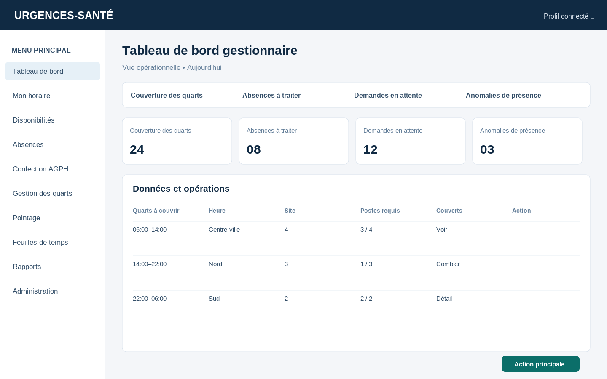

- **Objectif :** Vue opérationnelle • Aujourd'hui.
- **Profils :** Gestionnaire, planificateur, chef opérationnel.
- **Zones :** navigation latérale, titre et contexte, onglets métier, indicateurs synthétiques, grille de données, action principale.
- **Actions attendues :** filtrer, consulter le détail, modifier selon habilitation, soumettre ou approuver selon le rôle.
- **Règles UX :** afficher les statuts et motifs; confirmer les actions irréversibles; tracer les décisions sensibles.
- **Exigences :** E-GN-1 à E-GN-11; E-GR-1 à E-GR-10.

### S02 — Portail employé

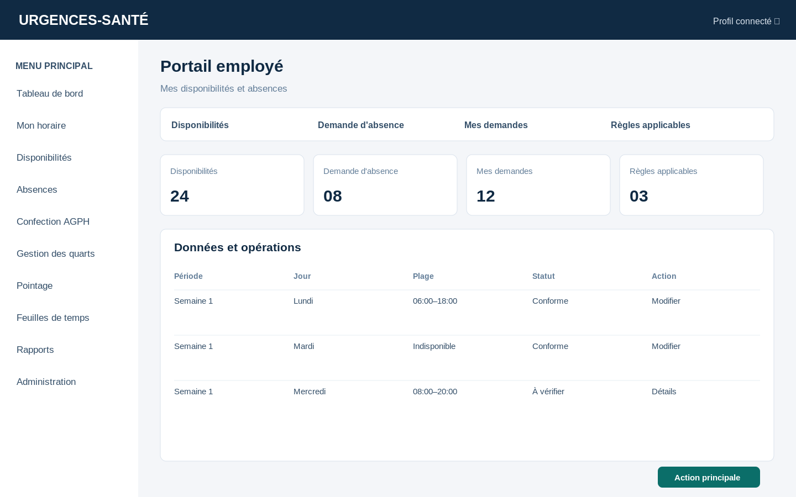

- **Objectif :** Mes disponibilités et absences.
- **Profils :** Employé / paramédic.
- **Zones :** navigation latérale, titre et contexte, onglets métier, indicateurs synthétiques, grille de données, action principale.
- **Actions attendues :** filtrer, consulter le détail, modifier selon habilitation, soumettre ou approuver selon le rôle.
- **Règles UX :** afficher les statuts et motifs; confirmer les actions irréversibles; tracer les décisions sensibles.
- **Exigences :** E-GN-12 à E-GN-16; E-GR-11; P-GH-1 à P-GH-4; P-GN-2/3.

### S03 — Mon horaire

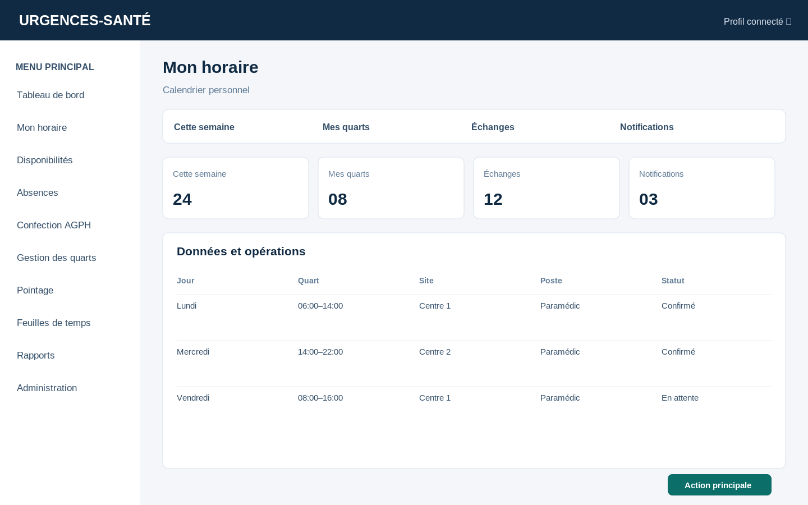

- **Objectif :** Calendrier personnel.
- **Profils :** Employé / paramédic.
- **Zones :** navigation latérale, titre et contexte, onglets métier, indicateurs synthétiques, grille de données, action principale.
- **Actions attendues :** filtrer, consulter le détail, modifier selon habilitation, soumettre ou approuver selon le rôle.
- **Règles UX :** afficher les statuts et motifs; confirmer les actions irréversibles; tracer les décisions sensibles.
- **Exigences :** E-GR-1; E-GR-7; E-GR-10 à E-GR-12.

### S04 — Confection annuelle AGPH

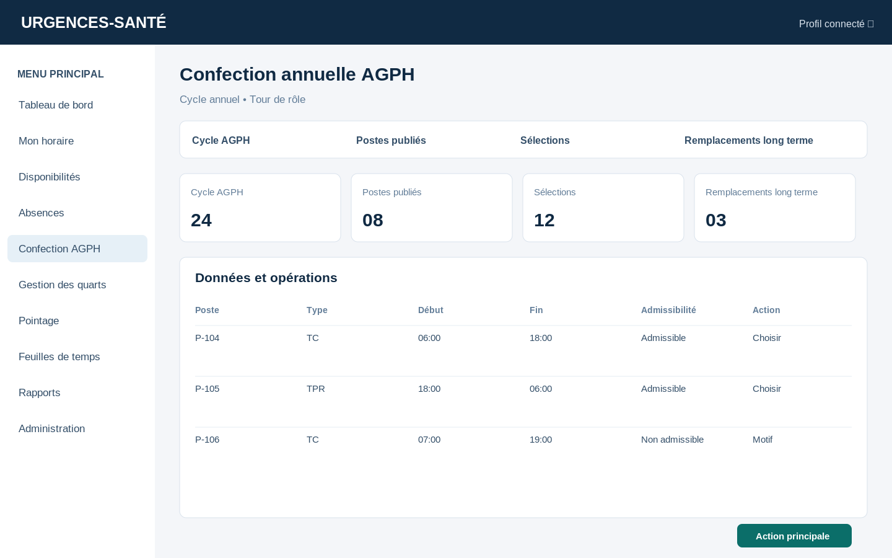

- **Objectif :** Cycle annuel • Tour de rôle.
- **Profils :** Planificateur AGPH, employé lors de son tour.
- **Zones :** navigation latérale, titre et contexte, onglets métier, indicateurs synthétiques, grille de données, action principale.
- **Actions attendues :** filtrer, consulter le détail, modifier selon habilitation, soumettre ou approuver selon le rôle.
- **Règles UX :** afficher les statuts et motifs; confirmer les actions irréversibles; tracer les décisions sensibles.
- **Exigences :** E-CH-1 à E-CH-10; P-CH-1 à P-CH-9.

### S05 — Centre de couverture des quarts

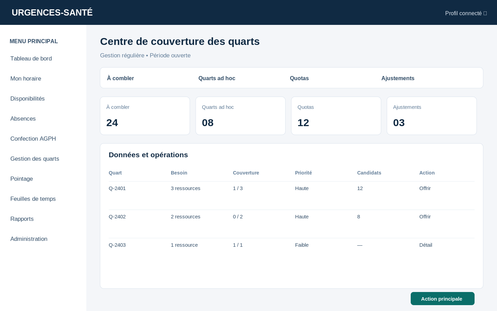

- **Objectif :** Gestion régulière • Période ouverte.
- **Profils :** Planificateur, gestionnaire de quart.
- **Zones :** navigation latérale, titre et contexte, onglets métier, indicateurs synthétiques, grille de données, action principale.
- **Actions attendues :** filtrer, consulter le détail, modifier selon habilitation, soumettre ou approuver selon le rôle.
- **Règles UX :** afficher les statuts et motifs; confirmer les actions irréversibles; tracer les décisions sensibles.
- **Exigences :** E-GN-1 à E-GN-6; E-GR-2 à E-GR-9; P-GN-1.

### S06 — Détail du quart

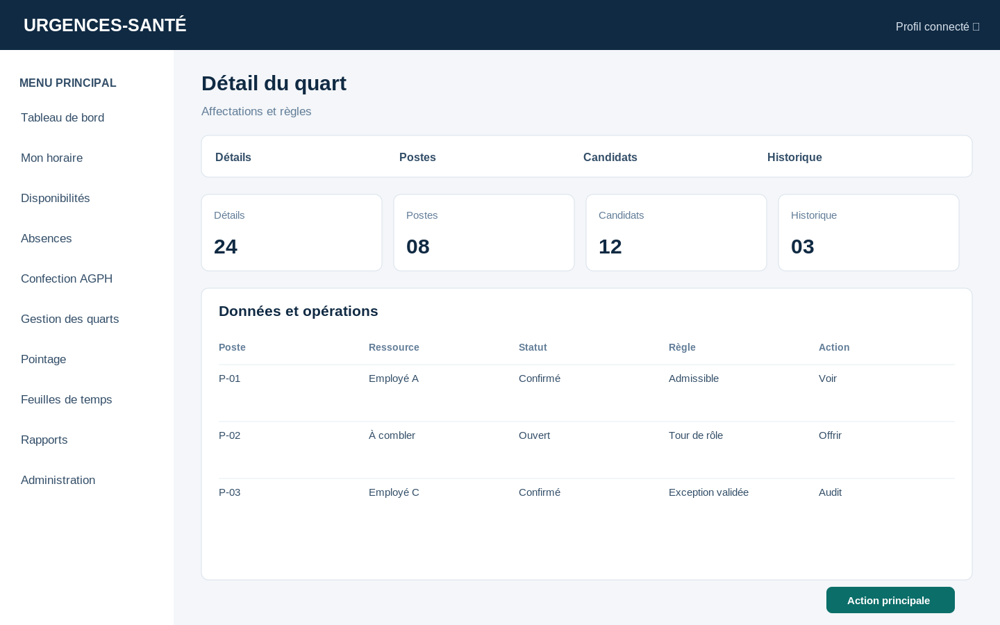

- **Objectif :** Affectations et règles.
- **Profils :** Gestionnaire et planificateur.
- **Zones :** navigation latérale, titre et contexte, onglets métier, indicateurs synthétiques, grille de données, action principale.
- **Actions attendues :** filtrer, consulter le détail, modifier selon habilitation, soumettre ou approuver selon le rôle.
- **Règles UX :** afficher les statuts et motifs; confirmer les actions irréversibles; tracer les décisions sensibles.
- **Exigences :** E-GN-1 à E-GN-11; E-GR-4/6/7.

### S07 — Demandes et échanges

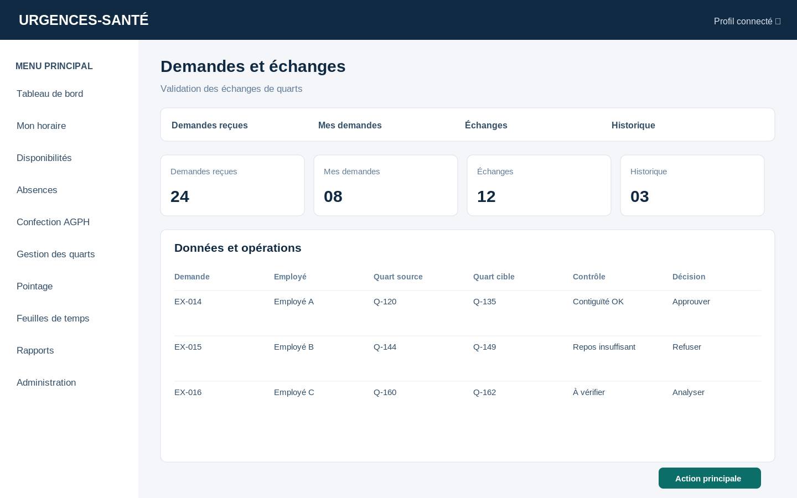

- **Objectif :** Validation des échanges de quarts.
- **Profils :** Employé et approbateur.
- **Zones :** navigation latérale, titre et contexte, onglets métier, indicateurs synthétiques, grille de données, action principale.
- **Actions attendues :** filtrer, consulter le détail, modifier selon habilitation, soumettre ou approuver selon le rôle.
- **Règles UX :** afficher les statuts et motifs; confirmer les actions irréversibles; tracer les décisions sensibles.
- **Exigences :** E-GR-7/12; E-GN-9/10.

### S08 — Pointage et présence

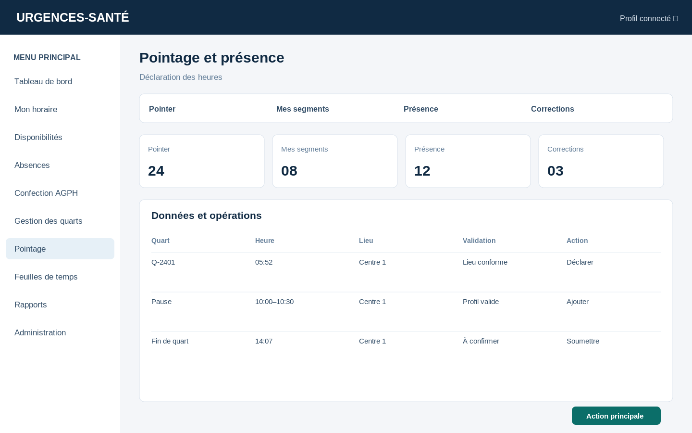

- **Objectif :** Déclaration des heures.
- **Profils :** Employé / paramédic, gestionnaire habilité.
- **Zones :** navigation latérale, titre et contexte, onglets métier, indicateurs synthétiques, grille de données, action principale.
- **Actions attendues :** filtrer, consulter le détail, modifier selon habilitation, soumettre ou approuver selon le rôle.
- **Règles UX :** afficher les statuts et motifs; confirmer les actions irréversibles; tracer les décisions sensibles.
- **Exigences :** E-GP-1 à E-GP-15; P-GP-1 à P-GP-4.

### S09 — Feuille de temps

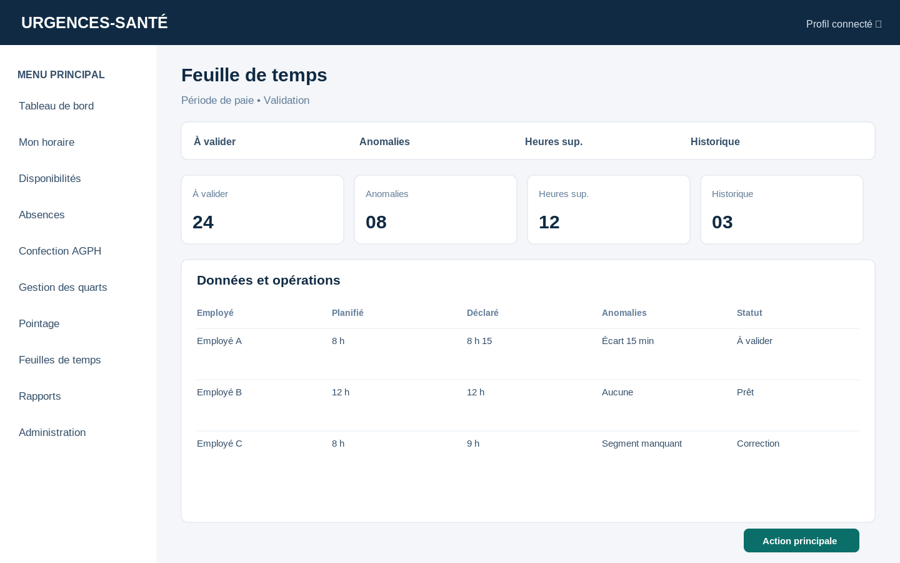

- **Objectif :** Période de paie • Validation.
- **Profils :** Gestionnaire, paie, RH.
- **Zones :** navigation latérale, titre et contexte, onglets métier, indicateurs synthétiques, grille de données, action principale.
- **Actions attendues :** filtrer, consulter le détail, modifier selon habilitation, soumettre ou approuver selon le rôle.
- **Règles UX :** afficher les statuts et motifs; confirmer les actions irréversibles; tracer les décisions sensibles.
- **Exigences :** E-RF-1 à E-RF-14.

### S10 — Rapports et indicateurs

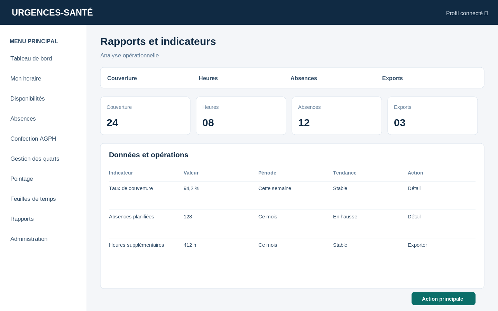

- **Objectif :** Analyse opérationnelle.
- **Profils :** Gestion, paie, analyste.
- **Zones :** navigation latérale, titre et contexte, onglets métier, indicateurs synthétiques, grille de données, action principale.
- **Actions attendues :** filtrer, consulter le détail, modifier selon habilitation, soumettre ou approuver selon le rôle.
- **Règles UX :** afficher les statuts et motifs; confirmer les actions irréversibles; tracer les décisions sensibles.
- **Exigences :** E-RF-7/8; P-RF-1; P-TN-7/8.

### S11 — Administration des règles

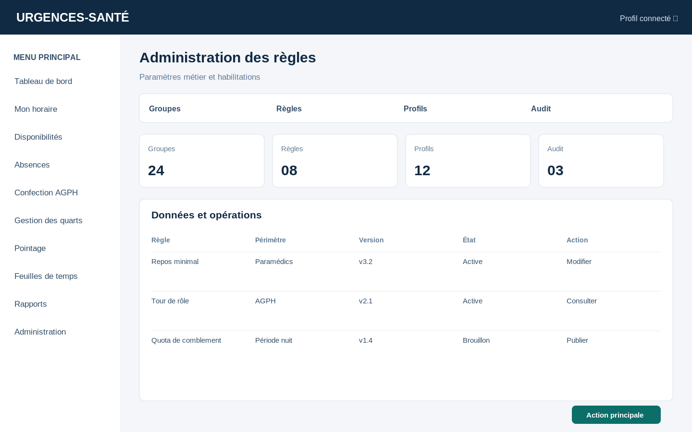

- **Objectif :** Paramètres métier et habilitations.
- **Profils :** Administrateur fonctionnel.
- **Zones :** navigation latérale, titre et contexte, onglets métier, indicateurs synthétiques, grille de données, action principale.
- **Actions attendues :** filtrer, consulter le détail, modifier selon habilitation, soumettre ou approuver selon le rôle.
- **Règles UX :** afficher les statuts et motifs; confirmer les actions irréversibles; tracer les décisions sensibles.
- **Exigences :** E-GN-7 à E-GN-16; E-TN-5/27/31.

### S12 — Administration technique

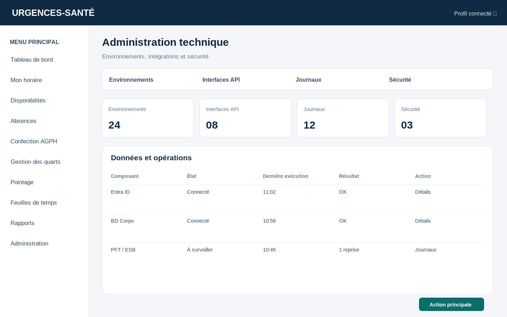

- **Objectif :** Environnements, intégrations et sécurité.
- **Profils :** Administrateur TI / sécurité.
- **Zones :** navigation latérale, titre et contexte, onglets métier, indicateurs synthétiques, grille de données, action principale.
- **Actions attendues :** filtrer, consulter le détail, modifier selon habilitation, soumettre ou approuver selon le rôle.
- **Règles UX :** afficher les statuts et motifs; confirmer les actions irréversibles; tracer les décisions sensibles.
- **Exigences :** E-TN-1 à E-TN-31; P-TN-1 à P-TN-23.

## 7.3 Règles de comportement importantes

- Les sélections de postes AGPH doivent être bloquées si non admissibles; l'interface explique le motif sans révéler les données d'autres employés.
- Les dérogations opérationnelles doivent être disponibles uniquement aux profils autorisés, avec justification obligatoire et journal d'audit.
- Les demandes d'absence doivent distinguer décision automatique, refus et autorisation manuelle exceptionnelle.
- Le centre de couverture doit calculer le besoin minimal de ressources et présenter le taux de couverture.
- Le pointage doit distinguer heure déclarée, lieu, mode de validation et résultat; la géolocalisation n'est pas supposée obligatoire en permanence, son usage dépend des règles validées.
- Les feuilles de temps doivent présenter le rapprochement planifié/réel et les anomalies par catégorie.
- Les écrans techniques sont principalement des consoles de configuration/monitoring et des preuves documentaires; ils ne remplacent pas les obligations d'exploitation du fournisseur.
