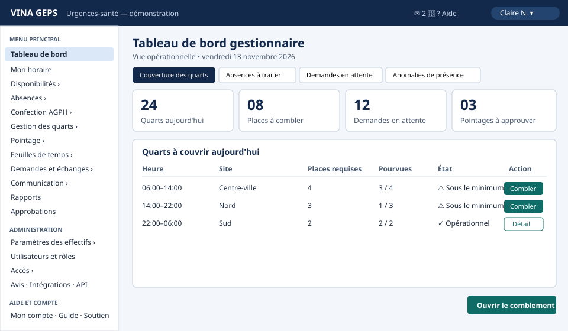

# VINA GEPS : gabarit d'écran, menu par profil et tableau de bord

> Écrit pour qui conçoit, développe ou évalue l'interface de **VINA GEPS** (VINA Gestion des
> Personnels de la Santé), livré à Urgences-santé dans le cadre de l'AO 26-015-DO. Ce document
> présente le chrome des écrans, la place de chaque écran dans le menu, ce que voit chaque profil,
> et l'exigence que chaque entrée sert.



## 1. Ce qui n'allait pas

Relevé le 13 novembre 2026 avec le compte `admin` de l'organisme de démonstration :

| Défaut | Effet |
|---|---|
| Une section « Tableau de bord » contenait une entrée « Tableau de bord » | Le libellé apparaissait deux fois, et le fil d'Ariane affichait « Tableau de bord › Tableau de bord ». |
| Quatre sections repliables, chacune avec des notions repliables | On atteignait un écran après trois clics. « Mon horaire » ouvrait la section qui contenait tout le module. |
| L'accueil montrait 29 boutons, sans aucun chiffre | Un gestionnaire ne savait pas ce qui l'attendait aujourd'hui. Planche s01 non respectée. |
| Mon horaire n'avait qu'une table à la semaine | Personne ne lit son horaire comme une liste. La planche s03 le présente comme un calendrier. |
| Deux bandeaux marine superposés (la barre de l'application, puis un bandeau « URGENCES-SANTÉ » sur chaque page) | Le chrome était dessiné deux fois. |
| La page de connexion s'ouvrait en anglais et proposait le malgache | Contraire à E-TN-21 (interface en français). |

## 2. Le gabarit (planche s01)

```
┌──────────────────────────────────────────────────────────────────────────────┐
│ VINA GEPS   Urgences-santé — démonstration         ✉ 2  🔔  ? Aide  Claire ▾ │  barre marine
├────────────────────┬─────────────────────────────────────────────────────────┤
│ MENU PRINCIPAL     │ Tableau de bord › Gestion des quarts › Comblement       │  fil d'Ariane
│ ▣ Tableau de bord  │                                                         │
│   Mon horaire      │ Titre de l'écran (h1)                                   │
│   Disponibilités › │ Sous-titre : ce que l'écran permet                      │
│   Absences ›       │                                                         │
│   …                │ [onglets / filtres]                                     │
│ ADMINISTRATION     │ [tuiles chiffrées]                                      │
│   …                │ [panneau de données]                  [Action principale]│
│ AIDE ET COMPTE     │                                                         │
└────────────────────┴─────────────────────────────────────────────────────────┘
```

- **La barre du haut est marine sur tous les écrans.** Elle porte la marque *VINA GEPS*, le nom de
  l'organisme (ou celui de sa charte, P-TN-9), la messagerie, les avis, l'aide de l'écran et le
  menu du profil. Le bandeau marine de page de l'ADR 0069 devient un simple surtitre en texte :
  il ne peut plus y avoir deux chromes empilés (ADR 0073).
- **La colonne de gauche est blanche** et regroupe le menu en trois rubriques fixes. Un intitulé de
  rubrique est un titre, pas un bouton : il ne se replie pas.
- **Deux niveaux au plus.** Une rubrique contient des entrées directes (un clic) ou des notions
  repliables. Une notion contient des écrans, et aucune notion ne contient une autre notion. Une
  notion qui n'aurait qu'un seul écran devient un lien direct.
- **Le fil d'Ariane commence au tableau de bord** et suit le menu : « Tableau de bord › Notion ›
  Écran ». Il n'est pas affiché sur le tableau de bord lui-même.
- Sous 1 024 px de large, la colonne devient un tiroir ouvert par « ☰ Menu ». Aucun élément ne
  recouvre le contenu, et rien ne déborde jusqu'à 320 px de large (1.4.10).

## 3. Le menu

Les libellés sont ceux des planches, colonne « MENU PRINCIPAL ». Le menu n'affiche que les écrans
que le **rôle** permet **et** que l'**organisme** a souscrits (module). Le serveur reste juge :
masquer une entrée ne remplace pas la garde.

### Menu principal

| Entrée | Écrans (clé de page) | Planche | Exigences servies |
|---|---|---|---|
| Tableau de bord | `dashboard` | s01, s02 | Pilotage du jour : couverture, absences, demandes, présence |
| Mon horaire | `monhoraire`, en calendrier mensuel ou en liste | s03 | Consultation de l'horaire publié, sur le Web et sur mobile |
| Disponibilités › | `mesdisponibilites`, `usdisponibilites` | s02 | Saisie des disponibilités et collecte par période |
| Absences › | `mesabsences`, `usabsences` | s02, s05 | Déclaration d'absence, décision et comblement |
| Confection AGPH › | `monagph`, `usagph` | s04 | Choix annuel des horaires par ancienneté |
| Gestion des quarts › | `uscomblement`, `usequipages`, `uspostes`, `usperiodes`, `usressources`, `usquotas` | s05, s06 | Confection, équipages, quotas, comblement |
| Pointage › | `monpointage`, `uspresence` | s08 | Horodatage, preuves de présence, approbation |
| Feuilles de temps › | `matemps`, `ustemps` | s09 | Feuille de temps, paliers d'approbation, export de paie |
| Demandes et échanges › | `mesechanges`, `usechanges` | s07 | Échanges de quarts et validation |
| Communication › | `usmessages`, `usappels`, `usdiffusion` | P11 | Messagerie sécurisée, appels, listes (ADR 0072) |
| Rapports | `rapports` | s10 | Indicateurs et constructeur de rapports |
| Approbations | `approvals` | — | Ce qui attend la décision de l'encadrement |

### Administration

| Entrée | Écrans | Planche |
|---|---|---|
| Paramètres des effectifs › | `usreferentiels`, `usregles`, `usmilieux`, `usperimetres`, `usintegrations`, `usretention`, `usjournal` | s11, s12 |
| Utilisateurs et rôles | `admin` | — |
| Accès › | `access` (objets protégés, octrois datés, qui accède à quoi) | — |
| Avis, Intégrations, API | `notifications`, `integrations`, `apidocs` | s12 |
| Organismes (exploitant seulement) | `superadmin` | — |

### Aide et compte

« Mon compte », « Guide » et « Soutien » (`account`, `help`, `soutien`). Ces écrans sont aussi
accessibles depuis le menu du profil, dans la barre du haut.

## 4. Ce que voit chaque profil

| Profil (rôle) | Menu principal | Administration |
|---|---|---|
| Paramédic, répartiteur (`employee`) | Tableau de bord (ses prochains quarts, accès rapides), Mon horaire, et ses propres vues : disponibilités, absences, AGPH, pointage, feuille de temps, échanges, communication | — |
| Ressources humaines (`rh`) | Tableau de bord, vues personnelles, communication (sans « Mon compte ») | Avis |
| Planificateur, chef d'équipe (`manager`) | Tout le menu principal, **dans son périmètre** (`usperimetres`) : ses vues personnelles, les consoles, Rapports, Approbations | Paramètres des effectifs, Avis |
| Directeur des opérations (`director`) | Le menu principal sauf Rapports ; il lit les indicateurs et tranche les dérogations | Paramètres des effectifs, API |
| Administration de l'organisme (`admin`) | Tout | Tout, sauf « Organismes » |
| Paie (`accountant`) | Tableau de bord | — |
| Exploitant de la plateforme (`superadmin`) | — | Organismes, modules, sauvegardes |

Ce tableau est le miroir de `MENU` dans `e2e/tests/e2e/acces-par-role.spec.ts`, qui vérifie, pour
chaque rôle, le menu exact et le refus d'ouvrir une page interdite par son adresse.

Le détail des profils, des périmètres et de l'authentification se trouve dans
[UTILISATEURS-PROFILS-ACCES.md](../UTILISATEURS-PROFILS-ACCES.md).

## 5. Le tableau de bord

**Pour l'encadrement**, le tableau de bord suit la planche s01 :

- quatre **onglets** : Couverture des quarts, Absences à traiter, Demandes en attente, Anomalies
  de présence ;
- quatre **tuiles chiffrées**, chacune un bouton qui ouvre l'onglet correspondant ;
  - quarts aujourd'hui : `GET /api/effectifs/planification/periodes/{id}/equipages?date=` ;
  - places à combler : la somme des places non pourvues ;
  - demandes en attente : échanges `A_VALIDER` ;
  - pointages à approuver : `GET /api/effectifs/presence/pointages?statut=A_APPROUVER` ;
- un **panneau de données** par onglet, avec une action par ligne : « Combler » pour un équipage
  sous le minimum, « Détail » sinon, « Décider » pour une absence ou une demande ;
- l'**action principale** « Ouvrir le comblement ».

Un chiffre qui ne se lit pas (module non souscrit, droit absent) affiche « — » et ne compte pas
pour zéro : un zéro dirait « rien à faire », ce qui serait faux.

**Pour l'employé**, il affiche les prochains quarts de la semaine (lus dans `mon-horaire`) et les
accès rapides vers ses propres écrans.

Ces lectures n'utilisent que des routes existantes : le tableau de bord n'ajoute aucune route au
serveur.

## 6. Mon horaire en calendrier (planche s03)

- La **vue par défaut est le calendrier du mois**, lundi en tête, avec le composant commun
  `Calendrier`. Chaque case liste ses quarts sous la forme « 06:00–14:00 · Centre-ville ». Un
  quart visé par un échange ouvert porte la mention « Échange en cours », en texte et pas
  seulement en couleur (1.4.1).
- La **vue en liste** (la table hebdomadaire précédente) reste disponible par la bascule
  « Calendrier / Liste ». Elle sert à la lecture au lecteur d'écran et à l'impression.
- Le calendrier lit le mois entier en un seul appel (`du` = premier jour, `au` = dernier jour).
- Les `data-testid` existants (`mho-*`) sont conservés. Le calendrier ajoute `mho-vue-calendrier`,
  `mho-vue-liste` et `mho-cal-*`.

## 7. Accessibilité (SGQRI 008 3.0, WCAG 2.2 AA)

- Un seul `<h1>` par écran. Un titre de rubrique du menu nomme un groupe (`role="group"` avec
  `aria-labelledby`) : un `<h2>` dans la colonne serait lu avant le `<h1>` de l'écran.
- Le menu est une `nav` nommée. L'entrée courante porte `aria-current="page"`. Les notions sont
  des `<details>` pilotés au clavier.
- Les onglets du tableau de bord suivent le patron WAI-ARIA `tablist`, avec les flèches gauche et
  droite. Les tuiles sont des boutons dont l'intitulé contient le chiffre.
- Contraste : texte blanc sur marine `#13294b` (14,5:1), texte `#1d2b3f` sur blanc (14,3:1),
  sarcelle `#0f6b66` sous du texte blanc (6,3:1).
- Cibles d'au moins 24 × 24 px partout, et de 44 px pour les entrées du menu.
- Vérification : `node scripts/audit-accessibilite.js` et
  `cd e2e && E2E_NO_BACKEND=1 npx playwright test --project=interface`.
